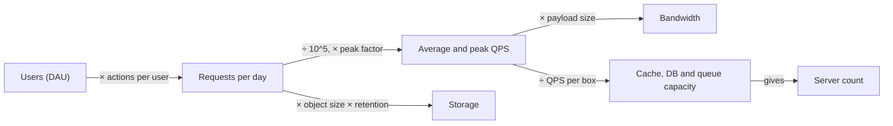

# 15. Back-of-the-Envelope Estimation

Estimates turn NFRs into numbers. The numbers decide the architecture. Topic 2 gives the order: CAP, then DAU, then throughput, then latency, then storage and bandwidth if relevant.

## What QPS tells you

QPS (queries per second) and RPS (requests per second) mean the same here. QPS decides how many CPUs and how much load you plan for.

| Design target | What it needs |
|---------------|---------------|
| 100 RPS | One machine |
| 10,000 RPS | Horizontal scaling and load balancers |
| 1,000,000 RPS | Aggressive caching, CDN offloading and custom DB sharding |

## Numbers to know

| Item | Size |
|------|------|
| 2^10 | 1024, about 1000 |
| 1 ASCII character | 1 byte |
| Average text message | about 100 bytes |
| Average image | about 1 to 3 MB |
| Average 1-minute video | about 20 to 50 MB |
| UUID | 16 bytes |

| Unit | Bytes |
|------|-------|
| 1 byte | 8 bits |
| 1 KB | 10^3 B |
| 1 MB | 10^6 B |
| 1 GB | 10^9 B |
| 1 TB | 10^12 B |
| 1 PB | 10^15 B |

### Time conversions

| Period | Seconds | Round to |
|--------|---------|----------|
| 1 day | 86,400 | 10^5 (100K) |
| 1 month | about 2.6 million | 2.5M |
| 1 year | about 31.5 million | 30M |

## Core formulas

| Quantity | Formula |
|----------|---------|
| Requests per day | DAU × requests per user per day |
| Average QPS | Requests per day ÷ 86,400 (about ÷ 10^5) |
| Peak QPS | Average QPS × peak factor |
| Concurrency | QPS × latency in seconds |
| Storage per day | New objects per day × average object size × replication factor |
| Total storage | Storage per day × retention days |
| Bandwidth (B/s) | QPS × bytes per request |
| Servers needed | Peak QPS ÷ sustainable QPS per server |

- **Peak factor:** 2 to 3× for stable traffic, 5× for consumer apps, 10× for bursty traffic.
- **Headroom:** Provision 1.5 to 2× extra capacity.
- **Concurrency:** The number of requests in flight at once. This is Little's law.

## Worked example: Twitter / X

**Given:**

- 300 million DAU
- Each user views 50 tweets per day
- Each user posts 2 tweets per day

### Read, write and peak RPS

| | Per day | Per second |
|---|---------|------------|
| Reads | 300M × 50 = 15 billion | 15B ÷ 10^5 = 150,000 RPS |
| Writes | 300M × 2 = 600 million | 600M ÷ 10^5 = 6,000 RPS |
| Peak reads (5×) | | 150,000 × 5 = 750,000 RPS |

- **Read to write ratio:** 25 : 1. The system is read-heavy.
- **Peak matters:** Average RPS rarely brings a system down. Peak traffic does. Peak is usually 5 to 10× the average.
- **Rule:** If peak traffic exceeds 10,000 RPS, you almost certainly need a distributed cache (like Redis) and horizontal DB sharding.

### Storage

Multiply the daily write volume by the size of each write. Then project it over 5 years.

| Step | Calculation |
|------|-------------|
| Text tweet | 140 chars (140 B) + metadata (60 B) = 200 B |
| Tweets with an image | About 10%, each about 1 MB |
| Average tweet size | (0.9 × 200 B) + (0.1 × 1 MB) ≈ 100 KB |
| Daily storage | 600M × 100 KB = 60 TB per day |
| 5-year storage | 60 TB × 365 × 5 ≈ 109 PB |

### Bandwidth

60 TB per day of writes ÷ 10^5 s ≈ 600 MB/s ≈ 5 Gbps of incoming data.

## Worked example: online judge contest

**Given:** 20,000 users in a 2-hour contest. Use historical data (user ratings) to estimate submissions per user: 12.

| Quantity | Calculation | Result |
|----------|-------------|--------|
| Average QPS | (20 × 10^3 × 12) ÷ (2 × 60 × 60) | about 33 QPS |
| Peak QPS | Average × M | M is a multiplier. The end of the contest gets many submissions. |
| Storage | 12 × 20 × 10^3 × 4 KB | about 1 GB |
| Concurrency | 10 submissions/s × 60 s each | 600 submissions in flight at most |
| Servers | 600 ÷ (submissions one server judges at once) | Average number of judge servers |

## Shortcut tables

### Daily requests to average QPS

Average QPS ≈ daily requests ÷ 100,000.

| Daily requests | Average QPS |
|----------------|-------------|
| 1M | 12 |
| 10M | 120 |
| 100M | 1.2K |
| 1B | 12K |
| 10B | 120K |

### Storage per day

| Object size | 1M objects/day | 1B objects/day |
|-------------|----------------|----------------|
| 100 B | 100 MB | 100 GB |
| 1 KB | 1 GB | 1 TB |
| 10 KB | 10 GB | 10 TB |
| 100 KB | 100 GB | 100 TB |
| 1 MB | 1 TB | 1 PB |

- **Physical storage:** Raw storage × replication factor. Example: 1 TB raw × RF 3 = 3 TB physical.

### Bandwidth

| Data per day | Average bandwidth |
|--------------|-------------------|
| 1 TB | 12 MB/s, about 100 Mbps |
| 10 TB | 120 MB/s, about 1 Gbps |
| 100 TB | 1.2 GB/s, about 10 Gbps |
| 1 PB | 12 GB/s, about 100 Gbps |

| Network link | Bytes per second |
|--------------|------------------|
| 1 Mbps | 125 KB/s |
| 100 Mbps | 12.5 MB/s |
| 1 Gbps | 125 MB/s |
| 10 Gbps | 1.25 GB/s |
| 100 Gbps | 12.5 GB/s |

### Latency ladder

| Operation | Latency |
|-----------|---------|
| CPU cache | 1 to 10 ns |
| RAM | about 100 ns |
| SSD | tens to hundreds of µs |
| Network in the same AZ | under 1 ms |
| Redis / in-memory cache | about 1 ms |
| Cross AZ, same region | 1 to 2 ms |
| Indexed DB read | 1 to 5 ms |
| Service call in a data center | 1 to 10 ms |
| HDD seek | 5 to 10 ms |
| Cross region | 50 to 150 ms |
| Cross continent | 100 to 200 ms |

CPU cache is far faster than RAM, RAM than SSD, and SSD than the network. This gap justifies caches and CDNs (topics 3 and 10).

### Capacity anchors

| Component | Rough capacity |
|-----------|----------------|
| Redis / cache instance | about 1 ms, 100K+ ops/s |
| Relational DB | tens to hundreds of thousands of queries/s |
| Single RDBMS storage | a few TB is often fine on one box |
| App server | 100K+ mostly idle concurrent connections |
| Message broker | up to about 1M messages/s per broker |
| Standard server | 8 to 64 CPU cores, 64 to 512 GB RAM |
| Network | 25 Gbps common, 50 to 100+ Gbps high-performance |

### Availability (nines)

| Availability | Max downtime per year |
|--------------|-----------------------|
| 99% | 3.65 days |
| 99.9% | 8 h 46 m |
| 99.99% | 52 m 36 s |
| 99.999% | 5 m 16 s |
| 99.9999% | 31.5 s |
| 99.99999% | 3.15 s |

- **Sequential dependencies multiply:** If a request needs service A (99.9%) and then service B (99.9%), the total is 0.999 × 0.999 ≈ 99.8%.

### Common payload sizes

| Item | Size |
|------|------|
| ID | 8 to 16 B |
| Metadata row | 100 to 500 B |
| JSON / API response | 1 to 10 KB |
| Chat message | 0.5 to 2 KB |
| Thumbnail | 10 to 100 KB |
| Compressed image | 100 KB to 2 MB |
| Audio | about 1 MB per minute |
| Compressed video | 5 to 20 MB per minute |

## Ground rules

- **Round everything:** 86,400 seconds becomes 10^5.
- **Read to write ratio:** Most systems are heavily read-biased, for example 100 : 1. Tell the interviewer.
- **State assumptions out loud:** "Assuming an average image size of 2 MB...". The exact numbers do not matter. The process does.
- **Use the 5× rule** for peak traffic.
- **Use latency numbers to justify architecture:** The gap between memory and disk or network explains why you add caches and CDNs.

> **Interview:** Spend 3 to 5 minutes here. Write DAU, read and write QPS, peak QPS, storage and bandwidth in a small table. Then say what each number forces: "750K peak reads, so a cache and sharding".
