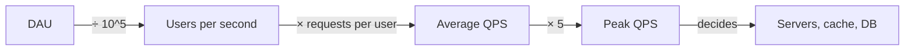

# 15. Estimation

Estimation turns the NFRs into a few numbers in 3 to 5 minutes. The numbers decide the design: one server, many servers behind a load balancer, a cache, or a [sharded](12-scaling-databases.md) DB.

## Key terms

| Term | Meaning |
|------|---------|
| DAU | DAU (daily active users) is the number of users who use the app on a given day. |
| Users per second | Users per second is DAU spread evenly over one day. It is DAU / 10^5. |
| Peak | Peak is the busiest time of day. We assume peak traffic is 5 times the average. |
| Read:write ratio | The read:write ratio compares how many requests read data with how many write it. Most systems read far more, often 100:1. |

[QPS](04-performance-throughput-load-balancing.md) and RPS (requests per second) mean the same thing here.

## How it works

1. **Start from DAU.** The interviewer gives it, or you assume it. For example, Rapido has 10^8 DAU.
2. **Get users per second.** A day has 3600 × 24 = 86,400 seconds, which we round to 10^5. So Rapido has 10^8 / 10^5 = 1,000 users per second.
3. **Count requests per user.** Ask how many reads and how many writes one user makes. A Rapido user makes about 5 reads and 2 writes.
4. **Get read and write QPS at peak.** Multiply users per second by requests per user, then by 5. Rapido gives 1,000 × 5 × 5 = 25K read QPS and 1,000 × 2 × 5 = 10K write QPS.
5. **Get storage if the app stores a lot.** Multiply writes per day by the size of one write. Then multiply by the days you keep the data.
6. **Say what the numbers mean.** Reads far above writes call for a cache. Writes above about 5K per second are too many for one Postgres server.

**Twitter example:** Twitter has 300M DAU. Each user reads 50 tweets and posts 2 tweets per day.

| Quantity | Calculation | Result |
|----------|-------------|--------|
| Users per second | 3 × 10^8 / 10^5 | 3,000 |
| Read QPS at peak | 3,000 × 50 × 5 | 750K |
| Write QPS at peak | 3,000 × 2 × 5 | 30K |
| Storage per day | 600M tweets × about 100 KB (text plus an image in 10% of tweets) | 60 TB |
| Storage for 5 years | 60 TB × 365 × 5 | about 110 PB |

## Trade-offs

| Peak QPS | What the design needs |
|----------|-----------------------|
| About 100 | One machine is enough. |
| About 10,000 | The design needs horizontal scaling and load balancers. Above this, add a Redis cache and shard the DB. |
| About 1,000,000 | The design needs heavy caching, a CDN and custom DB sharding. |

**Numbers:** A day is about 10^5 seconds, a month about 2.5M and a year about 30M. A text character is 1 byte, and a text message is about 100 bytes. An image is 1 to 3 MB, and a 1-minute video is 20 to 50 MB. 2^10 = 1024 is about 1000.

> **Interview:** Round every number and say each assumption out loud, such as "assume 5 reads per user". The process matters, not the exact numbers.

## Likely questions

- **How do you get QPS from DAU?** Divide DAU by 10^5 to get users per second. Multiply by requests per user, then by 5 for the peak.
- **Why plan for the peak?** The average rarely brings a system down. The peak does, and it is 5 to 10 times the average.
- **Why divide by 10^5?** A day has 86,400 seconds, and 10^5 is the round number closest to it.
- **What does a high read:write ratio tell you?** The system is read heavy, so add a cache.
- **How do you estimate storage?** Multiply writes per day by the size of one write, then by the days you keep the data.
