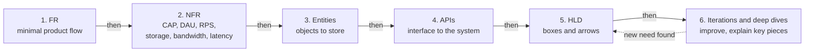
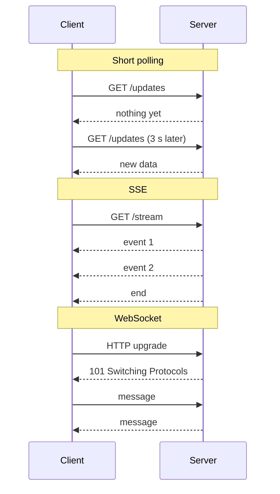

# 16. The Interview Framework

Every design in topics 22 to 30 follows the same six steps.

| Step | Question it answers | Output |
|------|---------------------|--------|
| 1. FR | What must the product do? | 2 to 4 core requirements, plus "below the line" |
| 2. NFR | How well must it do it? | CAP choice, DAU, read and write QPS, latency, storage, bandwidth |
| 3. Entities | What do we store? | A list of entities with key fields |
| 4. APIs | How do clients talk to it? | Endpoints with method, path, body and response |
| 5. HLD | What are the parts? | A diagram that satisfies every FR |
| 6. Deep dives | How does it meet the NFRs? | Changes to the diagram, one NFR at a time |

## Step 1: Functional requirements

Think of the minimal flow of the product (topic 2).

- **Core requirements:** Write them as "Users should be able to ...". Keep 2 to 4.
- **Below the line (out of scope):** List what you will not design. This shows you know the product and keeps time for depth.

Example (ChatGPT):

| Core | Below the line |
|------|----------------|
| Users can send a prompt in a chat and get an AI response | Editing or branching messages |
| Users can view past chats and resume one, with prior context | Image, audio and video. Sharing chats. Tools and web browsing. Search over history. |

## Step 2: Non-functional requirements

Follow the order from topic 2. Use the formulas from topic 15.

1. **CAP:** Consistency or availability, with the product reason (topic 14).
2. **DAU.**
3. **Throughput:** Read and write QPS, the read to write ratio, peak QPS.
4. **Latency:** A target for the main action, for example "first token under 500 ms".
5. **Storage and bandwidth:** Only if the system stores or moves a lot.

Write each NFR as one sentence with a number. Example: "The system should prefer availability over consistency for chat state (99.9%+)."

## Step 3: Entities

**Entities are the nouns of the FRs.** Underline the nouns in the core requirements. Each important noun becomes an entity.

"**Users** should be able to send a **prompt** in a **chat** and receive a **response**." This gives User, Chat and Message (a prompt and a response are both messages).

- **List key fields only:** id, owner, status, timestamps. A full schema is not needed yet.
- **Note what matters later:** For example, the user's tier (free or paid) matters for scheduling.

## Step 4: APIs

One endpoint per FR action, in REST (topic 8).

| Rule | Example |
|------|---------|
| Use nouns for resources, plural | `/chats`, `/messages` |
| The method says the action | `POST` creates, `GET` reads, `PATCH` updates, `DELETE` removes |
| Nest child resources | `POST /chats/{chatId}/messages` |
| Return the created id | `POST /chats` returns `{ chatId }` |
| Paginate lists with a cursor | `GET /chats?cursor={cursor}&limit={n}` |
| Take the user from the auth token | Never put `userId` in the body. The gateway reads it from the JWT or session. |
| Use correct status codes | `201` created, `404` missing, `429` rate limited |

- **Cursor pagination:** The server returns a `cursor` (for example the last id seen). The next call passes it. This is keyset pagination (topic 12). It stays fast on page 1000, unlike `OFFSET`.

## Step 5: High-level design

Go through the FRs one at a time. For each one, add only the boxes it needs. Then trace the request along the arrows.

1. Start from the base pieces (topic 6): client, API gateway, load balancer, services, DB, cache, blob store, queue.
2. Satisfy FR 1. Draw it. Walk through it.
3. Satisfy FR 2 on the same diagram.
4. Say "with this design, all FRs are satisfied". Then move to the NFRs.

Keep this design simple. Scaling comes in step 6.

## Step 6: Iterations and deep dives

Take each NFR and ask "does the current design meet it?". If not, change the design.

- **Check each element:** Can this box scale? Servers scale behind an LB. The DB scales with replicas and shards (topic 12). Add a cache for hot reads (topic 10).
- **Find the hard part:** Every design has one or two. Real-time delivery for chat. Double booking for tickets. Matching for ride-hailing.
- **Name trade-offs:** "SSE instead of WebSockets because the server only pushes, and SSE is plain HTTP".

## Toolbox: pushing updates to the client

Many designs must send data from the server to the client without the client asking each time.

| Pattern | How | Direction | State on the server | Use |
|---------|-----|-----------|---------------------|-----|
| Short polling | The client calls `GET` every few seconds, for example every 3 s | Client asks | None | Simple, rare updates. Wastes many calls. |
| Long polling | The client calls `GET`. The server holds it open until data exists or a timeout. Then the client calls again. | Client asks | Held request | Fallback when nothing else works |
| SSE (Server-Sent Events) | One HTTP response stays open. The server writes events into it. An end marker closes it. | Server to client only | Light, plain HTTP | Streaming tokens, live scores, notifications |
| WebSocket | One TCP connection upgraded from HTTP. Both sides send any time. | Both ways | Stateful connection | Chat, games, live location |

- **Polling cost:** One chat answer can need 10 API calls with 3 s polling.
- **WebSocket cost:** The connection is stateful. A user connected to server A cannot be served by server B. Scaling needs a way to route messages to the right server (topic 26).
- **SSE limit:** The browser's `EventSource` API opens only `GET` requests. So the stream endpoint must be a `GET`.

> **Interview:** Say the step you are on out loud. Get the interviewer to agree on FRs and NFRs before you draw. Satisfy the FRs first with a simple design. Use the rest of the time on deep dives.
