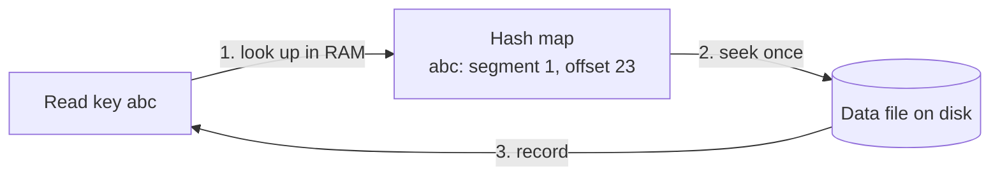
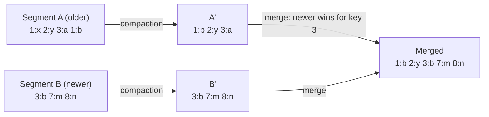
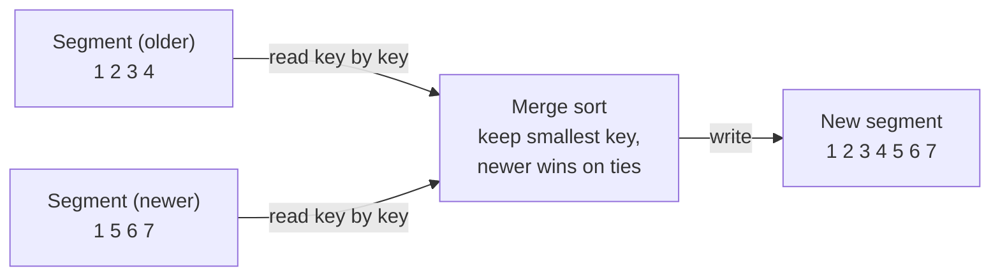
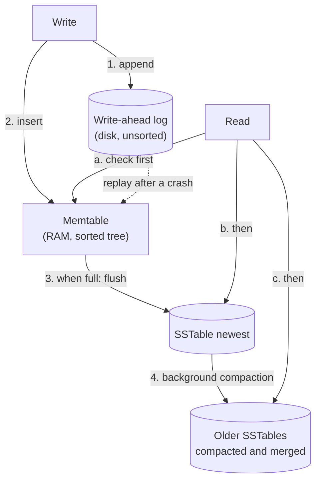

# 17. Storage Engines: Data Structures That Power Databases

After the HLD, the interviewer may ask how the database you chose works inside. This topic builds a storage engine step by step.

## Step 1: the strawman, a CSV file

Store each record as one line and append it to a file.

```
1, "xyz", "AZ Premium"
2, "abc", "AZ Plus"
1, "xyz", "AZ Basic"
```

| Operation | How | Cost |
|-----------|-----|------|
| Write | Append a new line at the end | O(1). Very cheap. |
| Read | Parse the whole file. Check each entry. | O(number of entries) |
| Update | Do not edit in place. Append the new version. The last one wins. | O(1) |

```python
for entry in parse(file):
    if entry[1] == "abc":
        return entry[2]
```

**Problems:**

1. **Slow reads:** Every read scans the entire file.
2. **No data integrity:** Nothing checks if an entry is valid. A scoreboard could get a negative score. A bug in the app writes bad data. We rely fully on the app code.
3. **Concurrency:** Two threads must not write to the file at once. That needs locks.
4. **Durability is hard:** A crash in the middle of a write leaves a broken line.

**Advantage:** Writes are efficient, because every write is sequential.

| | Sequential write | Random write |
|---|------------------|--------------|
| What | Each write goes right after the previous one | Writes jump to different places on the disk |
| HDD | Fast. The disk head does not move. | Slow. Each write needs a seek (5 to 10 ms). |
| SSD | Fast | Slower, and wears the SSD more |

To make reads fast, we need an **index**: extra data that points to where each record is. It speeds up reads but slows down writes, because every write must also update the index. The owner picks which key to index.

## Step 2: hash index

Keep an in-memory hash map. Key: the indexed field (for example the username). Value: where the record lives on disk.

| Key | Value |
|-----|-------|
| `xyz` | segment 1, byte offset 0 |
| `abc` | segment 1, byte offset 23 |



- **Read:** Look up the key in the map, then read from that offset. One disk seek.
- **Write, update, delete:** Append to the file. Point the map at the new offset. A delete appends a special "tombstone" marker.
- **Both reads and writes are fast.**

**Example:** Bitcask, the default engine in Riak, works this way.

### Compaction and merging

Appending forever fills the disk with old versions. Fix:

1. **Segments:** Do not use one big file. Write to a segment file. When it reaches a size limit, close it and start a new one.
2. **Compaction:** In a closed segment, throw away duplicate keys. Keep only the latest value of each key.
3. **Merging:** After compaction, segments are small. Combine several small segments into one.

**Rule:** The newest segment always has the latest value. When two segments have the same key, keep the newer one.



- **Background job:** Compaction and merging read and write the disk. They use disk bandwidth. Run them when traffic is low.
- **Sequential:** Appending and merging are both sequential writes. They are much faster than random writes.
- **Simple crash recovery:** Segments are never changed in place. A crash cannot corrupt old data.

### Limits of a hash index

1. **All keys must fit in RAM.** With billions of keys, they may not. Keeping part of the map on disk needs many random reads and special logic for hash collisions.
2. **No range queries.** "All keys from 100 to 200" must look up each key one by one. Keys are not stored in order.

## Step 3: SSTables

An **SSTable** (Sorted String Table) is a segment with two rules:

- Keys are **sorted** inside the segment.
- Each key appears **only once** in a segment.

**Merging is merge sort.** Read the segments from the left, one key at a time. Write out the smallest key. If two segments have the same key, keep the newer value.



### Sparse index

Keys are sorted, so you do not need every key in memory. Store only the first key of each block.

| Index key | Block |
|-----------|-------|
| 1 | block with 1, 2, 3, 4 |
| 5 | block with 5, 8, 9, 10 |
| 15 | block with 15, 19, 20, 21 |

- **Find key 3:** 3 is between 1 and 5. Read the first block and scan it.
- **Cost:** You scan one block. If blocks are small (a few KB), that is cheap.
- **Benefit:** Far less RAM than a full hash index.
- **Range queries work:** Keys are in order, so a range is a contiguous scan.

### The problem: writes arrive in any order

Say the blocks hold 11, 13, 14, 17. Key 12 arrives. It belongs between 11 and 13. Inserting it in place shifts every later key on disk. That is a random write.

## Step 4: LSM tree (memtable + SSTables)

The **LSM tree** (Log-Structured Merge tree) solves this:

1. **Write to a memtable:** Every write goes into an in-memory balanced tree (for example a red-black tree). It keeps keys sorted in RAM.
2. **Flush:** When the memtable passes a size limit (a few MB), write it to disk as a new SSTable. It is already sorted, so this is one sequential write. A new memtable takes new writes meanwhile.
3. **Read:** Check the memtable first. Then the newest SSTable. Then the next older one, and so on.
4. **Compact:** From time to time, a background job merges SSTables and drops overwritten and deleted values.

### Crash safety: the write-ahead log

The memtable is in RAM. A crash loses it. Fix: also append every write to an **append-only log** on disk (a write-ahead log, WAL). The log is not sorted. Its only job is crash recovery. After a crash, replay the log to rebuild the memtable. When the memtable is flushed as an SSTable, its log is deleted.



### Read problems and the Bloom filter

- **Several places to check:** A read may check the memtable and many SSTables.
- **Missing keys are slow:** A key that does not exist is checked everywhere before you know it is missing.
- **Fix: Bloom filter.** Keep one per SSTable. It says "definitely not here" or "maybe here". Skip every SSTable that says "definitely not here". Topic 22 explains how a Bloom filter works.

**Used by:** LevelDB, RocksDB, Cassandra, HBase, ScyllaDB.

## LSM tree vs B+ tree

The B+ tree is the other main engine (topic 12). It updates fixed-size pages in place.

| | LSM tree | B+ tree |
|---|----------|---------|
| Writes | Fast. Sequential appends and flushes. | Slower. Random page writes. Each write also goes to a WAL. |
| Reads | Can check several SSTables | One path from root to leaf, O(log N) pages |
| Range queries | Good (sorted SSTables) | Good (linked leaves) |
| Space | Compaction removes old data. Old versions live until then. | Pages may be partly empty |
| Background work | Compaction uses disk bandwidth | None |
| Used by | Cassandra, RocksDB, LevelDB | PostgreSQL, MySQL (InnoDB) |
| Best for | Write-heavy workloads | Read-heavy workloads, transactions |

> **Interview:** If the design is write-heavy (logs, metrics, chat messages), say "an LSM-based store like Cassandra, because writes are sequential appends". If it needs transactions and fast point reads, say "Postgres, which uses a B+ tree".

Further reading: github.com/donnemartin/system-design-primer.
