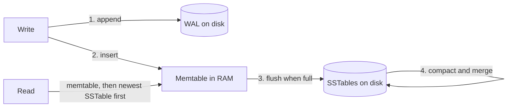

# 17. Storage Engines

After the high-level design, the interviewer may ask how your database stores data inside. The two main answers are the LSM tree, which is fast for writes, and the B-tree, which is fast for reads.

## Key terms

| Term | Meaning |
|------|---------|
| Storage engine | A storage engine is the part of a database that writes data to disk and reads it back. |
| Sequential write | A sequential write goes right after the previous one on disk. It is much faster than a random write, which jumps to a new place. |
| Page | A page is a fixed-size block of data on disk. |
| Segment | A segment is one data file. When a segment is full, the database starts a new one. |
| Compaction | Compaction removes old copies of a key from a segment and keeps only the latest value. Merging then joins small segments into one. |
| SSTable | An SSTable (sorted string table) is a segment whose keys are sorted, with each key only once. |
| Memtable | A memtable is a sorted tree in RAM, such as a red-black tree, that holds the newest writes. |
| LSM tree | An LSM tree (log-structured merge tree) is a storage engine that writes to a memtable and flushes it to disk as SSTables. |
| WAL | A WAL (write-ahead log) is an append-only file on disk. Each write is saved there first, so it survives a crash. |
| B-tree | A B-tree (B+ tree in most databases) is a sorted tree of pages on disk. A lookup walks from the root to a leaf in O(log N) pages. |

## How it works

1. **Store rows in a CSV file.** Each write appends a line, so writes are sequential and cheap. An update also appends, and the last line for a key wins. But a read must scan the whole file, which is O(N).
2. **Reads are slow.** Add an [index](09-data-modelling.md). A hash index keeps a map in RAM from each key to its segment and byte offset. A read then looks up the key and jumps to it. An index speeds up reads but slows down writes, because each write also updates the index.
3. **The disk fills with old versions.** Split the data into segments. In the background, compact each segment and merge small ones. Do this when traffic is low, because it uses disk bandwidth.
4. **A hash index has limits.** All keys must fit in RAM, and a range query must check keys one by one. The fix is to keep each segment sorted, which makes it an SSTable. Two SSTables merge like merge sort. A sparse index then stores only the first key of each block, so it needs far less RAM.
5. **Writes arrive in any order.** Inserting key 12 between 11 and 13 on disk would shift every later key. So each write goes into the memtable first. When the memtable passes a size limit, it is written to disk as a new SSTable. This design is the LSM tree.
6. **A crash loses the memtable.** The memtable lives in RAM. So each write goes to the WAL on disk first, then to the memtable. After a crash, the database replays the WAL.
7. **Reads check many places.** A read checks the memtable, then the newest SSTable, then older ones. A key that does not exist is checked everywhere. A Bloom filter fixes this. It is a small bit array that says "surely not here" or "maybe here".

## Trade-offs

| | LSM tree | B-tree |
|---|----------|--------|
| Writes | Writes are fast, because they are sequential appends and flushes. | Writes are slower, because each one updates pages in place on disk. |
| Reads | A read may check the memtable and several SSTables. | A read walks one path from the root to a leaf. |
| Range queries | Range queries are good, because SSTables are sorted. | Range queries are good, because leaves are sorted and linked. |
| Background work | Compaction uses disk bandwidth. | It needs no compaction. |
| Best for | It suits write-heavy databases, such as Cassandra for huge writes. | It suits read-heavy databases, such as the indexes in PostgreSQL. |

**Numbers:** An HDD seek, which a random write needs, takes 5 to 10 ms. A B-tree lookup reads O(log N) pages.

> **Interview:** Say "for a write-heavy system I pick an LSM-tree database, because all its writes are sequential. For a read-heavy system with transactions, I pick a B-tree database like PostgreSQL."

## Likely questions

- **Why are LSM writes fast?** Every write is a sequential append to the WAL and an insert into the memtable in RAM. Nothing is updated in place.
- **What is a memtable, and why is it needed?** It is a sorted tree in RAM. It sorts writes that arrive in any order before they go to disk as an SSTable.
- **What happens if the database crashes?** The memtable is lost, but every write is in the WAL on disk. The database replays the WAL to rebuild it.
- **What does compaction do?** It removes old copies of each key and merges small segments, so the disk does not fill up.
- **How does a Bloom filter help?** It tells the database a key is surely not present, so the read skips all the SSTables.
