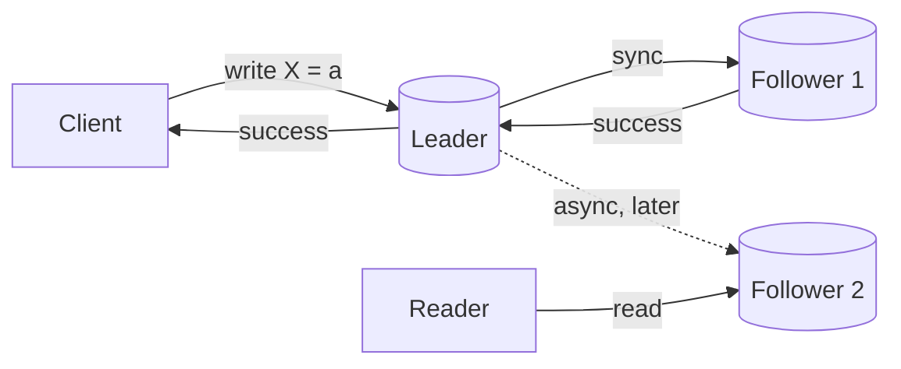

# 18. Replication

[Replication](12-scaling-databases.md) keeps a copy of the same data on many machines, and each copy is a [replica](05-scalability-availability-consistency.md). It keeps the system up when one DB server fails, lets users read from the closest copy, and spreads reads across servers.

## Key terms

| Term | Meaning |
|------|---------|
| Leader | The leader is the one replica that accepts all writes. |
| Follower | A follower is a replica that copies every change from the leader and serves reads. |
| Synchronous replication | In synchronous replication, the leader replies to the client only after every follower confirms the write. |
| Asynchronous replication | In asynchronous replication, the leader replies at once, and the followers get the change later. |
| Replication lag | Replication lag is the delay before a follower has the leader's latest write. |
| Log sequence number (LSN) | An LSN is the position of a change in the DB's append-only log. |

## How it works

1. **Writes need one owner.** One replica is the leader, and the others are followers. All writes go to the leader, and reads can go to any replica. The leader writes the change to its own storage and sends it to every follower.
2. **Waiting for every follower is slow.** Synchronous replication fails a write when any follower is down. Asynchronous replication is fast, but followers can be stale. The usual mix keeps the leader and one or two followers in sync and updates the rest later. This mix is called semi-synchronous replication.
3. **A new follower must copy live data.** A plain file copy misses the writes made during the copy. So the leader takes a consistent snapshot at a known LSN. The new follower copies the snapshot, then asks for every change after that LSN. When it has applied that backlog, it has caught up and gets changes live. A crashed follower restarts the same way, from the last LSN it stored.
4. **The leader can die.** Nodes send each other heartbeat messages that say "I am alive". If the leader is silent for a timeout, the nodes assume it is dead. They run a consensus algorithm, which lets nodes agree on one value, to elect a follower as the new leader. Clients then send writes to the new leader, and the old leader rejoins as a follower.
5. **Followers lag behind.** Asynchronous replication gives [eventual consistency](05-scalability-availability-consistency.md): followers catch up in the end. Until then, users can see the lag problems in the table below.
6. **One leader is far from users in other regions.** In multi-leader replication, each data center (DC) has its own leader, and the leaders replicate to each other asynchronously. It also suits clients that work offline. Its cost is write conflicts: DC1 sets X = a while DC2 sets X = b.

## Trade-offs

| | Synchronous | Asynchronous |
|---|-------------|--------------|
| Leader replies | The leader replies after every follower confirms. | The leader replies at once. |
| Latency | Write latency is high. | Write latency is low. |
| A follower is down | The write fails. | The write still succeeds. |
| The leader fails | No data is lost, because followers have every write. | Writes not yet sent are lost. |

| Failover problem | Why it happens |
|------------------|----------------|
| Lost writes | With async replication, the new leader may miss the old leader's last writes. |
| Split brain | Two nodes both believe they are the leader, so both accept writes. |
| Timeout choice | A timeout that is too small causes very frequent elections. |

| Replication log | What the leader sends |
|-----------------|-----------------------|
| Statement-based | The leader sends each write query, and each follower runs it. `NOW()`, `RAND()` and the current date give a different result on a follower, so the leader must send fixed values instead. |
| Write-ahead log shipping | The leader sends its [WAL](17-storage-engines.md), and the follower builds the exact same data structures from it. |

| Lag problem | What the user sees |
|-------------|--------------------|
| Reading your own writes | A user writes, then reads from a stale follower, so the update seems lost. The fix is to read from the leader for a short time after a write. Another fix is to send the last write's LSN, so a stale replica forwards the read or waits. |
| Monotonic reads | A user reads a comment from Follower 1, then reads from Follower 2, and the comment is gone. Data seems to move back in time. |
| Consistent prefix reads | With sharded data, a reader sees User 2's answer before User 1's question, because one shard's follower lags. |

| Conflict fix | How it works |
|--------------|--------------|
| Last write wins | Each write has a timestamp, and the latest wins. The other write is lost, and clocks on different machines never match exactly. |
| Replica priority | The value from the higher-priority replica wins. The other write is lost. |
| App code | The app merges both values while syncing. |
| CRDT | A conflict-free replicated data type merges by itself. Google Docs uses this kind of automatic merge. |

**Numbers:** The leader is assumed dead after about 30 s without a heartbeat. Reads stay on the leader for 5 to 30 s after a user's write.

> **Interview:** Say "writes go to the leader, and async followers serve reads. If the leader dies, heartbeats detect it and a follower is promoted".

## Likely questions

- **Sync or async replication?** Async is faster and survives a down follower, but stale reads and lost writes are possible. Semi-sync keeps one follower in sync, so the data survives a leader failure.
- **How does a new follower join?** It copies a snapshot taken at a known LSN. Then it applies every change after that LSN.
- **What happens when the leader fails?** Missed heartbeats show it is dead, and consensus elects a follower as the new leader. Async writes can be lost, and split brain is a risk.
- **Why is statement-based replication risky?** Functions like `NOW()` and `RAND()` give different results on each follower.
- **When do you use multi-leader replication?** Use it for many data centers or offline clients, and say how write conflicts are merged.
