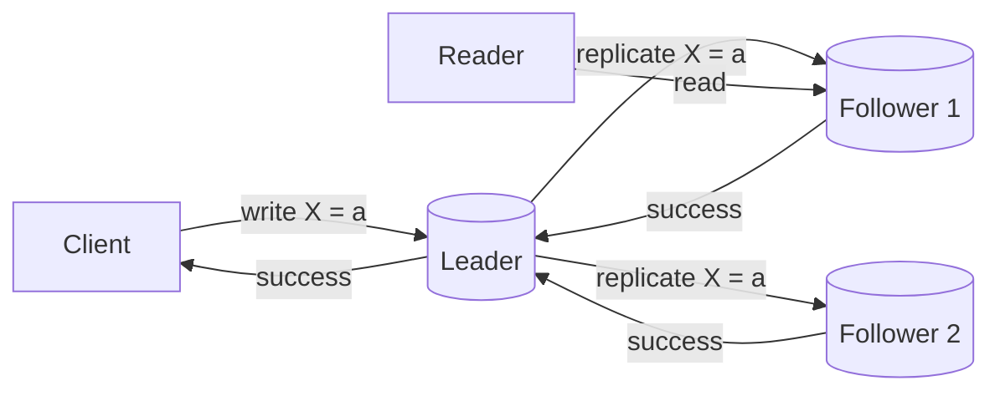
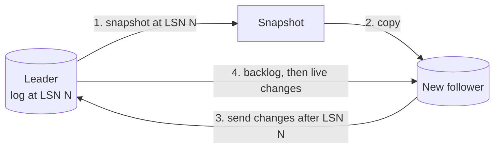
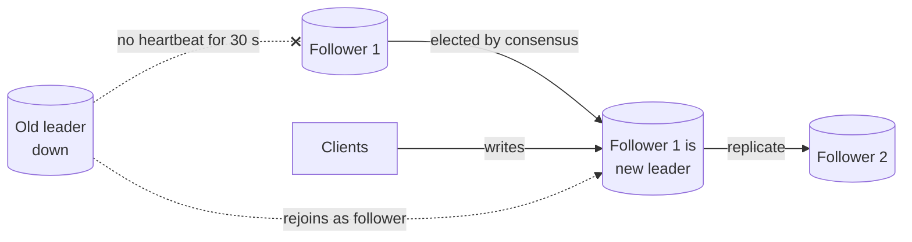
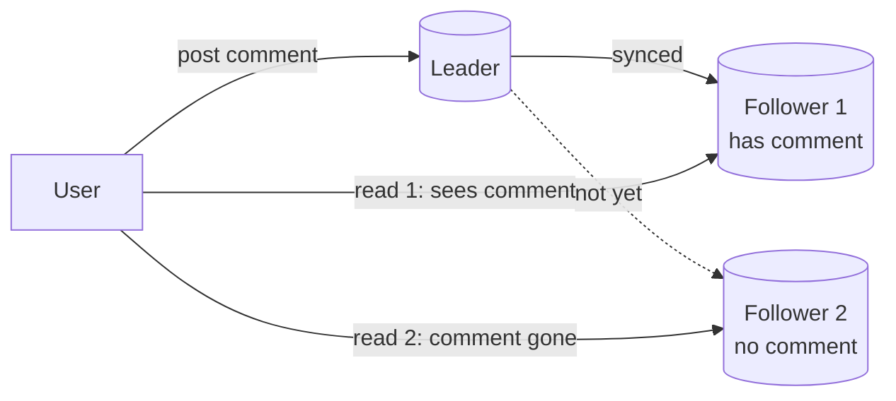
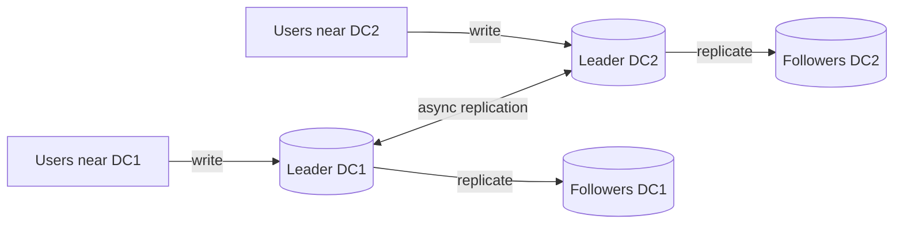

# 18. Replication

**Replication** keeps a copy of the same data on multiple machines. Each node that stores a copy is a **replica**. Topic 12 introduced read replicas. This topic goes deeper.

## Why replicate

| Reason | How replication helps |
|--------|-----------------------|
| Availability | One DB server that goes down breaks the system. With copies on several servers, another one serves. |
| Latency | Users on different continents read from the closest copy |
| Read throughput | Reads spread over many servers. Load on each one drops. |

## Leader-based replication (leaders and followers)

1. One replica is the **leader**. The others are **followers**.
2. All writes go to the leader. Reads can go to any replica.
3. When the leader writes new data to its local storage, it also sends the change to every follower, as part of replication.



**Used by:** PostgreSQL, MySQL, MongoDB, Kafka.

## Synchronous, asynchronous and semi-synchronous

Topic 12 shows the sync and async message flows.

| | Synchronous | Asynchronous | Semi-synchronous |
|---|-------------|--------------|------------------|
| Leader replies to the client | After every follower confirms | At once | After one (or a few) followers confirm |
| If a follower is down | The write fails | No effect | Another follower is made synchronous |
| Latency | High | Low | Medium |
| If the leader fails | No data loss. Every follower has the data. | Recent writes not yet sent are lost | No loss. At least one follower is up to date. |
| Reads from followers | Always fresh | Can be stale | Fresh on the sync follower only |

**Semi-sync in practice:** The leader and followers 1 and 2 stay in sync. Followers 3, 4, 5 and the rest get updates later.

**Stale read example (async):**

| Time | Leader | Follower 1 | Follower 2 |
|------|--------|------------|------------|
| t1 | X = "a" | X = "a" | X = old |
| t2 | X = "a" | X = "a" | X = "a" |

A client that reads X from Follower 2 between t1 and t2 gets stale data.

## Setting up a new follower

Copying the leader's files directly does not work. Writes keep arriving during the copy, so the copy would miss them. Locking the DB during the copy stops all writes. Instead:

1. Take a consistent **snapshot** of the leader's DB at some point in time.
2. Copy the snapshot to the new node.
3. The follower connects to the leader. It asks for every change since the snapshot. This needs the snapshot to be tied to an exact position in the leader's replication log.
4. When the follower has processed that backlog, it has **caught up**. It then processes changes live.

**Log sequence number (LSN):** Every DB keeps an append-only log. Each entry has a log sequence number.

| LSN | Change |
|-----|--------|
| 1 | X = a |
| 2 | b = c |
| ... | ... |
| 99 million | latest change |

If the snapshot was taken at LSN 99 million, the follower asks for everything after it.



**Follower crash:** Each follower stores the last LSN it applied. After a restart, it asks the leader for changes from that LSN. This is called catch-up recovery.

## Leader failover

If the leader fails, a follower must become the new leader.

1. **Detect the failure:** Nodes send heartbeat messages to each other: "I am alive". If no heartbeat comes from the leader for a timeout (for example 30 s), it is assumed dead.
2. **Elect a new leader:** The nodes run a **consensus algorithm** (for example Raft) to agree on one new leader. The best choice is the follower with the most recent data.
3. **Reconfigure:** Clients send writes to the new leader. Other followers consume changes from it. When the old leader comes back, it must accept the new leader and act as a follower.



### Failover problems

| Problem | Why |
|---------|-----|
| Lost writes | With async replication, the new leader may not have the old leader's last writes |
| Split brain | Two nodes both believe they are the leader. Both accept writes. Data diverges (topic 14). |
| Choosing the timeout | Too long: slow recovery. Too short: needless elections during a brief load spike. |

## How the replication log is built

| Method | What the leader sends | Problem |
|--------|-----------------------|---------|
| Statement-based | Every write query (`INSERT`, `UPDATE`, `DELETE`). Each follower parses and runs the SQL as if a client sent it. | Non-deterministic functions give different results |
| Write-ahead log (WAL) shipping | The exact log the leader writes to disk (topic 17). The follower builds the same data structures. | The log is tied to the storage format, so leader and followers must run the same DB version |
| Logical (row-based) log | The changed rows: "row 7 now has these values" | Larger than a statement |

**Non-determinism example:**

```sql
DELETE FROM orders WHERE date = CURRENT_DATE();
```

The leader runs it on 5 January. A follower replays it on 6 January. `CURRENT_DATE()` returns 6 January there, so it deletes the wrong rows. `NOW()` and `RAND()` have the same problem. Fix: the leader replaces them with fixed values before sending.

**Used by:** PostgreSQL uses WAL shipping. MySQL uses a row-based binlog.

## Replication lag problems

Async replication gives **eventual consistency**: followers catch up in the end. Until then, three problems appear.

### 1. Reading your own writes

A user writes, then reads from a follower that has not caught up. Their own update seems lost. Topic 12 shows the flow.

| Fix | How |
|-----|-----|
| Read your own data from the leader | Pin the user's reads to the leader for a short window after a write (topic 12) |
| Remember the last write time | The client sends the timestamp of its latest write. The replica checks if it has data up to that time. If not, it sends the read to another replica, or waits (which adds latency). |
| Use the LSN instead of time | Clocks on different machines never match exactly. An LSN is exact. |

### 2. Monotonic reads

A user posts a comment. The leader syncs it to Follower 1, but not yet to Follower 2. The user refreshes twice.



The data seems to move back in time. Bad user experience.

- **Fix:** Each user always reads from the same replica, for example by `hash(user_id)`.

### 3. Consistent prefix reads

Data is sharded. Each shard has its own leader and followers. User 1 and User 2 chat. User 3 reads the chat.

| Order written | Message | Stored on |
|---------------|---------|-----------|
| 1 | User 1: X (the question) | Shard 1 |
| 2 | User 2: Y (the answer) | Shard 2 |

User 3 reads from a follower of Shard 2 that is up to date, and a follower of Shard 1 that lags. User 3 sees answer Y before question X.

- **Fix:** Write causally related data to the same shard. For a chat, shard by `chat_id`, not by user.

## Multi-leader replication

Large companies run several data centers. With one leader, every write crosses the world to it.

**Multi-leader:** Each data center has its own leader. Writes go to the local leader. The leaders replicate to each other asynchronously.



**Use cases:**

- **Multiple data centers:** Lower write latency, and a DC can fail without stopping writes.
- **Clients with offline operation:** Each device is a "leader" for its local copy, for example a calendar app on a phone. It syncs when it is back online.
- **Collaborative editing:** Google Docs.

### The problem: write conflicts

Leader DC1 sets `X = a`. At the same time, Leader DC2 sets `X = b`. Both succeed locally. When they sync, which value wins?

- **Sync replication between leaders does not help:** It would make them act as one leader again.
- **Async replication causes the conflicts.**

### Converging to a single state

| Method | How | Trade-off |
|--------|-----|-----------|
| Last write wins (LWW) | Attach a timestamp to each write. The latest wins. | Simple. Silently loses the other write. Clocks drift. |
| Replica priority | Give each replica a priority. The higher-priority replica's value wins. | Simple. Also loses data. |
| Custom app code | The app merges both values (topic 14 merges cart items) | No loss. Needs code per data type. |
| CRDT | Conflict-free replicated data types. Special structures that merge automatically. | Used for collaborative editing like Google Docs |

> **Interview:** Default to single-leader replication with async followers. Say how failover works (heartbeat, consensus, promote a follower). Name the lag problem that matters for the product and its fix. Use multi-leader only for multiple regions or offline clients, and say how conflicts are resolved.
