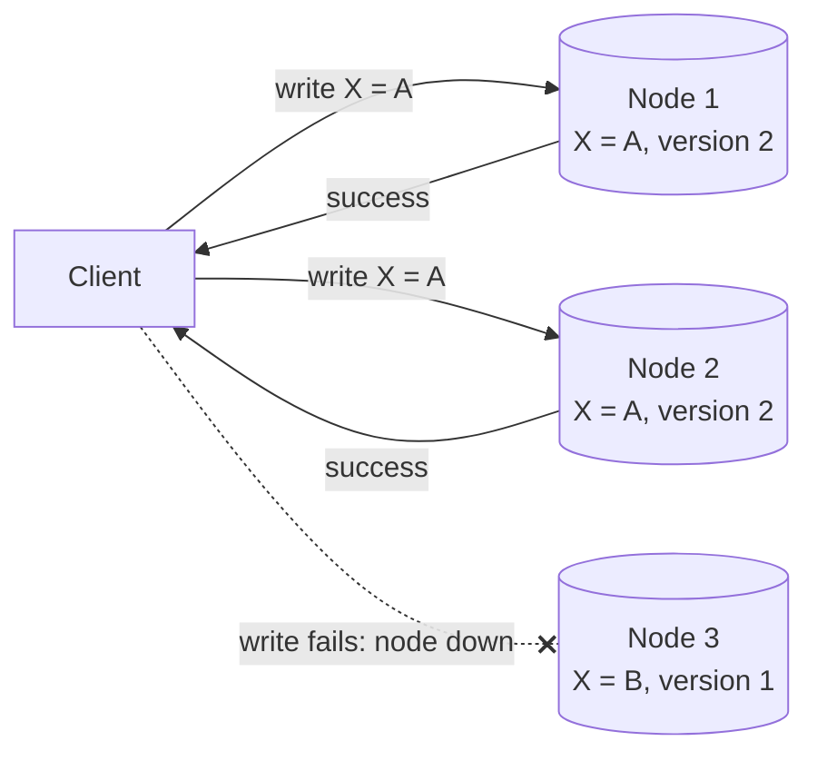
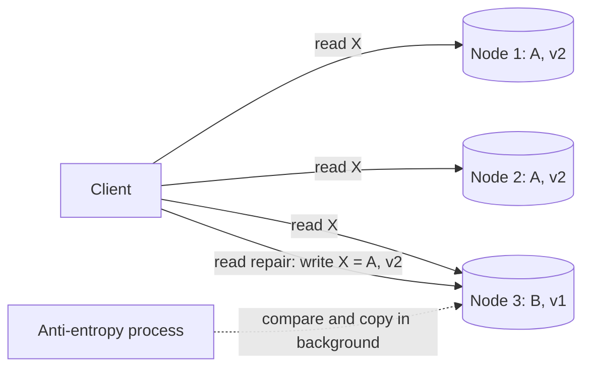
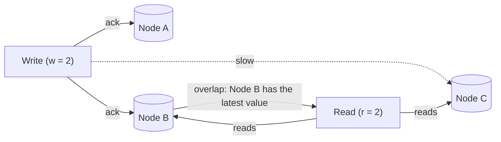
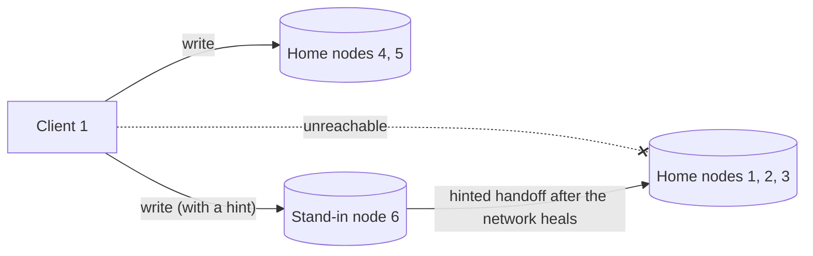
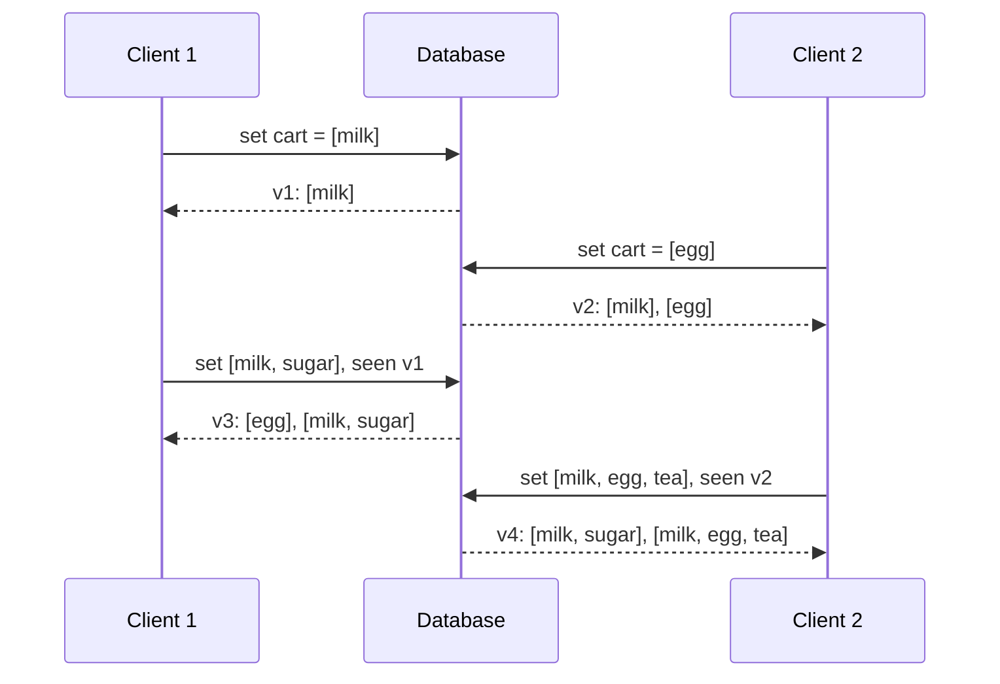

# 19. Leaderless Replication and Quorums

## The idea

In **leaderless replication**, there is no leader. The client (or a coordinator node acting for it) sends each write to **all** replicas. If enough of them reply "success", the write counts as successful.

**Used by:** Amazon Dynamo, Cassandra, Riak, ScyllaDB.

### Writing while a node is down

Three replicas. Node 3 is down when the client writes `X = A`.

Two of three succeeded. That passes the threshold, so the write succeeds.

**Problem:** Node 3 comes back with old data (`X = B`). A client that reads only from Node 3 gets stale data.

**Fix:** Reads also go to several nodes in parallel. Each value carries a **version number**. The client keeps the value with the highest version.

| Node | Value | Version |
|------|-------|---------|
| 1 | X = A | 2 |
| 2 | X = A | 2 |
| 3 | X = B | 1 |

The client sees A twice with version 2, and B once with version 1. A is the latest.

## Bringing stale nodes up to date

| Method | How | Good for | Weakness |
|--------|-----|----------|----------|
| Read repair | During a read, the client sees Node 3 has a stale value. It writes the newer value back to Node 3. | Values that are read often | Rarely read values may stay stale for a long time |
| Anti-entropy | A background process keeps comparing replicas and copies missing data between them | All data | Copies writes in no particular order. There can be a long delay. |

## Quorums for reading and writing

| Symbol | Meaning |
|--------|---------|
| n | Number of replicas for a value |
| w | Nodes that must confirm a write for it to succeed |
| r | Nodes that must answer a read |

**Quorum condition: w + r > n.** The set of nodes written and the set of nodes read must overlap in at least one node. That node has the latest value. So a read returns an up-to-date value.

Reads and writes that obey this are **quorum reads and writes**. Think of w and r as the minimum votes needed for a valid write or read.

- **Sent to all:** Reads and writes are always sent to all n replicas in parallel. w and r only decide how many replies to wait for.
- **Common choice:** Make n odd and set w = r = (n + 1) / 2. With n = 3: w = 2, r = 2.

### Tuning w and r

| Setting | Effect | Good for |
|---------|--------|----------|
| w = 1, r = n | Writes wait for one node. Low write latency. | Write-heavy systems |
| w = n, r = 1 | Reads wait for one node. Low read latency. | Read-heavy systems |
| Higher w | Higher write latency | |
| Higher r | Higher read latency | |

Pick w and r from the latency each operation needs.

### Edge cases where quorums still return stale data

1. **Partial write failure:** A write succeeds on fewer than w replicas. It is reported as failed. But it is **not rolled back** on the replicas where it succeeded. Later reads may or may not return it.
2. **Restore from an old replica:** A node with the new value fails. Its data is restored from a replica with the old value. Now fewer than w nodes hold the new value. The quorum condition breaks.

**Example:** Six nodes, w = 3. A write of `B` reaches only 2 nodes, so it fails. A later read from nodes 2, 3 and 4 still returns `B`, the value of the failed write.

Strict correctness needs transactions or consensus, which quorums alone do not give.

## Sloppy quorums and hinted handoff

10 nodes exist. Only n = 5 are the "home" nodes for a key. w = 3.

A network problem makes 3 home nodes unreachable for client 1. With a strict quorum, the write fails.

- **Sloppy quorum:** The write still needs w successful replies. But they may come from nodes that are not among the n home nodes.
- **Hinted handoff:** When the network heals, the stand-in nodes send those writes to the correct home nodes.

- **Benefit:** Higher write availability. As long as any w nodes are reachable, writes succeed.
- **Cost:** Even with w + r > n, a read may miss the latest value. It may sit on a stand-in node outside the home nodes.

## Concurrent writes

### Last write wins

Give each write a timestamp. The highest timestamp wins. It is simple, but clocks on different machines never match exactly. It also silently drops the other writes.

### The "happens-before" relationship

- **A happens before B:** B knows about A, or depends on it. Example: op 1 sets `X = n`, op 2 does `X = X + 1`. Op 2 builds on op 1.
- **Concurrent:** Neither happens before the other. Neither knew about the other.

The DB must keep concurrent writes side by side (as **siblings**) and only overwrite writes that a newer one has seen.

### Version numbers

1. The DB keeps a version number per key. Each write increments it.
2. A client reads a key. It gets every current value and the version number.
3. A client writes with the version it last read. It must merge all values it read into its write.
4. The server overwrites every value with that version or lower. It keeps any value with a higher version as a sibling, because it is concurrent.

**Shopping cart example (two clients, one key):**

| Step | Client sends | Server stores | Server replies |
|------|--------------|---------------|----------------|
| 1 | Client 1: [milk], no version | v1: [milk] | version 1, [milk] |
| 2 | Client 2: [egg], no version | v1: [milk], v2: [egg] | version 2, [milk], [egg] |
| 3 | Client 1: [milk, sugar], version 1 | v2: [egg], v3: [milk, sugar] | version 3, [egg], [milk, sugar] |
| 4 | Client 2: [milk, egg, tea], version 2 | v3: [milk, sugar], v4: [milk, egg, tea] | version 4, [milk, sugar], [milk, egg, tea] |

- **Step 3:** Client 1 had seen version 1. So v1 is overwritten. v2 ([egg]) is kept, because Client 1 never saw it.
- **Step 4:** Client 2 merged [milk] and [egg], and added tea. It had seen version 2, so v2 is overwritten. v3 is kept.
- **Next read:** The client merges the siblings: [milk, sugar, egg, tea]. No item is lost.

### Version vectors

With many replicas, one counter is not enough. Each replica keeps its own version number per key. The set of all of them is a **version vector**. It tells which values overwrite others and which are concurrent. Amazon's DynamoDB (from the Dynamo paper) follows this approach.

> **Interview:** For an AP system at large scale (carts, chat, sensor data), say "leaderless, like Cassandra, with n = 3 and quorum reads and writes (w = r = 2)". Explain w + r > n. Mention read repair and how concurrent writes are merged.
