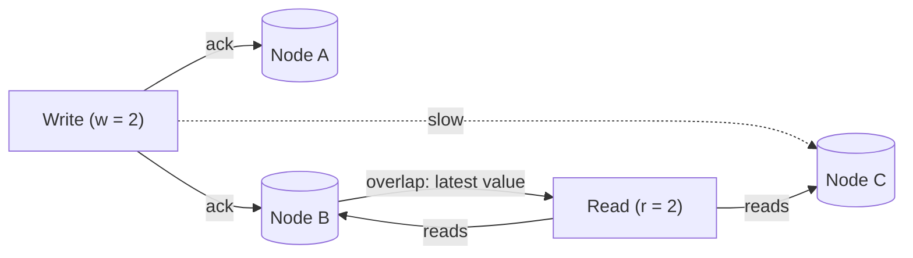

# 19. Leaderless Replication and Quorums

In leaderless replication, no replica is the [leader](18-replication.md). The client sends every write and read to all replicas and counts the replies. This keeps writes working while some nodes are down.

## Key terms

| Term | Meaning |
|------|---------|
| Leaderless replication | In leaderless replication, the client sends each write to all replicas, and the write succeeds when enough replicas reply "success". |
| Version number | A version number is stored with each value, and a higher number means newer data. |
| Quorum | A quorum is the minimum number of replicas that must reply before a read or write counts. |
| n, w, r | n is the number of replicas for a value. w is how many must confirm a write. r is how many must answer a read. |

## How it works

1. **A node is down during a write.** Node 3 of three is down when the client writes X = A. Nodes 1 and 2 confirm, which meets the threshold, so the write succeeds.
2. **The down node comes back with old data.** A read from node 3 alone returns the old X = B. So reads also go to all nodes in parallel, and the client keeps the value with the highest version number.
3. **The stale node must catch up.** In read repair, the client sees the stale value during a read and writes the newer value back to that node. In anti-entropy, a background process compares replicas and copies missing data between them.
4. **A read must see the latest write.** Use quorums with **w + r > n**. Then the nodes written and the nodes read share at least one node, and that node has the latest value. Requests still go to all n nodes, and w and r only set how many replies to wait for. A common choice is an odd n with w = r = (n + 1) / 2.
5. **Some home nodes are unreachable.** Only n of the nodes are the "home" nodes for a key. In a sloppy quorum, the write still needs w replies, but they may come from other nodes. When the network heals, those nodes send the writes to the home nodes. This is called hinted handoff.
6. **Two clients write the same key at once.** Write A happens before write B when B knows about A, such as X = 5 followed by X = X + 1. Two writes are concurrent when neither knew about the other. The DB keeps concurrent values side by side as siblings and lets the client merge them.

**Version numbers in a shopping cart:** The DB keeps a version number per key. A client writes with the version it last read and merges every value it saw. The server overwrites values at that version or lower and keeps newer ones as siblings.

| Step | Client sends | Server keeps |
|------|--------------|--------------|
| 1 | Client 1 sends [milk]. | v1: [milk] |
| 2 | Client 2 sends [egg]. | v1: [milk], v2: [egg] |
| 3 | Client 1 sends [milk, sugar] and says it saw v1. | v2: [egg], v3: [milk, sugar] |
| 4 | Client 2 sends [milk, egg, tea] and says it saw v2. | v3: [milk, sugar], v4: [milk, egg, tea] |

The next read merges the siblings into [milk, sugar, egg, tea], so no item is lost. With many replicas, each replica keeps its own counter per key, and the set of counters is a version vector. Amazon's Dynamo uses version vectors.

## Trade-offs

| Setting | Effect | Good for |
|---------|--------|----------|
| w = 1, r = n | Writes wait for one node, so write latency is low. | Write-heavy systems |
| w = n, r = 1 | Reads wait for one node, so read latency is low. | Read-heavy systems |
| Higher w or r | Each extra reply to wait for adds latency to that operation. | Choose from the latency each operation needs. |

| Repair | Strength | Weakness |
|--------|----------|----------|
| Read repair | It fixes values that are read often. | A value that is rarely read can stay stale for a long time. |
| Anti-entropy | It fixes all data. | It copies writes in no fixed order, and the delay can be long. |

**Quorums can still return stale data.** A write that reached fewer than w nodes is reported as failed, but it is not rolled back. For example, with six nodes and w = 3, a write of B reaches only 2 nodes and fails. A later read from nodes 2, 3 and 4 still returns B. A node restored from an old replica can also drop the new value below w copies. Transactions or consensus fix these cases. A sloppy quorum raises write availability. But even with w + r > n, a read may miss a value that sits outside the home nodes.

**Numbers:** With n = 3, use w = 2 and r = 2. In the sloppy example, 10 nodes exist, n = 5 and w = 3.

> **Interview:** For an [AP](14-cap-theorem.md) system, say "leaderless with n = 3 and w = r = 2. Since w + r > n, every read overlaps the latest write".

## Likely questions

- **Why must w + r > n?** The write set and the read set then share at least one node. That node returns the latest value.
- **How does a stale node catch up?** Read repair writes the newer value back during a read. Anti-entropy copies missing data in the background.
- **What is a sloppy quorum?** Writes may land on nodes outside the home nodes when home nodes are unreachable. Hinted handoff moves them home later.
- **Can a quorum still return stale data?** Yes. A failed write is not rolled back, and a node restored from an old replica can lose the new value.
- **How are concurrent writes kept?** The DB keeps them as siblings by version number. The client merges them on the next write.
