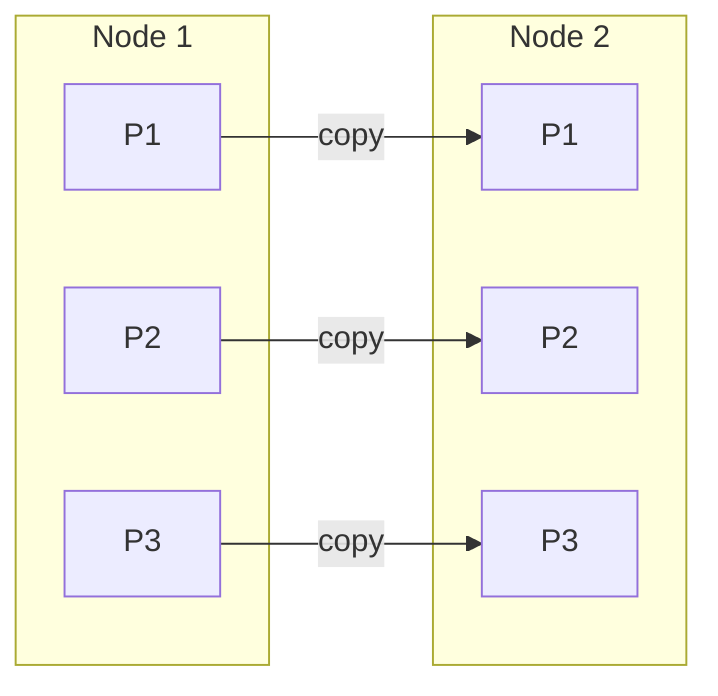

# 20. Partitioning

Partitioning splits the data so that each machine stores a different part, and all parts together form the full dataset. It is the same idea as [sharding](12-scaling-databases.md). Replication copies all data to every machine, while partitioning gives each machine a different part.

## Key terms

| Term | Meaning |
|------|---------|
| Partitioning | Partitioning splits the data so that each machine stores a different part. |
| Range partitioning | Range partitioning gives each partition a continuous range of keys, such as names starting with A or B. |
| Hash partitioning | Hash partitioning uses hash(key) to pick the partition, so keys spread evenly. |
| Consistent hashing | Consistent hashing puts nodes and keys on a ring, so adding a node moves only the keys in one arc. |
| Hot spot | A hot spot is a partition that gets far more data or load than the others. |
| Secondary index | A secondary index finds rows by a column other than the primary key, such as batch. |

## How it works

1. **One machine cannot hold or process all the data.** Split it. For example, 10^9 user ids over 10^3 machines gives each machine 10^6 ids.
2. **A partition can be lost when its machine fails.** Use partitioning with [replication](18-replication.md). Each partition is copied to several nodes, and each node holds several partitions.
3. **Keys must be split fairly.** Use range or hash partitioning, compared below. A perfect split is not possible, so a hot spot can appear. With ranges on `created_at`, the newest partition takes almost all traffic.
4. **A query by a non-key column hits every partition.** "All students in batch AZ2" needs a global secondary index, which is partitioned by batch. New student 9 in batch AZ2 then touches two partitions: partition 1 stores row 9, and partition 2 stores the AZ2 index entry. A distributed transaction updates both together, which is consistent but slower. An async update is faster, but the index is stale for a while. Reads by batch go to one partition, so they are fast.
5. **Data grows and nodes join or fail.** Partitions must move, and the goal is to move as little data as possible. Changing `hash(key) % 10` to `hash(key) % 15` moves almost every key, so use consistent hashing instead. Topic 12 shows the ring and virtual nodes.
6. **A client must find the node that holds key K.** Use one of three routing approaches, compared below.

## Trade-offs

| | Range partitioning | Hash partitioning |
|---|--------------------|-------------------|
| Example | P1 holds A and B, P2 holds C to E, and P3 holds F. | hash(user_id) picks the partition. |
| Range query | It is efficient, because you know which partitions to ask. Keys stay sorted inside each partition. | It is lost, because nearby keys land on different partitions. |
| Hot spots | They are likely when many keys fall in one range. | They are rare, because keys spread evenly. |

| Rebalancing | How it works | Cost |
|-------------|--------------|------|
| Fixed number of partitions | Create many more partitions than nodes, and move whole partitions to a new node. Stronger nodes hold more partitions. | Too many partitions means a lot of metadata. Too few means load cannot spread evenly. |
| Dynamic partitioning | Split a partition that grows too big, and merge one that shrinks. The count can also grow with the number of nodes. | The DB must stay up during splits and merges. |

| Routing | How it works | Cost |
|---------|--------------|------|
| Any node | The client asks any node. That node has the metadata and forwards the request to the owner. Nodes share metadata by broadcasting to each other. | It adds one extra hop. |
| Routing tier | A ZooKeeper service stores the latest partition map and routes the request. This is service discovery. | ZooKeeper is one more system to run. |
| Partition-aware client | The client knows the hash and the map, so it contacts the right node directly. | It is a bad idea, because every client must track metadata. |

**Numbers:** 10^9 ids over 10^3 machines gives 10^6 ids per machine. In the source, Node 0 has 10 GB RAM and holds 4 partitions, while Node 1 has 1 GB RAM and holds 2.

> **Interview:** Name the partition key and say why it spreads load evenly. Then say "consistent hashing moves only a few keys when a node joins".

## Likely questions

- **Range or hash partitioning?** Use range when you need range queries. Use hash for even load.
- **What is a hot spot?** It is a partition with far more load than the others, such as the newest month under `created_at` ranges.
- **Why not use hash mod N?** Changing N moves almost every key. Consistent hashing moves only the keys in one arc.
- **How is a query by a secondary key served?** A global index partitioned by that key serves it from one partition. Writes then update two partitions, by transaction or asynchronously.
- **How does a client find the right node?** It asks any node, a routing tier such as ZooKeeper, or it knows the map itself.
