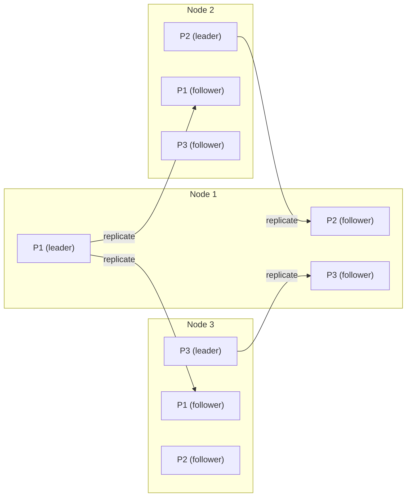
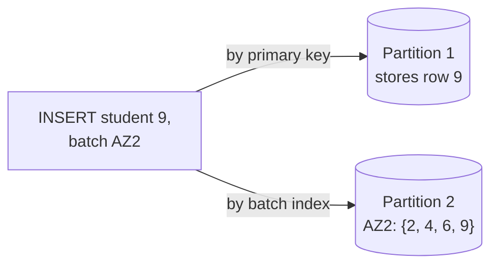
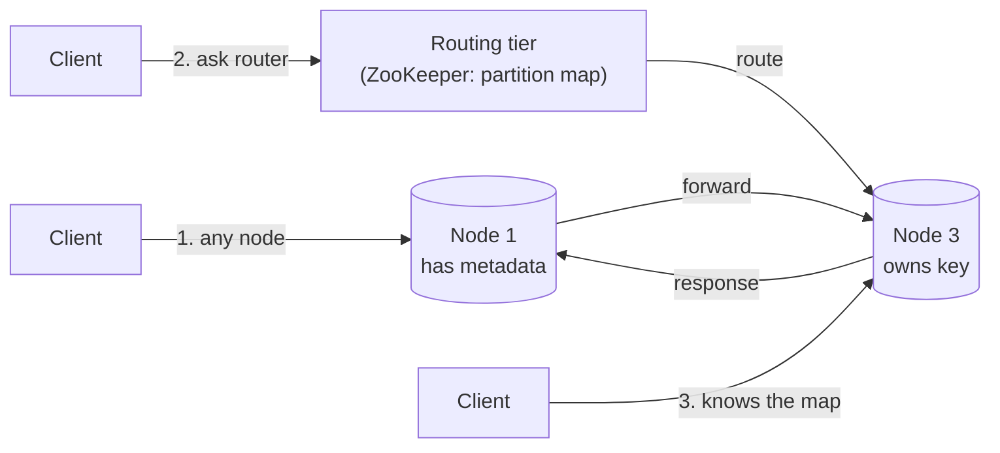

# 20. Partitioning

**Partitioning** (sharding, topic 12) splits the data so that each machine stores a different part. The union of all parts is the full dataset.

| | Replication | Partitioning |
|---|-------------|--------------|
| Each machine stores | The complete data | A different part of the data |
| Goal | Availability, read scale | Data and load too big for one machine |

**Example:** 10^9 user ids over 10^3 machines. Machine 1 holds ids 1 to 10^6. Machine 2 holds 10^6 to 2 × 10^6. And so on.

**Motivation:**

- **Too much for one machine:** One machine cannot store or process the whole dataset.
- **Not perfect:** A perfectly even partition is not possible. Some partitions get more data or load. A partition with far more load is a **hot spot**.

## Partitioning + replication

They are used together. Each partition is replicated on several nodes. Each node holds several partitions. A node can lead some partitions and follow others.

## How to split the keys

| Method | How | Range queries | Hot spots |
|--------|-----|---------------|-----------|
| Key range | Each partition owns a continuous range of keys | Efficient: you know which partitions to query | Likely, if many keys fall in one range |
| Hash of key | `hash(key)` decides the partition | Lost: neighbouring keys land on different partitions | Rare: keys spread evenly |

**Key range example:** Keys are names from A to Z.

| Partition | Keys starting with |
|-----------|--------------------|
| P1 | A, B |
| P2 | C, D, E |
| P3 | F |

- **Range query:** "All names starting with A" goes only to P1.
- **Sorted inside:** Each partition can keep its keys sorted (topic 17).
- **Uneven ranges:** The ranges are not equal in size, because data is not spread evenly across letters.

Topic 12 shows the hot-shard problem with `created_at` ranges and the hash method.

## Secondary indexes

Partitioning by primary key works for lookups by primary key. But a query like "all students in batch AZ2" needs a **secondary index** on `batch`.

### Global secondary index

The index on `batch` is itself partitioned, by `batch`, not by student id.

| Partition | Students (by id) | Index entries (by batch) |
|-----------|------------------|--------------------------|
| 1 | 1, 3, 8 | AZ1: {1, 3}, AZ5: {8} |
| 2 | 2, 4, 5, 6, 7 | AZ2: {2, 4, 6}, AZ3: {5, 7} |

A new student 9 in batch AZ2 arrives.

- **One write, two partitions:** By primary key, row 9 goes to partition 1. By batch, the index entry AZ2 lives on partition 2.
- **Option 1, distributed transaction:** Update both partitions together (two-phase commit, topic 14). Always consistent, but slower writes.
- **Option 2, asynchronous:** Update the primary partition now. Update the index later. Faster, but the index is stale for a while.
- **Benefit:** Reads by batch go to one partition. Faster reads.

### Local secondary index

Each partition indexes only its own rows. Writes touch one partition. But a query by batch must ask every partition and combine the answers (**scatter-gather**). Reads are slower.

| | Local index | Global index |
|---|-------------|--------------|
| Write | One partition | Several partitions (transaction or async) |
| Read by secondary key | All partitions (scatter-gather) | One partition |
| Example | MongoDB, Cassandra | DynamoDB global secondary indexes |

## Rebalancing partitions

Data grows, load shifts, and nodes are added or fail. Partitions must move between nodes. **Goal: move as little data as possible.**

### Do not use hash mod N

Going from `hash(key) % 10` to `hash(key) % 15` moves almost every key. Use consistent hashing instead (topic 12).

### Fixed number of partitions

Create many more partitions than nodes, for example 100 partitions for 10 nodes. Each node holds several. A new node takes a few whole partitions from the others. Keys never move between partitions. Only whole partitions move between nodes.

**Uneven hardware:** Give stronger nodes more partitions.

| Node | Hardware | Partitions |
|------|----------|------------|
| Node 0 | 10 GB RAM, 10× CPU | P2, P7, P8, P9 |
| Node 1 | 1 GB RAM, 1× CPU | P0, P5 |

- **Too many partitions:** Each one needs metadata. Very many partitions means a lot of metadata to keep. Not good practice.
- **Too few partitions:** You lose the chance to spread load evenly.

### Dynamic partitioning

Increase the number of partitions with the load. A partition that grows too big is split in two. A partition that shrinks is merged with a neighbour. The DB must stay up during splits and merges.

- **Variant:** Keep the number of partitions proportional to the number of nodes.

## Request routing

How does a client know which node holds key K?

| Approach | How | Trade-off |
|----------|-----|-----------|
| 1. Any node | The client contacts any node. That node has the metadata. If it does not own K, it forwards the request to the right node, and the answer goes back. Nodes share metadata with each other (member broadcasting, gossip). | No extra service. One extra hop. |
| 2. Routing tier | A routing service (backed by ZooKeeper) knows the partition map. The client asks it. ZooKeeper stores all the partitioning metadata and always keeps the latest. This is service discovery. | Clean. ZooKeeper is another system to run. |
| 3. Partition-aware client | The client knows the hash function and the map. It contacts the right node directly. | Fastest. Bad idea in general: every client must track metadata. |

- **ZooKeeper:** A coordination service. Nodes register with it. When partitions move, it updates the map and notifies the routers. Kafka and HBase use it. Cassandra uses gossip (approach 1).

> **Interview:** Name the partition key and say why it spreads load. Say how a secondary-key query is served (global or local index). Say how partitions rebalance (consistent hashing or a fixed number of partitions) and how requests are routed.
