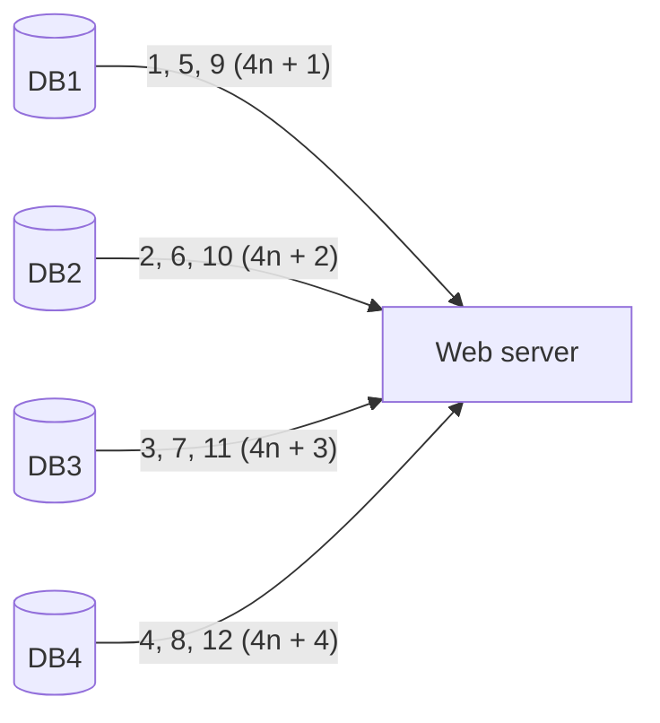
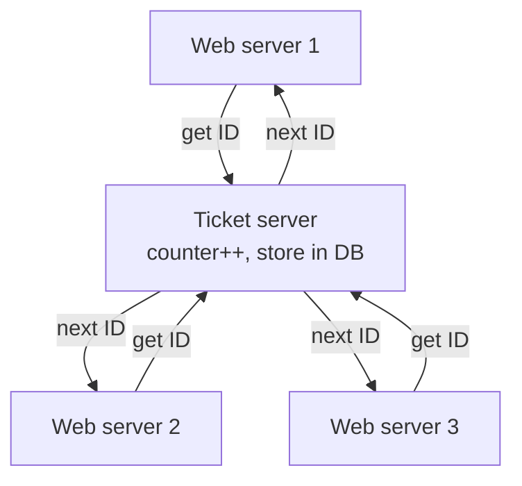
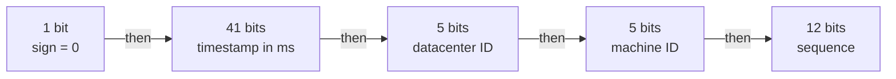

# 21. Unique ID Generator

Design a service that gives every new record (message, tweet, order) an ID.

## Requirements

| Requirement | Meaning |
|-------------|---------|
| Unique | No two records ever get the same ID |
| Sorted by time | A record created later gets a bigger ID. X at 7:45 am and Y at 7:46 am means ID(Y) > ID(X). |
| 64 bits | The ID fits in 64 bits |
| Numeric | Only digits. Decide this first, because the character set fixes the length. |

**Why the character set matters:** With only letters (a to z, A to Z) there are 52 options per character. A fixed length of 10 gives 52^10 IDs. With digits in 64 bits, there are 2^64 IDs.

## Starting point: one server with a counter

```
counter = 0
while (1) {
    request = getRequest()
    counter++
    return counter
}
```

- **Problem:** If the server restarts, the counter starts from 0 again. The IDs issued before are not stored, so old IDs repeat.
- **Fix:** Store the counter in a DB. On restart, read it back.

```
counter = getCounterFromDB()
while (1) {
    request = getRequest()
    counter++
    storeCounterOnDB(counter)
    return counter
}
```

- **New problem:** With several servers, each has its own counter. Keeping them in sync is very hard.

**Auto-increment:** With one DB server, the DB's `AUTO_INCREMENT` column solves this. It only works while one DB can hold all the data. Once data is sharded across DB1 to DB4, each shard's auto-increment starts from 1, and IDs repeat.

## Approach 1: multi-master step counting

Each of the k DBs increments by k, starting from a different offset. With 4 DBs:

| DB | IDs | Rule |
|----|-----|------|
| DB1 | 1, 5, 9, 13 | 4n + 1 |
| DB2 | 2, 6, 10, 14 | 4n + 2 |
| DB3 | 3, 7, 11, 15 | 4n + 3 |
| DB4 | 4, 8, 12, 16 | 4n + 4 |



**Not sorted by time:** Requests 1 and 2 go to DB1. They get 1 and 5. Request 3 goes to DB2. It gets 2.

| Time | ID |
|------|----|
| t0 | 1 |
| t1 | 5 |
| t2 | 2 |

**Scaling problem:** Adding a fifth DB changes the step from 4 to 5. Every server's rule must change. Removing a DB is easy, but about 1/4 of the ID space goes unused.

- **Used by:** Flickr ran two such ticket DBs (odd and even IDs).

## Approach 2: UUID

A **UUID** (Universally Unique Identifier) is a random 128-bit ID, for example `09c93e62-50b4-468d-bf8a-c07e1040bfb2`.

- **Generated locally:** Every server makes its own. No coordination between servers.
- **Collision chance:** Very low, but not zero. The rare case must still be handled (for example, a unique constraint in the DB that rejects a duplicate and retries).
- **Version 4:** Fully random. **Version 7** puts a timestamp first, so it sorts by time.

## Approach 3: ticket server

One central server whose only job is to issue IDs. It runs the counter-in-DB code from the starting point.



- **Simple and numeric:** Meets all four requirements with very little code.
- **Single point of failure:** If the ticket server goes down, no record anywhere can be created.
- **Hard to scale:** Adding a second ticket server brings back the sync problem.
- **Overflow:** After many years, the counter may get close to its limit. Old records that are no longer needed must be cleaned up.

## Approach 4: Twitter Snowflake

Split the 64 bits into parts. Each machine builds IDs alone.

| Bits | Field | Purpose |
|------|-------|---------|
| 1 | Sign bit | Always 0. Kept spare for emergencies. |
| 41 | Timestamp | Milliseconds since a chosen epoch |
| 5 | Datacenter ID | 2^5 = 32 data centers |
| 5 | Machine ID | 2^5 = 32 machines per data center |
| 12 | Sequence number | Counter per machine per ms. Resets to 0 each ms. |



### Why it works

- **Unique:** Datacenter ID + machine ID + sequence never repeat within one millisecond. Two machines never share the first two. One machine never repeats a sequence in the same ms.
- **Sorted by time:** The timestamp is in the highest bits. A later ms gives a bigger ID.
- **No sync:** Each machine is independent. No coordination is needed.
- **Numeric, 64 bits:** Yes.

### Timestamp and epoch

- **Epoch:** A fixed start time. The **Unix timestamp** counts ms since 1 January 1970. Snowflake subtracts a custom epoch (Twitter's is in November 2010) to save bits.
- **41-bit limit:** 2^41 ms is about 69 years. After that, the timestamp overflows.
- **When it runs out:** Pick a new epoch and set the timestamp to 0 again, or use the spare sign bit. Either way, the generation technique must change.

### Limits

| Limit | Detail |
|-------|--------|
| 4096 IDs per ms per machine | 2^12 = 4096. If a machine needs more in one ms, it waits for the next ms. |
| Bit split depends on load | Twitter used 12 bits for the sequence. A system with lower QPS can use fewer and give the bits elsewhere. |
| Clock sync | Order across machines is correct only if their clocks match. Keeping every server on the same time is very hard. |
| Clock going backwards | If a clock is reset backwards, a machine could repeat IDs. It must refuse to issue IDs until the clock catches up. |

**NTP (Network Time Protocol):** Keeps the clocks of many servers in sync over the network. Servers ask NTP time servers for the correct time and adjust. It gives accuracy of a few ms, not perfect sync.

## Comparison

| | Multi-master | UUID | Ticket server | Snowflake |
|---|-------------|------|---------------|-----------|
| Unique | Yes | Very likely | Yes | Yes |
| Sorted by time | No | No (v7: yes) | Yes | Yes (with synced clocks) |
| 64 bits | Yes | No, 128 | Yes | Yes |
| Numeric | Yes | No (hex) | Yes | Yes |
| Coordination | Fixed step setup | None | All calls go to one server | None after machine IDs are set |
| Weak point | Adding servers | Size, randomness hurts B+ tree inserts | Single point of failure | Clock sync |

> **Interview:** Ask the four requirements first. If IDs must be sortable and 64-bit at high scale, use Snowflake. Explain each field and the 4096 per ms limit. Mention NTP and what happens if the clock moves backwards.
