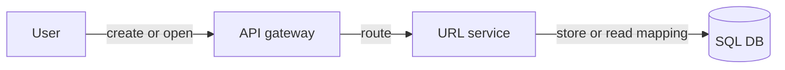
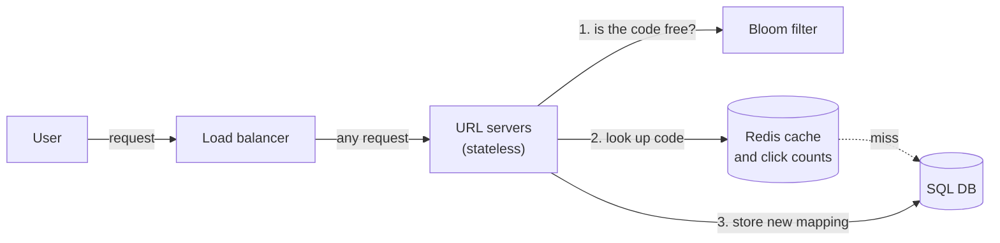

# 22. Design a URL Shortener

A URL shortener turns a long URL into a short one. Opening the short URL redirects the browser to the long URL.

## Step 1: FR

- User should be able to submit a long URL and get a short URL.
- User should be able to open a short URL and reach the long URL.
- User should be able to see how many times a short URL was opened.

Custom names, expiry dates and user accounts are out of scope.

## Step 2: NFR

- **[CAP](14-cap-theorem.md):** We choose AP. A redirect must always work, and a new short URL that reaches every [replica](05-scalability-availability-consistency.md) a moment late is fine.
- **Latency:** A redirect takes under 100 ms.

## Step 3: Estimates

| Quantity | Calculation | Result |
|----------|-------------|--------|
| [DAU](15-estimation.md) | | 100 million (10^8) |
| Users per second | 10^8 / 10^5 | 10^3 |
| Write QPS at peak | 10^3 × 0.1 new URLs × 5 | 500 per second |
| Read QPS at peak | 10^3 × 10 opens × 5 | 50K per second |

Reads are 100 times the writes, so the system is read heavy and needs a [cache](04-performance-throughput-load-balancing.md). In 5 years we create 10^7 × 365 × 5, about 1.8 × 10^10 short URLs.

## Step 4: Entities

| Entity | Key fields |
|--------|------------|
| URL | `short_code` (primary key), `long_url`, `created_at` |
| Click count | `short_code`, `count` |

## Step 5: APIs

- `POST /urls {longUrl}` creates a short URL and returns `{shortUrl}`.
- `GET /{shortCode}` returns [status code](08-rest-and-blob-storage.md) 302 with the long URL, so the browser goes there.
- `GET /urls/{shortCode}/clicks` returns `{count}`.

## Step 6: Basic diagram

The [API gateway](06-gateway-observability-maintainability.md) routes each request to the URL service. On create, the service hashes the long URL and keeps the first 7 characters in base62. Base62 uses the 62 characters 0 to 9, A to Z and a to z. Seven characters give 62^7, about 3.5 × 10^12 codes, which is far more than we need. The service stores the short code and the long URL in a [SQL](07-storing-data-and-redis.md) DB. On open, it reads the long URL by short code and redirects. With this design, FRs are satisfied.

## Step 7: Problems

**1. Two long URLs can hash to the same short code.** This is a collision, and the mapping must stay one to one. The fix is to check the DB first. If the code is taken, add a fixed string to the long URL and hash again, until the code is free.

**2. Every check is a DB call.** With many collisions, the loop calls the DB again and again. The fix is a Bloom filter. A Bloom filter is an array of bits that tells, using little memory, that a code is surely not in the DB. Each code is hashed to a few bit positions, and those bits are set to 1. If any of a code's bits is 0, the code is surely free, so we skip the DB. If all are 1, the code may exist, so we check the DB.

**3. The DB gets 50K reads per second.** The fix is a cache of short code to long URL in [Redis](07-storing-data-and-redis.md). On a miss, the server reads the DB and fills the cache ([cache-aside](11-cache-patterns-and-problems.md)). [Stateless](04-performance-throughput-load-balancing.md) servers sit behind a [load balancer](04-performance-throughput-load-balancing.md).

**4. With status 301, clicks are missed.** A 301 means "moved for good", so the browser caches it and skips our server next time. A 302 means "this time only", so every click reaches the server. We use 302. Each click adds 1 to the short code's count in Redis, because the SQL DB cannot take 50K count writes per second.

**Hash or unique ID?** A second way to make the code avoids collisions.

| | Hash | Unique ID |
|---|----------------------|---------------------|
| How it works | The service hashes the long URL and keeps 7 characters. | The service gets a [Snowflake ID](21-unique-id-generator.md) and writes it in base62. |
| Collisions | They happen, and shorter codes collide more often. | They never happen, because every ID is unique. |
| Extra system | It needs nothing extra. | It needs a separate ID generator. |

> **Interview:** Say "a hash or a unique ID makes the base62 code, and a Bloom filter skips most DB checks". Then add "Redis serves the reads, and 302 lets us count clicks".

## Likely questions

- **301 or 302?** A 301 is cached by the browser, so it lowers load. A 302 sends every click to the server, so we can count clicks.
- **How do you handle collisions?** Add a fixed string to the long URL and hash again. A Bloom filter avoids most of the DB checks.
- **What does a Bloom filter tell you?** If it says no, the code is surely not in the DB. If it says yes, the code may exist, so you check the DB.
- **Why base62, not base64?** Base64 adds `+` and `/`, which have special meanings in URLs.
