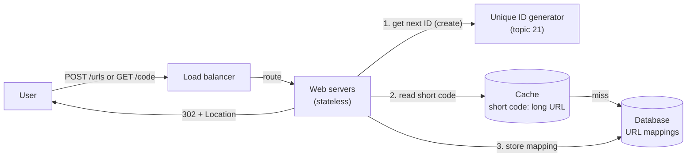
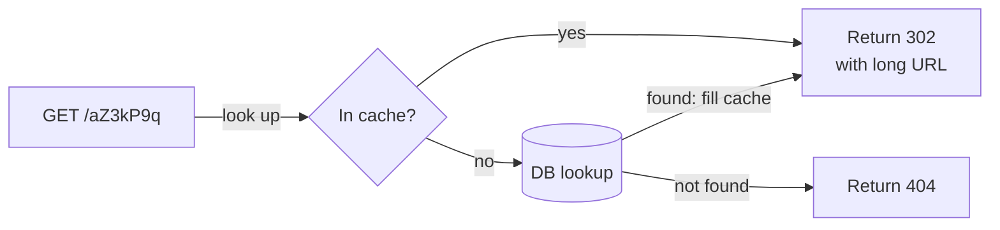
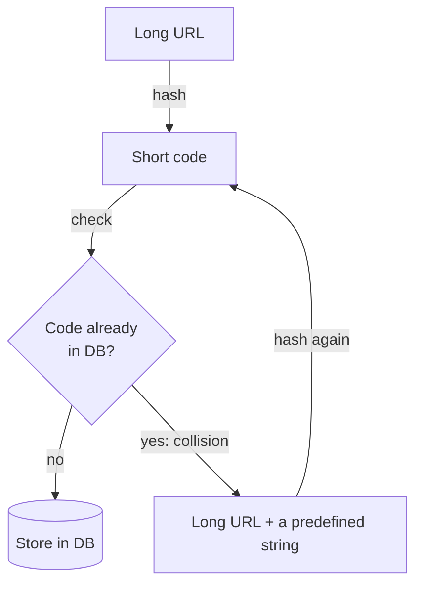
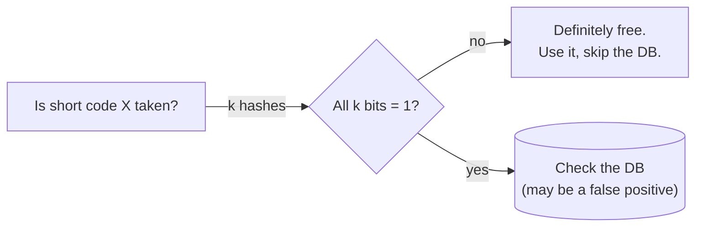

# 22. Design a URL Shortener

A URL shortener turns a long URL into a short one. Visiting the short URL redirects to the long one.

| Long URL | Short URL |
|----------|-----------|
| `https://www.abcdefxyz.com/articles/2024/system-design/part-7?ref=home` | `https://short.ly/aZ3kP9q` |

## Step 1: Functional requirements

| Core | Below the line |
|------|----------------|
| Users can submit a long URL and get a short URL | Custom aliases (`short.ly/my-name`) |
| Users who open a short URL are redirected to the long URL | Expiry dates. User accounts. Analytics dashboards. |

## Step 2: Non-functional requirements

1. **CAP:** Availability for redirects. A broken short link is worse than a slightly late new one. Creating a short code must still be unique (no two long URLs share one).
2. **DAU and writes:** 100 million new short URLs per day.
3. **Throughput:**
   - Writes: 10^8 / 10^5 s = about 1,000 per second.
   - Reads: links are opened far more than created. Read : write = 100 : 1. So about 100,000 redirects per second.
4. **Latency:** A redirect under 100 ms.
5. **Storage:** About 500 bytes per row (long URL, short code, timestamps). 10^8 × 500 B = 50 GB per day. Over 5 years: 50 GB × 365 × 5 = about 90 TB.
6. **Bandwidth:** 100,000 reads × 500 B = 50 MB/s.

## Step 3: Entities

| Entity | Key fields |
|--------|------------|
| URL mapping | `short_code` (primary key), `long_url`, `created_at` |

## Step 4: APIs

**Create a short URL:**

```
POST /urls
Body:     { "longUrl": "https://www.abcdefxyz.com/..." }
Response: 201 { "shortUrl": "https://short.ly/aZ3kP9q" }
```

**Redirect:**

```
GET /{shortCode}
Response: 302 Found
          Location: https://www.abcdefxyz.com/...
```

### 301 vs 302

| Code | Meaning | Browser caches it? | Server sees every click? |
|------|---------|--------------------|--------------------------|
| 301 Moved Permanently | This short URL always goes here | Yes. Later visits skip the server. | No |
| 302 Found | Redirect for this time only | No. Every visit hits the server. | Yes |

- **301:** Less load on the server.
- **302:** Use it to count which long URLs are opened most (analytics).

## Step 5: High-level design



**Create (POST):** The web server makes a short code (step 6). It stores `short_code: long_url` in the DB. It returns the short URL.

**Redirect (GET):** The web server checks the cache. On a hit it returns the long URL. On a miss it reads the DB, fills the cache, then returns it (cache-aside, topic 11).



With this design, both FRs are satisfied.

## Step 6: Deep dives

### How to make the short code

The mapping must be **one to one**: one long URL, one short code. Two ways:

| | Hash of the long URL | Unique ID + base 62 |
|---|-----------------------|---------------------|
| How | `hash(long_url)`, keep the first 8 characters | Get a unique number (topic 21). Write it in base 62. |
| Collisions | Yes. The shorter the code, the more likely. | None. Every number is unique. |
| Extra system | None | A unique ID generator |
| Same long URL twice | Gives the same code | Gives a new code each time |

**Code space:** The characters `[0-9] + [A-Z] + [a-z]` give 62 options.

| Length | Codes |
|--------|-------|
| 7 | 62^7 = 3.5 trillion |
| 8 | 62^8 = 218 trillion |

At 100 million per day for 5 years, we need 1.8 × 10^11 codes. 7 characters are enough.

- **Why base 62, not base 64:** Base 64 adds `+` and `/`. They have special meaning in URLs.

**Base 62 example:** ID 125 = 2 × 62 + 1. Digits 2 and 1 map to `c` and `b` (with `a` = 0). So the code is `cb`.

### Handling hash collisions



Each check is a DB call. A Bloom filter avoids most of them.

### Bloom filter

A **Bloom filter** is a memory-efficient structure that says for sure that something is **not** in a set. It is an array of **m bits**, all 0 at the start, with k hash functions. Each hash gives a number from 0 to m - 1.

- **Insert:** Run the k hashes. Set those k bits to 1.
- **Check:** Run the k hashes. If any of those bits is 0, the item is definitely not in the set. If all are 1, the item may be in the set.

**Example:** m = 12 bits, k = 2 hashes.

| Step | Hashes give | Result |
|------|-------------|--------|
| Insert A | 1, 5 | Bits 1 and 5 set to 1 |
| Insert B | 3, 8 | Bits 3 and 8 set to 1 |
| Check C | 5, 10 | Bit 10 is 0. C definitely does not exist. No DB call. |
| Check D | 1, 8 | Both bits are 1 (set by A and B). D may exist. But D is not in the DB. This is a **false positive**. |



| Property | Detail |
|----------|--------|
| False negatives | Never. An inserted item always has all its bits set. |
| False positives | Possible. Rate = (1 - e^(-kn/m))^k for n items. |
| Delete | Not possible. Clearing a bit could remove other items too. |
| Size | About 10 bits per item gives a 1% false positive rate. 1 billion codes need about 1.2 GB. |

- **Where it is used:** LSM trees skip SSTables with it (topic 17). Caches avoid lookups for keys that do not exist (cache penetration, topic 11).

### Scaling

| Part | How it scales |
|------|---------------|
| Web servers | Stateless. Add more behind the LB. |
| Reads (100K/s) | Cache hot codes in Redis. A small share of links gets most of the clicks. |
| DB (90 TB) | Key-value lookups only. Shard by `short_code` with consistent hashing (topic 12). Add read replicas. |
| ID generator | Snowflake on each web server, or a counter service that hands out ranges of 1,000 IDs at a time |

> **Interview:** Discuss both code methods (hash vs unique ID + base 62), how collisions are handled, why 7 characters are enough, 301 vs 302, and the cache in front of the DB. Showing these points proves you know the full setup.
