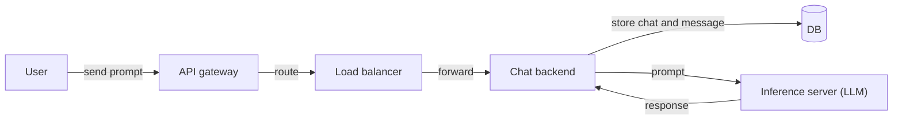
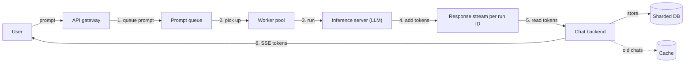

# 23. Design ChatGPT

A user sends a prompt in a chat, and an LLM writes the answer. An LLM (large language model) is the AI model that writes text. It writes the answer one token at a time, and a token is a small piece of text, about one word.

## Step 1: FR

- User should be able to start a new chat.
- User should be able to send a message and get the AI response.
- User should be able to open an older chat and continue it.

Image generation, branching and sharing chats, image or voice input, and user memory are out of scope.

## Step 2: NFR

- **CAP:** We choose AP ([CAP](14-cap-theorem.md)). The chat must keep working, and a chat list that is a moment old is fine.
- **Latency:** The first token reaches the user in under 500 ms. After that, tokens arrive at a steady rate.

## Step 3: Estimates

| Quantity | Calculation | Result |
|----------|-------------|--------|
| DAU | | 200 million (2 × 10^8) |
| Users per second | 2 × 10^8 / 10^5 | 2,000 |
| Write QPS at peak | 2,000 × 50 prompts × 5 | 500K per second |
| Read QPS at peak | Each response is read about once. | 500K per second |

Reads and writes are about equal, 1 : 1. If users often reopen old chats, the system becomes read heavy. 500K writes per second is far more than one Postgres server can take.

## Step 4: Entities

| Entity | Key fields |
|--------|------------|
| User | `id`, `name` |
| Chat | `id`, `user_id`, `name`, `state` (active or not) |
| Message | `id`, `chat_id`, `role` (user or model), `content`, `token_usage`, `model_name`, `created_at` |

## Step 5: APIs

- `POST /chats` starts a chat and returns `{chatId}`.
- `POST /chats/{chatId}/messages {content}` sends a prompt and returns `{runId}`. A run ID names the one answer that is being written.
- `GET /chats/{chatId}/messages` returns the messages of an older chat, so the user can continue it.

## Step 6: Basic diagram

The [API gateway](06-gateway-observability-maintainability.md) checks auth and [rate limits](06-gateway-observability-maintainability.md). The chat backend first stores the chat and the message in the DB. Then it sends the prompt to the inference server, which is the GPU server that runs the LLM. It stores the response and sends it back to the user. Many chat backend servers sit behind the [load balancer](04-performance-throughput-load-balancing.md). With this design, FRs are satisfied.

## Step 7: Problems

**1. The user waits for the whole answer.** The LLM takes seconds to write it all. The fix is to stream tokens. The inference server adds each token to a response stream, which is one queue per run ID. The chat backend reads the tokens from that stream. The gateway checks that the user owns the run ID.

**2. The client keeps asking for new tokens.** Polling every 3 seconds needs about 10 calls for one answer. A [WebSocket](16-interview-framework.md) is two-way but stateful, so the user is tied to one server and scaling is hard. The fix is SSE. The client sends one HTTPS request, and the server keeps writing tokens into the response. At the end it sends an end signal, and the connection closes. Any chat backend can read the run's stream, so the servers stay stateless.

**3. The GPUs cannot run every prompt at once.** A GPU can work on only a fixed number of prompts, say 20. The fix is a [queue](13-message-queues.md) of prompts, such as RabbitMQ. A pool of workers takes prompts from the queue and calls the inference server. When the queue is too full, the server replies 429 Too Many Requests. This is back pressure, which means refusing new work when the system is full. Workers can also batch small prompts, which means sending them to the GPU together in one pass. Separate queues keep paid users and image jobs apart from free users.

**4. The DB gets 500K writes per second.** The fix is to [shard](12-scaling-databases.md) the DB by user, so each user's chats live on one shard. [Consistent hashing](20-partitioning.md) picks the shard. A [cache](04-performance-throughput-load-balancing.md) in front of the DB makes reading old chats faster.

> **Interview:** Say "SSE streams the tokens from a response stream per run ID". Then say "a queue in front of the GPUs gives back pressure, and the DB is sharded by user".

## Likely questions

- **Why SSE, not WebSocket?** Only the server sends the tokens. SSE is a plain HTTP response, so the servers stay stateless and easy to scale.
- **Why not polling?** Polling needs about 10 calls for one answer, and most of them find nothing new.
- **What if too many prompts arrive at once?** Prompts wait in a queue for the workers. When the queue is full, the server replies 429.
- **How do paid users get a better experience?** They get their own queue, so free users cannot slow them down.
