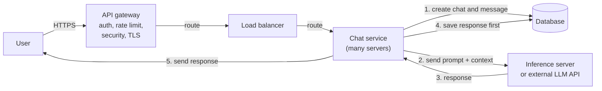
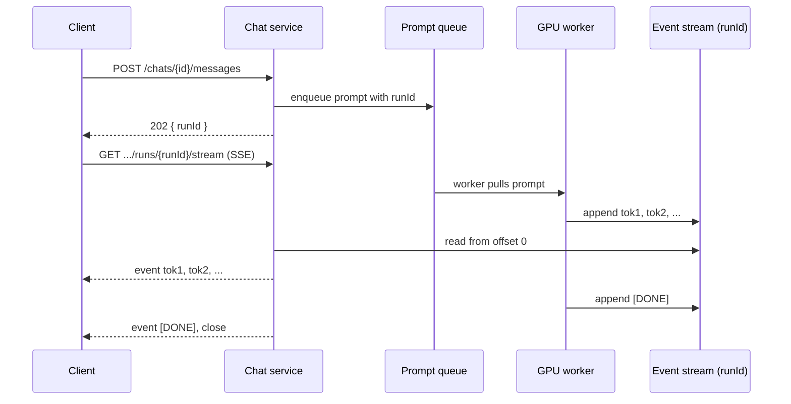
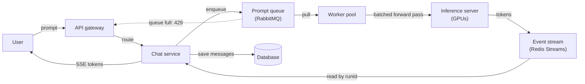
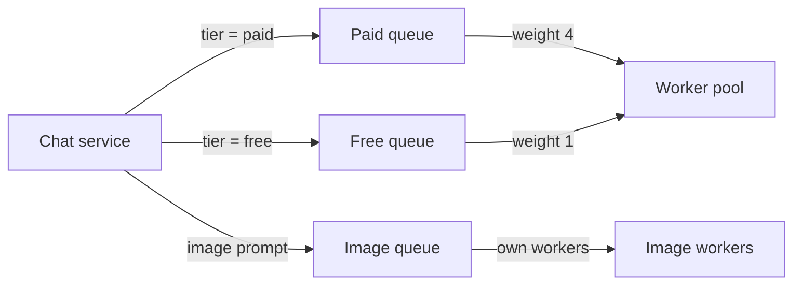

# 23. Design ChatGPT

A chat app where a user sends a prompt and an LLM streams back a response, token by token.

## Step 1: Functional requirements

| Core | Below the line (out of scope) |
|------|-------------------------------|
| Users can send a prompt in a chat and receive an AI-generated response | Editing or branching existing messages |
| Users can view past chats and resume a conversation, with the chat's prior context carried into the prompt | Image, audio or video input and output (text only) |
| | Sharing chats or collaborating with other users |
| | Custom GPTs, tool or function calling, web browsing |
| | Full-text search across a user's chat history |
| | Auth and user memory (assume the gateway handles auth) |

## Step 2: Non-functional requirements

| NFR | Target |
|-----|--------|
| Latency | Time to first token under about 500 ms. Then smooth, continuous streaming. A full response can take up to about 30 s. |
| CAP | AP. Availability over strong consistency for chat state (99.9%+). Better to return an error or a degraded answer than to block the system on perfectly synced chat state. |
| Durability | A finished message must never be lost |
| Scale | 200 million DAU. About 20,000 prompts per second at peak. About 120,000 concurrent in-flight streams. |
| Capacity | GPU-constrained. Fair allocation across free and paid tiers. |

### Estimation

| Quantity | Calculation | Result |
|----------|-------------|--------|
| Prompts per day | 200M DAU × 5 prompts | 10^9 |
| Average prompts per second | 10^9 / 10^5 s | 10,000 |
| Peak prompts per second | 2 × average | 20,000 |
| Message writes at peak | Each prompt writes 2 messages (prompt and response) | 40,000 per second |
| Concurrent streams | 20,000 per second × about 6 s per stream | 120,000 |
| Storage per day | 2 × 10^9 messages × 2 KB | 4 TB |
| Storage for 5 years | 4 TB × 365 × 5 | About 7 PB |
| Streaming bandwidth | 20,000 × 2 KB per second | About 40 MB/s |

- **Concurrent streams:** In-flight count = arrival rate × time each one stays open.
- **Read to write ratio:** For normal chatting it is about 1 : 1. If users often reopen old chats, it becomes read-heavy.
- **Heavier estimate:** The handwritten notes assume 100 messages per user per day. That gives about 100K writes per second and a 500K QPS peak to ingest. State your assumption out loud.

## Step 3: Entities

The nouns of the FRs: **users**, **prompt**, **response**, **chats**.

| Entity | Key fields | Note |
|--------|------------|------|
| User | `id`, `tier` (free or paid) | The tier matters for fairness and scheduling |
| Chat | `id`, `user_id`, `title`, `state` (active or not), `created_at`, `updated_at` | One conversation thread. Belongs to one user. Groups an ordered sequence of messages. |
| Message | `id`, `chat_id`, `role` (user or assistant), `content`, `token_count`, `model_name`, `created_at` | One turn. A prompt and a response are both messages. |
| Run (generation) | `run_id`, `chat_id`, `status` (queued, running, done, cancelled, failed) | One in-flight response. The client uses it to follow the stream. |

## Step 4: APIs

| Purpose | API | Response |
|---------|-----|----------|
| Start a new chat | `POST /chats`, body `{}` | `{ chatId }` |
| Send a prompt | `POST /chats/{chatId}/messages`, body `{ content }` | `{ runId }` |
| Follow the response | `GET /chats/{chatId}/runs/{runId}/stream` | Message tokens over SSE |
| Stop generating | `POST /chats/{chatId}/runs/{runId}/cancel` | `202 Accepted` |
| List chats (sidebar) | `GET /chats?cursor={cursor}&limit={n}` | `Chat[]` |
| Load one chat | `GET /chats/{chatId}/messages?cursor={cursor}&limit={n}` | `Message[]` |

- **POST for messages:** It creates a new Message and starts the model response on the server.
- **`runId`:** A handle for the in-flight response. Sending and streaming are split into two calls.
- **GET for the stream:** The browser's `EventSource` API only opens GET requests (topic 16).
- **Cursor pagination:** A heavy user can have thousands of chats. A long chat can have thousands of messages.

## Step 5: High-level design

### FR 1: send a prompt and get a response

1. The gateway checks auth, rate limits, security and terminates TLS (topic 6).
2. The chat service creates the chat and the user's message in the DB.
3. It sends the prompt to the inference server and receives the response.
4. It saves the response in the DB first. Then it sends it back to the user.

### FR 2: view past chats and resume

- **Sidebar:** `GET /chats` reads the user's chats from the DB, newest first.
- **Resume:** `GET /chats/{chatId}/messages` loads the messages.
- **Context:** On a new prompt, the chat service loads the chat's recent messages and sends them to the LLM with the prompt. That is how prior context is carried. Old turns beyond the model's context window are dropped or summarised.

With this design, all FRs are satisfied.

## Step 6: Deep dives

### Deep dive 1: streaming tokens fast and smoothly

Two problems:

- **First token:** How fast the first token reaches the screen. A pure latency problem.
- **Smooth stream:** The rest must arrive in order, without gaps, even as chat service instances come and go.

**Step 1, make the run first-class.** The inference server writes tokens into a per-run stream (`<tok1><tok2>...`), keyed by `runId`. The user asks for tokens of a particular `runId`. The gateway checks that this user may read this `runId`.

**Step 2, choose how the client receives tokens** (topic 16 compares the options):

| Option | Result here |
|--------|-------------|
| Short polling every 3 s | Works, but about 10 API calls for one answer. Tokens arrive in bursts. |
| WebSocket | Bidirectional, but the client only needs server to client. Stateful: a user connected to one server cannot read from another. Hard to scale. |
| SSE | One HTTP response stays open. Tokens are pushed as they come. An end marker (`[DONE]`) closes it. Plain HTTP. **Chosen.** |

Cancel and new prompts are plain HTTP calls on the side, so SSE's one direction is enough.

**Step 3, move tokens from the GPU worker to the right chat service instance.** The user's SSE connection is held by one chat service instance. The tokens come from a GPU worker.

| Option | How | Problem |
|--------|-----|---------|
| Pin server | The worker sends tokens straight to the instance holding the connection | Stateful. If that instance dies, the stream is lost. |
| Pub/sub | The worker publishes tokens on channel `runId`. The instance subscribes. | Fire and forget. Tokens sent while no one is subscribed (during a reconnect) are lost. A message queue is overkill. |
| Event stream | The worker appends tokens to a log for `runId`. Any instance reads from any offset. | None of the above. **Chosen.** |

- **Why an event stream:** The chat service is not tied to one `runId`. If the client reconnects to a different instance, it sends the last token id it saw (`Last-Event-ID` header in SSE). The new instance replays the log from that offset. No gaps.
- **Redis Streams:** One short-lived stream per run, with a TTL. Good fit for many small streams.
- **Kafka:** Durable and high throughput. Use a topic partitioned by `runId`, not one topic per run.

### Deep dive 2: routing and scheduling requests across GPU workers

A GPU can only process a fixed number of requests at once, for example 20. At peak, we cannot run every request in parallel.

- **Queue the prompts:** The chat service no longer calls the LLM. It puts each prompt on a queue (for example RabbitMQ). A pool of worker threads pulls from it. Each worker calls the inference server and streams the result (topic 13).
- **Backpressure:** If too many prompts are already queued, reject new ones with `429 Too Many Requests` or "server unavailable". Do not let the queue grow forever.
- **Batching:** Neural networks can process many inputs in one forward pass. Workers group several small requests into one GPU call. This raises GPU throughput a lot.

### Deep dive 3: fairness across tiers

Heavy users must not take over the GPU pool. Paid tiers must get a better experience.

- **Service level (SLA) queues:** Separate queues per class. One for paid users, one for free users, one for image generation.
- **Weighted pulling:** Workers pull more often from the paid queue, for example 4 paid prompts for every 1 free prompt. Free prompts still progress, so they never starve.
- **Per-user limits:** At the gateway, cap requests per minute per user. Cap in-flight runs per user, for example 1 for free, 3 for paid (topic 29).
- **Degrade, do not fail:** Under heavy load, route free users to a smaller, cheaper model.

### Deep dive 4: cancelling a run and reclaiming the GPU

1. The user hits stop. The client calls `POST /chats/{chatId}/runs/{runId}/cancel`. This is the side channel set aside when SSE was chosen.
2. The chat service sets the run's status to `cancelled`.
3. It publishes a cancel signal on a control channel keyed by `runId`.
4. The worker checks that channel between token batches. When it sees the signal, it drops the sequence and stops generating. The GPU slot is free for the next prompt.

This is the payoff of making the run first-class.

### Deep dive 5: does every part scale?

| Part | How it scales |
|------|---------------|
| Chat service | Stateless. Any instance serves any stream because tokens live in the event stream. Add more behind the LB. |
| Database | Postgres sharded by `user_id` with consistent hashing (topic 12). A user's chats and messages live on one shard. |
| Chat list reads | Cache the sidebar list and recent messages in Redis to make read calls faster |
| Message writes | Each message is one row insert. 40K per second spread across shards is fine. |
| GPU workers | The real limit. Add GPUs, batch more, and use the queues to smooth peaks. |

> **Interview:** The hard parts are streaming and GPU scheduling. Say "SSE for one-way streaming, an event stream keyed by runId so any chat server can resume, a prompt queue with backpressure and batching, and tiered queues for fairness". Show cancellation as a separate POST.
