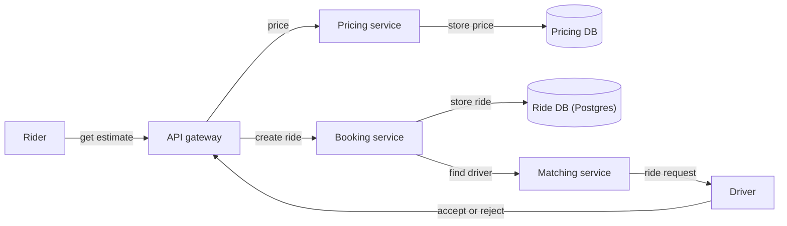
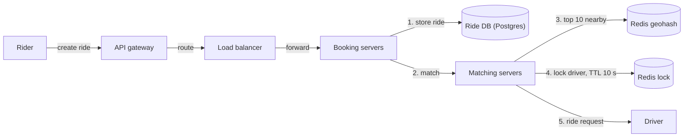

# 24. Design Rapido (Ride Booking)

A rider books a ride from A to B. The system finds a nearby driver, and the driver accepts or rejects the ride.

## Step 1: FR

- User should be able to get a price estimate and the vehicle types available for a ride from A to B.
- User should be able to confirm a ride and get matched with a driver.
- Driver should be able to accept or reject a ride request.

Ride state updates (start, in progress, end), OTP, live tracking, notifications, messaging, tipping and payments are out of scope.

## Step 2: NFR

- **CAP:** We choose CP for booking ([CAP](14-cap-theorem.md)). One driver must never get two rides. The rest of the flow, such as the price estimate, can be eventually consistent. The ride DB must give [ACID transactions](09-data-modelling.md), so each booking happens fully or not at all.
- **Latency:** A ride is matched in under 1 to 2 minutes. If no driver accepts in that time, the ride is cancelled.

## Step 3: Estimates

| Quantity | Calculation | Result |
|----------|-------------|--------|
| DAU | | 100 million (10^8) |
| Users per second | 10^8 / 10^5 | 1,000 |
| Read QPS at peak | 1,000 × 5 reads × 5 | 25K per second |
| Write QPS at peak | 1,000 × 2 writes × 5 | 10K per second |

Reads are higher than writes. 10K writes per second is more than one Postgres server can take, which is about 5K per second.

## Step 4: Entities

| Entity | Key fields |
|--------|------------|
| Rider | `id`, `name` |
| Driver | `id`, `vehicle_type`, `available` |
| Price | `id`, `src`, `dest`, `vehicle_type`, `estimated_time`, `fare` |
| Ride | `id`, `rider_id`, `driver_id`, `src`, `dest`, `price_id`, `status` |
| Location | `driver_id`, `lat`, `long`, `last_updated` |

## Step 5: APIs

- `POST /pricing {source, destination}` returns a list of `{vehicle, price}`.
- `POST /rides {source, destination, vehicle}` books a ride and returns `{rideId}`.
- `PATCH /rides/{rideId} {accept or reject}` lets the driver answer a ride request.

## Step 6: Basic diagram

The pricing service works out the fare from the distance and stores the price. The booking service checks that the price exists, then stores the ride in Postgres. The matching service sends the ride request to a driver. The driver's answer updates the ride. With this design, FRs are satisfied.

## Step 7: Problems

**1. Finding the drivers near the rider.** Drivers send their location with `POST /drivers/{driverId}/location {lat, long}`. PostGIS, a Postgres add-on for maps, can search by location. But Postgres cannot take more than about 5K writes per second. The fix is geohashing in a Redis cluster. Geohashing splits the world into equal cells, and each cell has a hash. The matching service searches the cells next to the rider's cell and gets the top 10 drivers.

**2. Two riders get the same driver.** Two riders in one area fetch the same top 10 drivers. Both race to book the same driver. The fix is a [distributed lock](11-cache-patterns-and-problems.md) on each driver in Redis, with a TTL of 10 seconds. Only the server that gets the lock sends that driver the request. If the driver accepts, the ride DB is updated. If the driver rejects or 10 seconds pass, the lock expires, and the request goes to the next driver.

**3. One server cannot take the load.** The fix is to run many stateless booking and matching servers behind a [load balancer](04-performance-throughput-load-balancing.md).

> **Interview:** Say "Redis geohash finds the nearby drivers, and a Redis lock with a TTL gives each driver to one rider". Then say "Postgres keeps the rides consistent".

## Likely questions

- **Why not store driver locations in Postgres?** Location updates are heavy writes, and Postgres takes only about 5K writes per second. Redis takes far more.
- **How do you find nearby drivers?** Geohashing gives each cell of the map a hash. You search the rider's cell and the cells next to it.
- **How do you stop two riders getting the same driver?** A Redis lock on the driver lets only one server send that driver a request.
- **What if the driver does not answer?** The lock's TTL ends after 10 seconds, and the request goes to the next driver.
