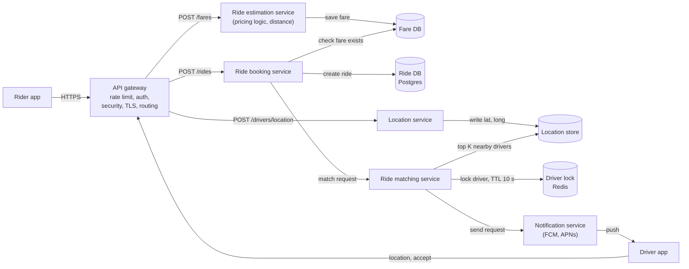
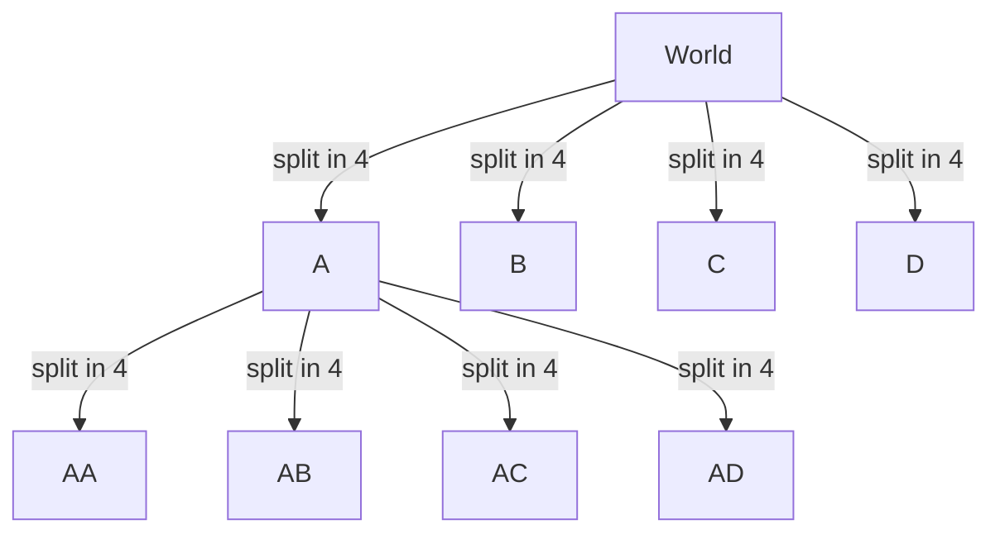
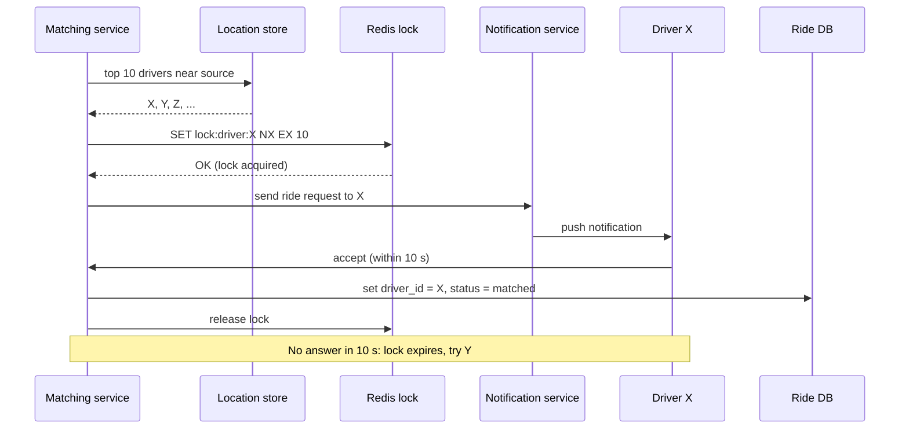

# 24. Design Rapido (Ride-Hailing)

Riders book a bike, auto or cab from A to B. The system finds a nearby driver.

## Step 1: Functional requirements

Follow the product journey of one booking.

| Core | Below the line (out of scope) |
|------|-------------------------------|
| Riders can enter a source and destination and get a fare estimate per vehicle type | Ride states after confirmation (start, in progress, end) |
| Riders can confirm a ride and be matched with a nearby driver | OTP for each ride, live tracking |
| Drivers can accept or reject a ride request sent to them | Messaging, tipping |
| | Payments |
| | Scheduled rides, booking for someone else |

## Step 2: Non-functional requirements

| NFR | Target |
|-----|--------|
| CAP | CP for booking: one driver must never get two rides, and one ride must never get two drivers. Eventual consistency for the rest (estimates, locations). |
| Database | ACID transactions for ride and driver state |
| Latency | Fare estimate under 1 s. A match within 1 to 2 minutes, otherwise cancel the request. |
| Scale | 100 million DAU |
| Availability | High for estimates and location updates |

### Estimation

| Quantity | Calculation | Result |
|----------|-------------|--------|
| Users per second | 10^8 / 10^5 s | 1,000 |
| Read requests per user | Estimates, ride status | 5 |
| Write requests per user | Bookings, accept or reject | 2 |
| Peak factor | | 5× |
| Read QPS at peak | 1,000 × 5 × 5 | 25,000 |
| Write QPS at peak | 1,000 × 2 × 5 | 10,000 |
| Location writes | 10 million online drivers, one update every 2 s | 5 million per second |

The location writes are by far the biggest load.

## Step 3: Entities

An entity is something the system needs to track.

| Entity | Key fields |
|--------|------------|
| Rider | `id`, `name`, `phone` |
| Driver | `id`, `vehicle_type`, `status` (available or not) |
| Fare (price) | `id`, `rider_id`, `src`, `dest`, `vehicle_type`, `estimated_fare`, `estimated_time`, `expires_at` |
| Ride | `id`, `rider_id`, `driver_id` (empty until matched), `fare_id`, `src`, `dest`, `status` (requested, matched, cancelled, ...) |
| Location | `driver_id`, `lat`, `long`, `last_updated` |

Each ride can have a different price. So the fare is its own entity.

## Step 4: APIs

| Purpose | API | Response |
|---------|-----|----------|
| Get estimates | `POST /fares`, body `{ source, destination }` | `[{ fareId, vehicleType, price, eta }]` |
| Book a ride | `POST /rides`, body `{ fareId }` | `201 { rideId, status: "requested" }` |
| Driver location | `POST /drivers/location`, body `{ lat, long }` | `200` |
| Ride details | `GET /rides/{rideId}` | Ride details |
| Accept or reject | `PATCH /rides/{rideId}`, body `{ action: "accept" or "reject" }` | Ride details |

- **Estimates use POST:** The call creates a Fare entity and stores it. The rider gets a `fareId`.
- **Book with `fareId`:** The server reads the stored fare, so the rider cannot send a fake, lower price.
- **Driver id from the token:** The driver's id comes from the auth token, not the path or body (topic 16).
- **Ride details pushed:** The ride request is pushed to the driver's phone as a notification. The app then calls `GET /rides/{rideId}`.

## Step 5: High-level design



1. **Estimate:** The ride estimation service finds the distance with a maps API. It applies the pricing logic per vehicle type. It saves each fare and returns them.
2. **Book:** The ride booking service checks that the fare exists and has not expired. It creates the ride with status `requested` in Postgres. It sends the ride to the matching service.
3. **Location:** Every few seconds, each driver app sends its location. The location service stores it.
4. **Match:** The matching service gets the top K available drivers near the source. It sends the request to one driver at a time, through the notification service.
5. **Accept or reject:** The driver's answer updates the ride in the Ride DB.

With this design, all FRs are satisfied.

## Step 6: Deep dives

### Deep dive 1: finding nearby drivers fast

**Option 1, PostGIS:** A Postgres extension with geo indexes (an R-tree, similar to a quadtree). "Drivers within 2 km" is one query.

- **Trade-off:** Postgres handles only about 5,000 writes per second on such an index. We need 5 million location writes per second.

**Option 2, geohashing in a Redis cluster. Chosen.**

**Geohash:** Divide the world into 4 quadrants. Name them A, B, C, D. Divide each again: A becomes AA, AB, AC, AD. Keep going. Every cell gets a string. A longer string means a smaller cell.



- **Shared prefix means close:** Cells AA and AB are next to each other inside A.
- **Search:** Find the rider's cell. Look in that cell and its 8 neighbours. Return the top 10 nearest available drivers.
- **Neighbours matter:** Two points near a cell border can have different prefixes. So always check the neighbouring cells too.
- **Redis:** `GEOADD drivers <long> <lat> <driverId>` stores a location as a geohash in a sorted set. `GEOSEARCH drivers FROMLONLAT <long> <lat> BYRADIUS 2 km ASC COUNT 10` returns the 10 nearest. It is all in memory, so it handles very high write rates. Shard the cluster by city or region.

Real geohashes use base 32 characters, not A to D.

| Geohash length | Cell size (about) |
|----------------|-------------------|
| 4 | 39 km × 20 km |
| 5 | 4.9 km × 4.9 km |
| 6 | 1.2 km × 0.6 km |
| 7 | 150 m × 150 m |

| | Geohash (Redis) | Quadtree |
|---|-----------------|----------|
| Cells | Fixed grid | Split only where density is high |
| Updates | Very cheap. Recompute the hash. | Costly. The tree may rebalance. |
| Dense cities | Some cells get crowded | Adapts to density |
| Best for | Frequent location updates | Mostly static places (restaurants) |

- **Reduce writes:** The app sends a location only if the driver moved, or every 5 s when idle.
- **Stale drivers:** Remove drivers whose `last_updated` is older than 30 s from search results.

### Deep dive 2: two riders, one driver (race condition)

Two riders in the same area search at the same time. Both get the same top K list. Both send a request to driver X. X could be booked twice.

**Fix: a distributed lock per driver in Redis** (the same lock as the thundering herd fix in topic 11).

```
SET lock:driver:X <rideId> NX EX 10
```

- **Acquire first:** Only one matching thread can acquire the lock. Only that thread sends the request to driver X.
- **Lock taken:** The other thread skips X and tries the next driver in its list.
- **TTL 10 s:** If X does not answer in 10 s, the lock expires. The ride moves to the next driver.
- **Accept:** Update the Ride DB in one transaction: `UPDATE rides SET driver_id = X, status = 'matched' WHERE id = ? AND status = 'requested'`. Then release the lock.



### Deep dive 3: widening the search

- **First pass:** Fetch the top 10 drivers in a small radius. This is the basic case.
- **Second pass:** If none accept, fetch the top 50 in a larger radius.
- **Give up:** After 1 to 2 minutes, cancel the request and tell the rider.

### Deep dive 4: not losing a ride request

If a matching server crashes mid-search, the request must not vanish.

- **Queue the requests:** Ride booking puts each request on a queue (Kafka or SQS). Matching servers pull from it, behind the scaling layer.
- **Retry:** A request is removed only after a match or a cancel. If a server dies, another one picks it up (topic 13).

### Does every part scale?

| Part | How it scales |
|------|---------------|
| Estimation, booking, matching services | Stateless. Add servers behind LBs. |
| Location store | Redis cluster sharded by region. In memory. Handles millions of writes per second. |
| Ride DB | Postgres for ACID. Shard by city. Only 10K writes per second at peak. |
| Notifications | FCM and APNs deliver pushes to phones |

> **Interview:** The hard parts are location search and double booking. Say "geohash in Redis, because PostGIS cannot take millions of writes per second" and "a Redis lock per driver with a 10 s TTL, plus a conditional update in Postgres".
