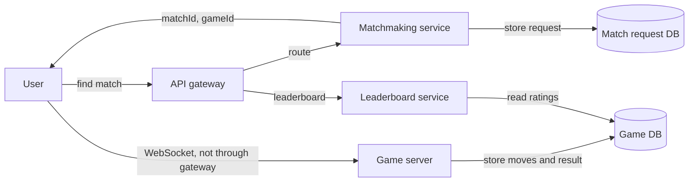
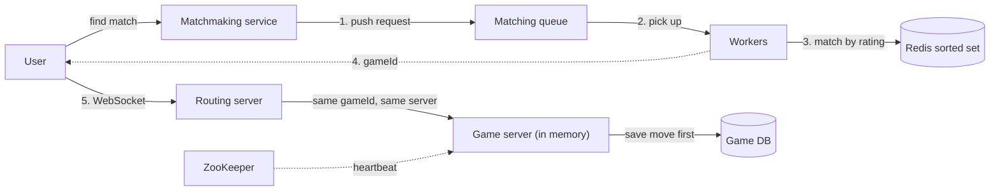

# 25. Design Chess.com (Multiplayer Game)

Two players of similar skill are matched and play a live game of chess. After the game, their ratings change and the leaderboard updates.

## Step 1: FR

- User should be able to get matched with a player of similar rating for a chosen time control.
- User should be able to play the game in real time.
- User should be able to see their rating updated after the game and view the global leaderboard.

Playing a bot, inviting a friend, chat and tournaments are out of scope.

## Step 2: NFR

- **CAP:** We choose CP ([CAP](14-cap-theorem.md)). Both players must see the same board, and an eventually consistent move is useless.
- **Latency:** A move reaches the opponent in 50 to 100 ms, and never later than 200 ms.

## Step 3: Estimates

| Quantity | Calculation | Result |
|----------|-------------|--------|
| DAU | | 10 million (10^7) |
| Users per second | 10^7 / 10^5 | 100 |
| Games at peak | 10^7 / 50 = 200K players in 100K games, × 5 | 500K games |
| Open connections | 500K games × 2 players | 1M |
| Write QPS at peak | 1M players, each moving about once every 10 s | 100K moves per second |
| Read QPS at peak | Each move is read once, by the opponent. | 100K per second |

The peak comes during tournaments. The load is 1M connections that stay open for a 10-minute game, not single clicks. 100K writes per second is far more than one Postgres server can take.

## Step 4: Entities

| Entity | Key fields |
|--------|------------|
| Player | `id`, `rating`, `wins`, `losses` |
| MatchRequest | `id`, `user_id`, `user_rating`, `time_control`, `status`, `game_id` |
| Game | `id`, `white_player_id`, `black_player_id`, `compressed_board`, `white_time`, `black_time`, `status` |
| Move | `id`, `game_id`, `from`, `to`, `move_num` |

## Step 5: APIs

- `POST /matchmaking {matchType}` asks for a match and returns `{matchRequestId}`. The user ID comes from the auth token.
- A [WebSocket](16-interview-framework.md) at `/games/{gameId}` carries the game. The client sends `sendMove {from, to, moveNum}` or `resign`. The server sends `checkValid`, `opponentMove` and `gameEnd {result}`, with both players' clocks.
- `GET /leaderboard` returns the top players.

## Step 6: Basic diagram

The matchmaking service stores the request and pairs two players. It sends both of them the game ID. Each player then opens a WebSocket to the game server, which checks each move and saves it. At the end, the game server updates both ratings, and the leaderboard reads them. With this design, FRs are satisfied.

## Step 7: Problems

**1. Matchmaking gets about 100K requests in a tournament.** A sorted waiting list in memory would be fast. But then the matchmaking servers are stateful and hard to scale. The fix is a Redis [sorted set](07-storing-data-and-redis.md) of active requests, ordered by rating. Each Redis command is atomic, so two players cannot both take the same opponent. A timestamp lets players who came first get matched first.

**2. Matching is slow when requests arrive in a burst.** The fix is a [queue](13-message-queues.md). The matchmaking service saves the request in the match request DB and in Redis, then pushes it onto a matching queue. A worker takes the request and finds a match in Redis. It updates the match request DB and sends a push notification with the game ID. A [push notification](26-whatsapp.md) is a message that reaches the phone through Apple or Google, even when the app is closed.

**3. The two players are on different game servers.** Each WebSocket stays open on one server, so the servers are stateful. They keep the game in memory, because going to the DB for every move is slow. The fix is a routing server that sends every request with the same game ID to the same game server. [ZooKeeper](20-partitioning.md) checks with heartbeats that each game server is alive.

**4. A game server crashes.** A move is accepted only after it is saved in the game DB. When a server dies, its games are routed to another server. That server loads each game from the game DB and carries on.

> **Interview:** Say "a Redis sorted set matches players by rating". Then say "a routing server keeps both players on one server, and each move is saved before it is accepted".

## Likely questions

- **Why WebSocket for the game?** Both players send moves at any time, and a WebSocket lets both sides send on one open connection.
- **Why Redis for matchmaking?** It keeps requests sorted by rating in memory, and each command is atomic, so no opponent is taken twice.
- **How do both players reach the same server?** A routing server sends every request with the same game ID to the same game server.
- **What if a game server crashes?** Every move is saved in the game DB first, so another server loads the game and carries on.
