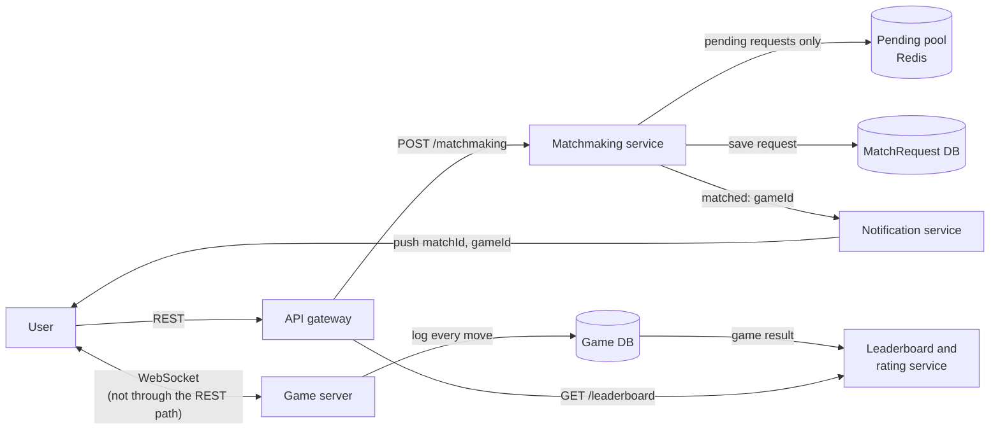
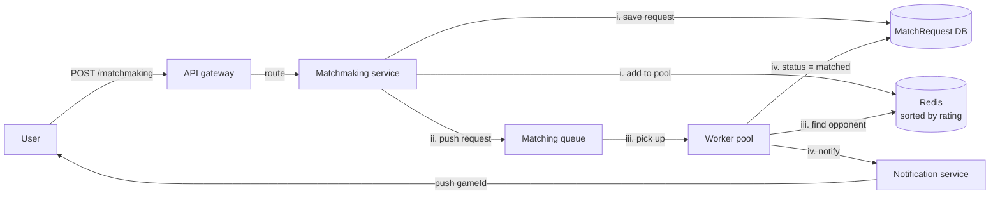
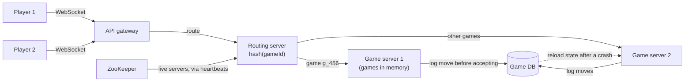
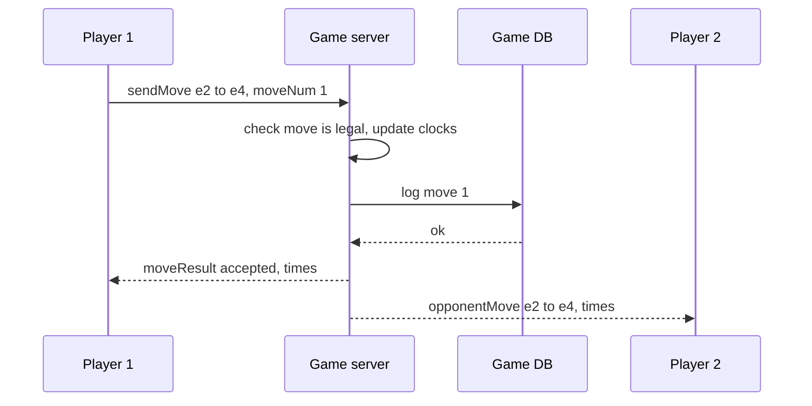

# 25. Design Chess.com (Real-Time Multiplayer Game)

Players find an opponent of similar skill, play a timed game live, and get a new rating after it. The same design works for Ludo and other turn-based games.

## Step 1: Functional requirements

How to write an FR:

- **"User should be able to X":** Something the user does.
- **"User should see X happening":** Something the user observes.
- **No implementation details** in an FR.

| Core | Below the line (out of scope) |
|------|-------------------------------|
| Users can be matched with an opponent by skill, for a chosen time control (for example 10 min) | Playing against a bot |
| Users can play the started game in real time | Inviting a friend to a game |
| After a game, users see their rating updated, and a global leaderboard | In-game chat, spectating |
| | Cheat detection |

## Step 2: Non-functional requirements

| NFR | Target |
|-----|--------|
| CAP | Strong consistency. Both players must see the same board. There is no point in "eventually" applied moves. |
| Latency | Under 200 ms in the worst case, aim for 50 to 100 ms. Otherwise it does not feel real-time. |
| Scale | 10 million DAU. Peaks during tournaments. |
| Durability | An accepted move is never lost |

**Latency by product type:**

| Product | Tolerable latency |
|---------|-------------------|
| Real-time game | 50 to 100 ms, 200 ms worst case |
| Social media feed | A few hundred ms |
| Normal API call | 5 s at most |

Real-time products need consistency more. A chat forum like Slack can live with eventual consistency.

### Estimation

| Quantity | Calculation | Result |
|----------|-------------|--------|
| Users per second (average) | 10^7 / 10^5 s | 100 |
| Concurrent games at a tournament peak | 1/100 of DAU playing at the same time | 100,000 |
| Design load | 5× safety margin | 500,000 concurrent games |
| Concurrent connections | 2 players per game | 1 million |
| Game length | Based on the timer | About 10 minutes |
| Move rate | 500K games, one move every 10 s per game | 50,000 moves per second |

These are not one-click API calls. Each connection stays open for the whole game.

## Step 3: Entities

| Entity | Key fields |
|--------|------------|
| Player | `player_id`, `profile`, `rating`, `wins`, `losses` |
| MatchRequest | `id`, `user_id`, `user_rating`, `time_control`, `status` (pending, matched, cancelled), `game_id` (set once matched) |
| Game | `game_id`, `white_player_id`, `black_player_id`, `compressed_board`, `white_time_ms`, `black_time_ms`, `status` |
| Move | `move_id`, `game_id`, `from`, `to`, `move_num`, `color` |

## Step 4: APIs

### Matchmaking (REST)

```
POST /matchmaking
Body:     { "timeControl": "10+0" }
Response: 201 { "matchRequestId": "mr_123" }
```

The user id comes from the auth token, not the body.

```
GET /matchmaking/{matchRequestId}
Response: 200 { "status": "matched", "gameId": "g_456" }
```

- **How the client learns about the match:** Poll this endpoint, plus a push notification (FCM), the same as Rapido.
- **Why not SSE:** SSE suits a stream of many updates over time. Here only one event is needed: "you are matched".

### Game (WebSocket)

Once the game starts, both players need real-time, two-way communication. So they use a WebSocket: `wss://.../games/{gameId}`.

| Direction | Message | Fields |
|-----------|---------|--------|
| Client to server | `sendMove` | `from`, `to`, `moveNum` |
| Client to server | `resign` | none |
| Server to client | `moveResult` | `accepted`, `reason` (if rejected), `whiteTimeMs`, `blackTimeMs` |
| Server to client | `opponentMove` | `from`, `to`, `whiteTimeMs`, `blackTimeMs` |
| Server to client | `gameEnd` | `result` (white wins, black wins, draw) |

### Leaderboard (REST)

```
GET /leaderboard?cursor={cursor}&limit={n}
Response: 200 [{ "playerId", "rating", "rank" }]
```

## Step 5: High-level design



1. **Match:** The user asks for a match. The matchmaking service saves the request. It keeps only pending requests in a small, fast store (Redis). When it finds an opponent, it creates a game and notifies both users with the `gameId`.
2. **Play:** Both users open a WebSocket to the game server. The server checks each move, logs it, and sends it to the opponent.
3. **Rate:** When the game ends, the rating service updates both ratings and the leaderboard.

With this design, all FRs are satisfied.

## Step 6: Deep dives

### Deep dive 1: matchmaking under tournament load

About 100K match requests may arrive at once. The waiting players should be kept sorted by rating, in memory. But the matchmaking service must scale out, so it cannot be stateful.

**Fix:** Keep the waiting pool in Redis, as a sorted set per time control. The score is the rating.

```
ZADD pool:10min 1600 user_42
ZRANGEBYSCORE pool:10min 1500 1700
```

- **Find an opponent:** Search within ±100 rating. If no one is found, widen the range every few seconds (±200, ±400).
- **No double match:** Redis runs each command and each Lua script atomically. A script that finds an opponent and removes both players with `ZREM` runs as one step. Two players can never get the same opponent.
- **Fairness:** Store the arrival time too. Among equal candidates, match the player who has waited longest.

**Optimised design with a queue:**



1. The matchmaking service writes the request to the MatchRequest DB and to Redis.
2. It pushes the request onto the matching queue.
3. A worker thread picks up the request and tries to match it in Redis.
4. Once it finds a match, the worker updates both entries in the MatchRequest DB and sends a notification to both users.

### Deep dive 2: the game server

Game servers are **stateful**: they keep each live game in memory. This makes responses faster than going to the DB on every move. It brings two problems:

1. **Routing:** Both players of one game must reach the same server.
2. **Crashes:** A game must survive its server dying.

**Fix for routing:** A routing server sends every connection to a game server based on `gameId` (consistent hashing, topic 12). Both players of one game always land on the same server. ZooKeeper tracks which game servers are alive, using heartbeats (topic 20).

**Fix for crashes:**

- **Log first:** A move is never accepted until it is logged in the Game DB.
- **Recover:** If a server dies, the router sends that game to another server. The new server loads the game's state from the Game DB. Clients reconnect and carry on.



**Move flow:**



**Alternative: players on different servers.** Each player connects to any game server. Servers pass moves through a pub/sub channel per game (for example Redis pub/sub on `game:g_456`). Server 1 publishes Player 1's move. Server 2, which holds Player 2, receives it and forwards it. WhatsApp uses exactly this pattern (topic 26).

### Deep dive 3: the clocks

- **The server owns the clock:** The client's time can be faked. The server stores `white_time_ms` and `black_time_ms`.
- **Each move:** The server subtracts the time since the last move from the mover's clock. It sends both times with every result.
- **Network delay:** Each player's round trip counts against their thinking time. Servers can add a small allowance for measured lag.
- **Timeout:** If a player's clock reaches 0, the server sends `gameEnd`.

### Deep dive 4: ratings and the leaderboard

**Elo rating:** Player A (rating Ra) plays B (rating Rb).

- **Expected score:** E = 1 / (1 + 10^((Rb - Ra) / 400)).
- **New rating:** Ra' = Ra + K × (S - E). S is 1 for a win, 0.5 for a draw, 0 for a loss. K is often 20 to 40.
- **Effect:** Beating a stronger player gains more points.

**Leaderboard:** A Redis sorted set with the rating as the score.

```
ZADD leaderboard 1650 user_42
ZREVRANGE leaderboard 0 99 WITHSCORES
```

- **Flow:** The game end event goes on a queue. The rating service updates the Player table in the DB and the sorted set.
- **Cost:** `ZREVRANGE` returns the top 100 in O(log N + 100).

### Does every part scale?

| Part | How it scales |
|------|---------------|
| Matchmaking | Stateless service. Redis pool per time control. Queue plus workers smooth the tournament spike. |
| Game servers | 1M connections. About 50K connections per server means about 20 servers, routed by `gameId`. |
| Game DB | 50K move writes per second. A write-heavy store (Cassandra, partitioned by `game_id`), or sharded Postgres. |
| Leaderboard | Redis sorted set, read from replicas |

> **Interview:** The hard parts are matchmaking at a spike and stateful game servers. Say "Redis sorted set by rating with atomic scripts", "route by gameId so both players share a server", and "log every move before accepting it, so another server can take over after a crash".
