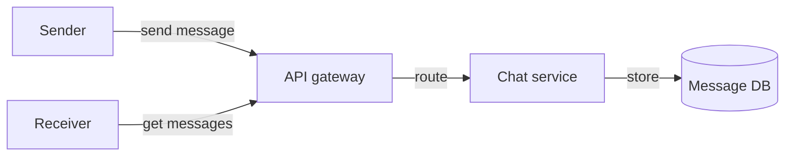
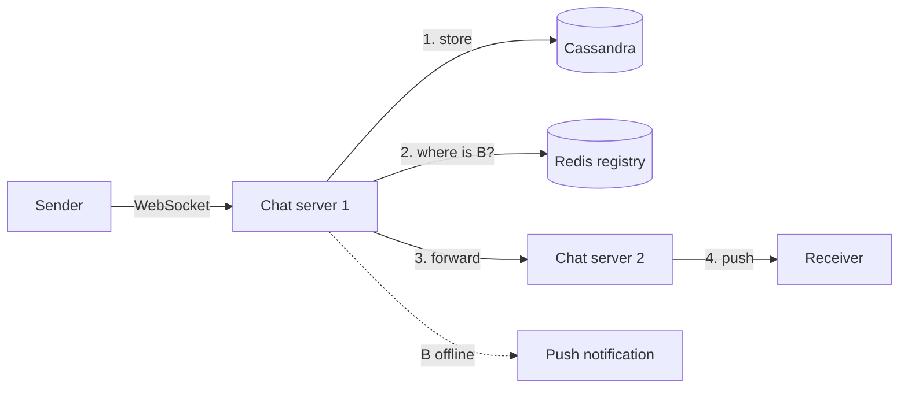

# 26. Design WhatsApp (Chat App)

Users send messages to one person or a group. If the receiver is offline, they get the messages later.

## Step 1: FR

- User should be able to send and receive messages in a one-to-one chat.
- User should be able to create a group and message it.
- User should be able to get messages that were sent while they were offline.

**Out of scope:** Calls, media, read receipts, last seen, encryption.

## Step 2: NFR

- **CAP:** AP. Chat must keep working. A message arriving a moment late is fine.
- **Latency:** An online receiver gets a message in under 500 ms.

## Step 3: Estimates

| Quantity | Calculation | Result |
|----------|-------------|--------|
| DAU | | 1 billion (10^9) |
| Users per second | 10^9 / 10^5 | 10^4 |
| Write QPS (peak) | 10^4 × 40 messages × 5 | 2M per second |
| Read QPS (peak) | Each message is read about once | 2M per second |

Read : write is 1 : 1. 2M writes per second is far more than one Postgres can take.

## Step 4: Entities

- **User:** `id`, `name`
- **Chat:** `id`, `type` (one-to-one or group), `members`
- **Message:** `id`, `chat_id`, `sender_id`, `content`, `created_at`

## Step 5: APIs

- `POST /chats {memberIds}` returns `{chatId}`
- `POST /chats/{chatId}/messages {content}` returns `{messageId}`
- `GET /chats/{chatId}/messages` returns the messages

## Step 6: Basic diagram

The chat service stores each message. The receiver reads them from the DB. For a group, the chat service reads the member list and stores one message for the chat. With this design, FRs are satisfied.

## Step 7: Problems

**1. The receiver keeps asking "anything new?"** Polling wastes calls. Both sides send at any time. Fix: each user keeps a **WebSocket** open. The server pushes new messages.

**2. The sender and receiver are on different chat servers.** A WebSocket stays on one server. Fix: a **registry** in Redis: `user: server`. The sender's server looks up the receiver's server and forwards the message.

**3. The receiver is offline.** Fix: the message stays in the DB. A **push notification** wakes the phone. On reconnect, the app fetches missed messages.

**4. 2M writes per second.** Fix: use **Cassandra**. It handles heavy writes. Keep each chat's messages together (partition by `chat_id`).

> **Interview:** Say "WebSockets for live messages, a Redis registry to find the receiver's server, and Cassandra for heavy writes".

## Likely questions

- **Why WebSocket, not polling?** Polling wastes calls. With a WebSocket the server pushes at once.
- **How does a message reach a user on another server?** Look up their server in Redis, then forward.
- **What if the receiver is offline?** The message waits in the DB. A push notification tells the phone.
- **Why Cassandra, not Postgres?** 2M writes per second. Cassandra handles heavy writes.
