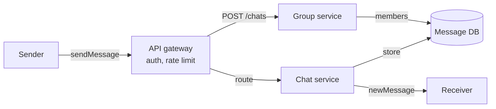
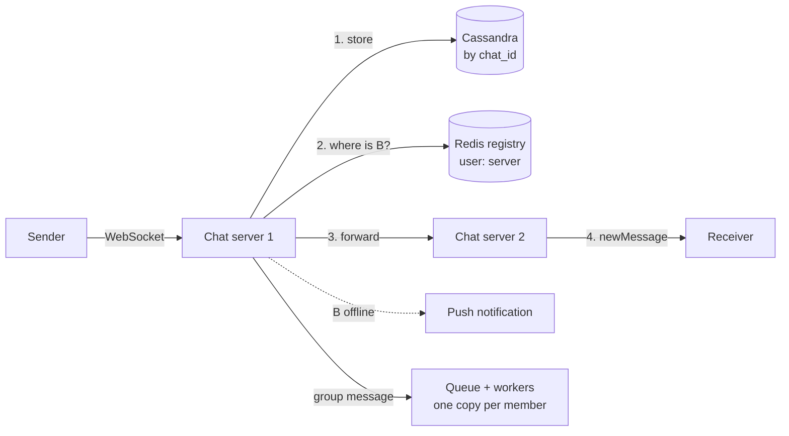

# 26. Design WhatsApp (Chat App)

Users send messages to one person or a group. Online users get them at once. Offline users get them later.

## Step 1: FR

- User should be able to send and receive messages in a one-to-one chat.
- User should be able to create a group (up to 100 members) and message it.
- User should be able to receive messages sent while they were offline.
- User should be able to see message status: sent, delivered, read.

**Out of scope:** Calls, stories, media, end-to-end encryption, search.

## Step 2: NFR

- **CAP:** AP. Chat must keep working. A message arriving a moment late is fine.
- **Latency:** An online receiver gets a message in under 500 ms.
- **Durability:** A message the server accepted is never lost.
- **Ordering:** Every member sees a chat's messages in the same order.

## Step 3: Estimates

| Quantity | Calculation | Result |
|----------|-------------|--------|
| DAU | | 1 billion (10^9) |
| Users per second | 10^9 / 10^5 | 10^4 |
| Write QPS (peak) | 10^4 × 40 messages × 5 | 2M per second |
| Read QPS (peak) | Each message read about once | About 2M per second (1 : 1) |
| Connections | Half of DAU online at peak | 500M |

- **2M writes per second:** One Postgres cannot take it. Use Cassandra.
- **500M connections:** About 1M per server, so 500+ stateful chat servers.

## Step 4: Entities

- **User:** `id`, `phone`, `last_seen`
- **Chat:** `id`, `type` (direct or group), `members`
- **Message:** `message_id`, `chat_id`, `sender_id`, `content`, `created_at`
- **Inbox:** `user_id`, `message_id`, `status` (sent, delivered, read)

## Step 5: APIs

**REST:**

- `POST /chats {participantIds, name?}` returns `{chatId}`
- `GET /chats/{chatId}/messages?cursor=&limit=` returns `Message[]`
- `GET /inbox?after={lastMessageId}` returns undelivered messages

**WebSocket messages:**

- `sendMessage {chatId, clientMessageId, content}` (client to server)
- `newMessage {chatId, messageId, senderId, content}` (server to client)
- `ackDelivered {messageIds}` and `markRead {chatId, upToMessageId}` (client to server)

## Step 6: Basic diagram

The chat service stores each message, then sends it to the receiver. If the receiver is offline, it stays in their inbox until they sync. With this design, FRs are satisfied.

## Step 7: Problems

**1. The receiver must get messages live.** Polling every few seconds wastes calls. Both sides send at any time. Fix: a **WebSocket** per user.

**2. WebSocket servers are stateful.** The sender and receiver sit on different chat servers. Fix: a **registry** in Redis (`user: server`). The sender's server looks up the receiver's server and forwards the message.

**3. The receiver is offline.** Fix: keep the message in the inbox. Send a push notification. On reconnect, the app calls `GET /inbox`.

**4. A server crashes before delivery.** Fix: store in the DB first, then reply `messageAck` (one tick). The client resends with the same `clientMessageId`. The server drops the duplicate.

**5. A group message needs 100 copies.** Fix: a **queue + workers**. Store the message once. Workers put one delivery per member on the queue.

**6. 2M writes per second.** Fix: **Cassandra**, partitioned by `chat_id`. All messages of one chat sit together.

**7. Messages arrive out of order.** Phone clocks cannot be trusted. Fix: the server gives each message an id that grows within a chat. The app sorts by it.

| Part | How it scales |
|------|---------------|
| Chat servers | Add servers. Clients reconnect on failure. |
| Registry | Redis cluster, sharded by `user_id` |
| Group delivery | Add workers |
| Message DB | Cassandra, add nodes |

> **Interview:** The hard parts are routing between stateful servers and group fan-out. Say "WebSockets, a Redis registry of user to server, store before ack, and Cassandra by chat_id".

## Likely questions

- **Why WebSocket, not SSE?** Both sides send at any time. SSE only pushes from the server.
- **How does a message reach a user on another server?** Look up their server in the Redis registry, then forward.
- **What if the receiver is offline?** The message waits in their inbox. A push notification wakes the phone.
- **How do you avoid losing a message?** Store it before the ack. The client resends with the same id.
- **Why Cassandra?** 2M writes per second, append only. It partitions by `chat_id`.
