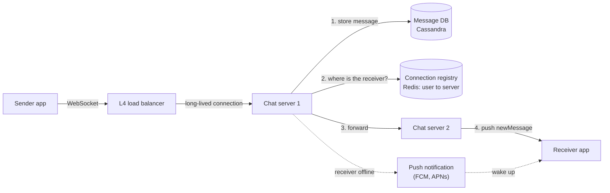
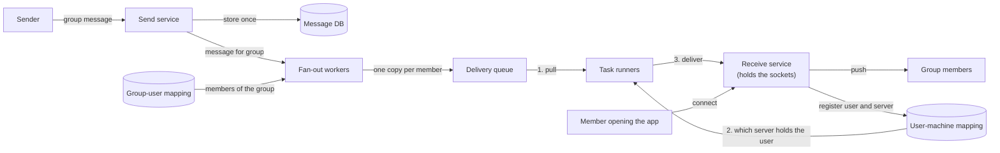

# 26. Design WhatsApp (Chat App)

Users send text messages to one person or to a group. Messages arrive in real time and are delivered later if the receiver is offline.

## Step 1: Functional requirements

| Core | Below the line (out of scope) |
|------|-------------------------------|
| Users can send and receive messages in a one-to-one chat, in real time | Voice and video calls |
| Users can create group chats (up to 100 members) and message the group | Stories (status), channels |
| Users receive messages that were sent while they were offline | End-to-end encryption details |
| Users see message status: sent, delivered, read | Search, message editing |
| | Media is covered briefly in deep dive 6 |

## Step 2: Non-functional requirements

| NFR | Target |
|-----|--------|
| Latency | An online receiver gets a message in under 500 ms |
| Durability | A message the server has acknowledged is never lost |
| Ordering | Messages in one chat appear in the same order for every member |
| CAP | AP. Keep chatting during a partition. Order and no loss within a chat matter more than instant global consistency. |
| Scale | 1 billion DAU |

### Estimation

| Quantity | Calculation | Result |
|----------|-------------|--------|
| Messages per day | 10^9 users × 40 messages | 4 × 10^10 |
| Messages per second (average) | 4 × 10^10 / 10^5 s | 400,000 |
| Peak | 2× average | 800,000 per second |
| Storage per day | 4 × 10^10 × 100 B | 4 TB |
| Kept on the server | Until delivered, plus 30 days | About 120 TB |
| Concurrent connections | Half of DAU online at peak | 500 million |
| Chat servers | About 1 million connections per tuned server | 500+ servers |
| Bandwidth | 800,000 × 100 B | 80 MB/s, plus group fan-out |

The number of open connections is the hardest number here, not storage.

## Step 3: Entities

| Entity | Key fields |
|--------|------------|
| User | `id`, `phone`, `last_seen` |
| Chat | `id`, `type` (direct or group), `name` |
| ChatParticipant | `chat_id`, `user_id`, `role` (admin or member) |
| Message | `message_id`, `chat_id`, `sender_id`, `content`, `created_at` |
| Inbox (delivery) | `user_id`, `message_id`, `status` (sent, delivered, read) |
| Connection | `user_id`, `server_id` (which chat server holds the user's socket) |

## Step 4: APIs

Messages flow both ways, all the time. So the client keeps a **WebSocket** open (topic 16). REST is used for the rest.

### WebSocket messages

| Direction | Message | Fields |
|-----------|---------|--------|
| Client to server | `sendMessage` | `chatId`, `clientMessageId`, `content` |
| Server to client | `messageAck` | `clientMessageId`, `messageId`, `createdAt` (status: sent) |
| Server to client | `newMessage` | `chatId`, `messageId`, `senderId`, `content`, `createdAt` |
| Client to server | `ackDelivered` | `messageIds` |
| Client to server | `markRead` | `chatId`, `upToMessageId` |
| Server to client | `statusUpdate` | `messageId`, `status` (delivered or read) |

### REST

| Purpose | API | Response |
|---------|-----|----------|
| Create a chat or group | `POST /chats`, body `{ participantIds, name? }` | `201 { chatId }` |
| Add a group member | `POST /chats/{chatId}/participants`, body `{ userId }` | `200` |
| Load history | `GET /chats/{chatId}/messages?cursor={cursor}&limit={n}` | `Message[]` |
| Sync after reconnect | `GET /inbox?after={lastMessageId}` | Undelivered messages |

- **`clientMessageId`:** Made on the phone. If the client resends after a network drop, the server sees the same id and does not store the message twice (idempotency, topic 13).

## Step 5: High-level design

1. **Connect:** On app open, the client opens a WebSocket to a chat server. The server records `user: server` in the connection registry.
2. **Send:** The sender's chat server stores the message (durable first). It replies `messageAck` (one tick).
3. **Route:** It looks up the receiver's server in the registry and forwards the message there.
4. **Deliver:** The receiver's server pushes `newMessage`. The receiver replies `ackDelivered` (two ticks).
5. **Offline:** If the receiver has no connection, the message stays in their inbox. A push notification wakes the phone. On reconnect, the app syncs the inbox.

With this design, all FRs are satisfied.

## Step 6: Deep dives

### Deep dive 1: routing between chat servers

The chat servers are **stateful**: each holds the open sockets of its users. The sender and receiver are usually on different servers.

| Option | How | Trade-off |
|--------|-----|-----------|
| Direct forward | Look up the receiver's server in the registry. Call it directly. | Fast. The registry must stay correct as users reconnect. |
| Pub/sub per user | Each server subscribes to a channel for each connected user (Redis pub/sub). The sender's server publishes to `user:B`. | Simple routing. Fire and forget: if B is reconnecting, the publish is lost, so the inbox is still the source of truth. |
| Message queue + task runners | Put the message on a queue. Task runners look up the user's server and deliver. | Most robust. Retries are built in. Used for groups below. |

- **Registry cleanup:** Each entry has a TTL. The server refreshes it with heartbeats. A dead server's entries expire.
- **Inside a server:** Each server keeps a local map of `user_id: socket object` (a user-connection cache).

### Deep dive 2: group messages and fan-out

Every member of a group needs their own copy. This is **fan-out**.

- **Send and receive split:** A send service takes writes. A receive service holds the connections. Each scales on its own.
- **Store once:** The message body is stored once. Each member gets a small inbox entry that points to it.
- **Fan-out workers:** They read the group's member list and put one delivery task per member on the queue.
- **Task runners:** They look up the member's server and hand the message to it. If a member is offline, they trigger a push notification.
- **Cost:** A 100-member group turns one message into 100 deliveries. That is why the member limit exists. Very large groups (channels) use fan-out on read: members pull new messages instead.

### Deep dive 3: never losing a message

- **Store first, then ack:** The server writes to the DB before it sends `messageAck`. If the server crashes before the ack, the client resends with the same `clientMessageId`.
- **At-least-once delivery:** A message is removed from the inbox only after `ackDelivered`. A message may be delivered twice. The client drops duplicates by `messageId` (topic 13).
- **Write once, deliver from the log:** Writing to the DB and to the queue as two steps can fail halfway. Fix: write only to the DB. Change data capture (CDC, topic 14) reads the DB's log and feeds the delivery queue.

### Deep dive 4: ordering

- **The server orders:** Clocks on phones cannot be trusted. The server gives each message an id that grows over time within a chat (Snowflake, topic 21, or a per-chat sequence number).
- **Client sorts by id:** Even if two messages arrive out of order, the app shows them in id order.
- **One partition per chat:** In the DB, all messages of a chat share one partition and are sorted by `message_id`. This also avoids the consistent prefix problem (topic 18).

### Deep dive 5: storage

The load is write-heavy and append-only. Use **Cassandra** (an LSM-tree store, topic 17).

| Table | Partition key | Clustering key | Query |
|-------|---------------|----------------|-------|
| `messages` | `chat_id` | `message_id` (descending) | Latest messages of a chat |
| `inbox` | `user_id` | `message_id` | Undelivered messages of a user |

- **Replication:** n = 3 with quorum writes (topic 19). A message survives one node failing.
- **Retention:** Delete delivered messages after 30 days (a TTL on the row).

### Deep dive 6: media, presence and read receipts

- **Media:** The client uploads the photo straight to blob storage with a presigned URL (topic 8). The message carries only the URL and a thumbnail.
- **Presence (online, last seen):** The client sends a heartbeat every 30 s. Redis stores `user: last_seen` with a TTL. Contacts read it when they open the chat. Do not push presence to every contact on every change; it multiplies the load.
- **Read receipts:** `markRead` updates the inbox status. A `statusUpdate` goes back to the sender through the same routing.

### Does every part scale?

| Part | How it scales |
|------|---------------|
| Chat (receive) servers | 500+ stateful servers behind an L4 LB. Scale by adding servers. Clients reconnect on failure. |
| Connection registry | Redis cluster sharded by `user_id` |
| Fan-out and delivery | Queue partitioned by `user_id`. Add workers and task runners. |
| Message DB | Cassandra, partitioned by `chat_id`, add nodes for more capacity |

> **Interview:** The hard parts are routing between stateful servers and group fan-out. Say "WebSockets to chat servers, a Redis registry of user to server, store the message before the ack, at-least-once delivery with dedup by message id, and Cassandra partitioned by chat_id".
