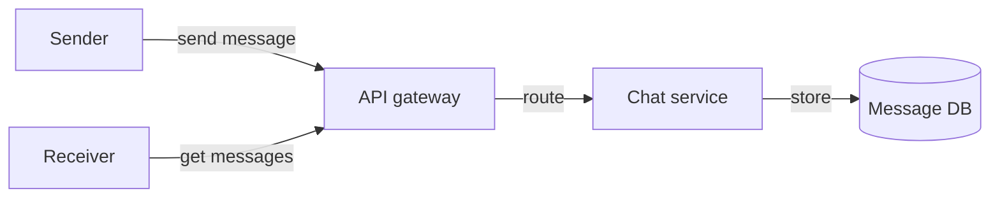
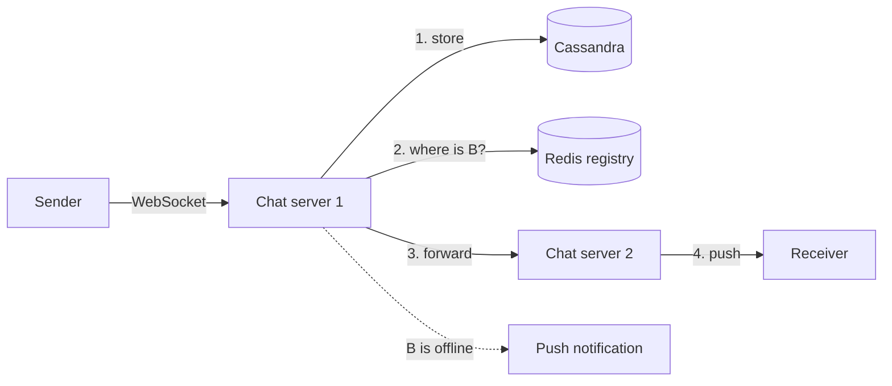

# 26. Design WhatsApp (Chat App)

Users send messages to one person or to a group. If the receiver is offline, they get the messages later.

## Step 1: FR

- User should be able to send and receive messages in a one-to-one chat.
- User should be able to create a group and send messages to it.
- User should be able to get the messages that were sent while they were offline.

Calls, media, read receipts, last seen and encryption are out of scope.

## Step 2: NFR

- **CAP:** We choose AP. Chat must keep working, and a message that arrives a moment late is fine.
- **Latency:** An online receiver gets a message in under 500 ms.

## Step 3: Estimates

| Quantity | Calculation | Result |
|----------|-------------|--------|
| DAU | | 1 billion (10^9) |
| Users per second | 10^9 / 10^5 | 10^4 |
| Write QPS at peak | 10^4 × 40 messages × 5 | 2M per second |
| Read QPS at peak | Each message is read about once. | 2M per second |

Reads and writes are about equal. 2M writes per second is far more than one Postgres server can take.

## Step 4: Entities

| Entity | Key fields |
|--------|------------|
| User | `id`, `name` |
| Chat | `id`, `type` (one-to-one or group), `members` |
| Message | `id`, `chat_id`, `sender_id`, `content`, `created_at` |

## Step 5: APIs

- `POST /chats {memberIds}` creates a chat and returns `{chatId}`.
- `POST /chats/{chatId}/messages {content}` sends a message and returns `{messageId}`.
- `GET /chats/{chatId}/messages` returns the messages of a chat.

## Step 6: Basic diagram

The chat service stores each message in the DB. The receiver reads new messages from the DB. A group is just a chat with many members, so it uses the same flow. With this design, FRs are satisfied.

## Step 7: Problems

**1. The receiver keeps asking "anything new?".** This is polling, and it wastes calls. In a chat, both sides send at any time. The fix is a WebSocket for each user, so the server pushes each new message at once.

**2. The sender and receiver are on different chat servers.** Each WebSocket stays open on one server. The fix is a registry in Redis. The sender's server looks up the receiver's server and forwards the message to it.

**3. The receiver is offline.** The message stays in the DB. A push notification wakes the phone. A push notification is a message sent through Apple or Google that reaches the phone even when the app is closed. When the app reconnects, it fetches the missed messages.

**4. The DB gets 2M writes per second.** The fix is Cassandra, because it handles heavy writes. All messages of one chat are stored together on the same node, so reading a chat is fast.

> **Interview:** Say "WebSockets carry live messages, a Redis registry finds the receiver's server, and Cassandra takes the heavy writes".

## Likely questions

- **Why WebSocket, not polling?** Polling wastes calls. With a WebSocket, the server pushes each message at once.
- **How does a message reach a user on another server?** The sender's server looks up the receiver's server in Redis and forwards the message.
- **What if the receiver is offline?** The message waits in the DB, and a push notification tells the phone.
- **Why Cassandra, not Postgres?** There are 2M writes per second, and Cassandra is built for heavy writes.
