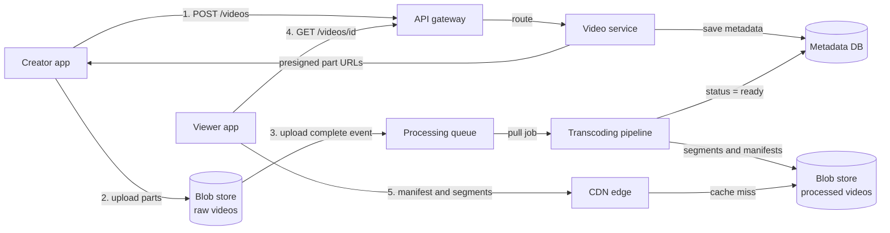
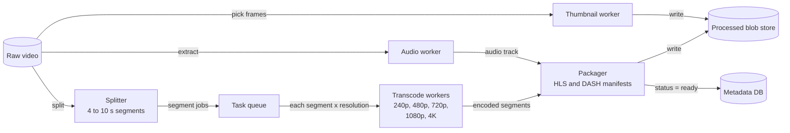
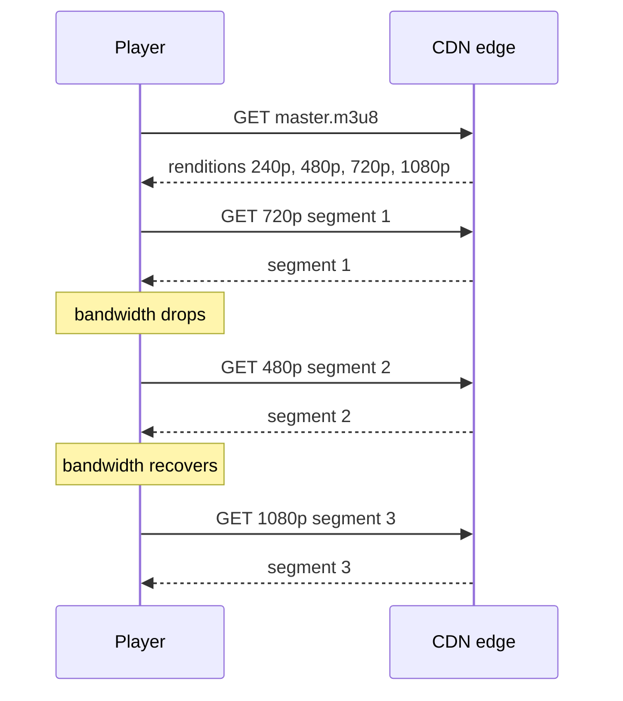

# 27. Design YouTube (Video Upload and Streaming)

Creators upload videos. Viewers anywhere watch them with little buffering, on any network.

## Step 1: Functional requirements

| Core | Below the line (out of scope) |
|------|-------------------------------|
| Users can upload a video with a title and description | Comments, likes, subscriptions |
| Users can watch (stream) a video | Recommendations and the home feed |
| Users can see a video's details (title, uploader, views) | Search |
| | Live streaming, ads, monetisation |

## Step 2: Non-functional requirements

| NFR | Target |
|-----|--------|
| CAP | AP. A new video may appear a few seconds late. View counts may lag. Watching must always work. |
| Latency | Playback starts in under 2 s. Little or no buffering. |
| Network | Adapt quality to each viewer's bandwidth, from 2G phones to 4K TVs |
| Uploads | Support large files (up to 256 GB) and resume after a dropped connection |
| Scale | 1 billion DAU. 500 hours of video uploaded every minute. |
| Durability | An uploaded video is never lost |

### Estimation

| Quantity | Calculation | Result |
|----------|-------------|--------|
| Views per day | 10^9 DAU × 5 videos | 5 × 10^9 |
| Views per second (average) | 5 × 10^9 / 10^5 s | 50,000 |
| Peak views per second | 2× average | 100,000 |
| Read : write | 5 × 10^9 views vs about 3 × 10^6 uploads per day | Very read-heavy |
| Video uploaded per day | 500 h × 60 × 24 | 720,000 hours |
| Storage per day | 720,000 h × about 5 GB per hour (all resolutions) | About 3.6 PB |
| Concurrent viewers | 5 × 10^9 views × 5 min / 1,440 min | About 17 million |
| Egress bandwidth | 17 million × 5 Mbps | About 85 Tbps |

85 Tbps cannot come from one data center. A CDN is required (topic 10).

## Step 3: Entities

| Entity | Key fields |
|--------|------------|
| User | `id`, `name` |
| Video | `id`, `uploader_id`, `title`, `description`, `status` (uploading, processing, ready, failed), `duration`, `manifest_url`, `created_at` |
| Upload | `upload_id`, `video_id`, `parts_done` (for resuming) |
| Rendition | `video_id`, `resolution` (240p to 4K), `codec`, `segment_path` |

## Step 4: APIs

**1. Start an upload:**

```
POST /videos
Body:     { "title", "description", "sizeBytes", "contentType" }
Response: 201 { "videoId", "uploadId", "partUrls": ["https://blob/...part1?sig=...", ...] }
```

**2. Upload the parts** straight to blob storage, not through our servers:

```
PUT https://blob/...partN?sig=...   (body: 100 MB of the file)
Response: 200 { "etag" }
```

**3. Finish the upload:**

```
POST /videos/{videoId}/complete
Body:     { "uploadId", "parts": [{ "partNumber", "etag" }] }
Response: 202 { "status": "processing" }
```

**4. Watch:**

```
GET /videos/{videoId}
Response: 200 { "title", "uploader", "views", "manifestUrl": "https://cdn/.../master.m3u8" }
```

The player then fetches the manifest and the video segments from the CDN.

- **Presigned URLs:** The upload URLs are signed and expire. The client uploads directly to the blob store (topic 8). Our servers never carry the video bytes.
- **202 Accepted:** Processing takes minutes. The server accepts the job and finishes later.

## Step 5: High-level design



1. **Upload:** The video service stores the metadata with status `uploading`. It returns presigned URLs. The client uploads the parts to the raw blob store.
2. **Process:** The blob store emits an event. A job goes on the processing queue. The transcoding pipeline makes every resolution and writes them to the processed blob store. It sets the status to `ready`.
3. **Watch:** The viewer gets the metadata and the manifest URL. The player streams segments from the nearest CDN edge. On a miss, the CDN fetches from the processed blob store.

With this design, all FRs are satisfied.

## Step 6: Deep dives

### Deep dive 1: large, resumable uploads

A 50 GB upload over one HTTP request fails if the network drops for a second.

- **Multipart upload:** The client splits the file into parts (for example 100 MB). Each part is uploaded on its own, several in parallel.
- **Resume:** If a part fails, only that part is retried. The server records which parts are done, so the upload continues after the app restarts.
- **Complete:** The client sends the list of parts. The blob store joins them into one object.
- **Checksums:** Each part carries a hash. The blob store rejects a corrupted part.

### Deep dive 2: the transcoding pipeline

A raw upload is one big file in one format. Phones, laptops and TVs need different resolutions and codecs.

- **Transcoding:** Converting a video into another resolution, bitrate or codec (H.264, VP9, AV1).
- **Segments:** Split the video into short segments of 4 to 10 s. Transcode each segment separately. Then thousands of workers work on one video in parallel.



- **Pipeline as a DAG:** An orchestrator tracks which tasks depend on which. The packager starts only when all segments of all resolutions are done.
- **Queues between stages:** Each stage reads from a queue (topic 13). A failed task is retried. A task that keeps failing goes to a dead-letter queue.
- **Fast first:** Produce 480p first and mark the video watchable. Higher resolutions follow.

### Deep dive 3: adaptive bitrate streaming

The player must change quality as the viewer's network changes.

- **HLS (Apple) and DASH:** Streaming over plain HTTP. The video is a list of small segment files.
- **Master manifest:** Lists every rendition (240p at 0.4 Mbps, 720p at 3 Mbps, 1080p at 5 Mbps, and so on).
- **Per-rendition manifest:** Lists that rendition's segment URLs in order.
- **The player decides:** Before each segment, it measures its bandwidth and buffer. It fetches the next segment from the rendition that fits.



- **Fast start:** The first segment is fetched at a low quality, so playback starts in under 2 s.
- **Seeking:** Jump to minute 10 means fetching segment 10 × 60 / 6 = 100 (6 s segments). No need to download the earlier part.

### Deep dive 4: serving at 85 Tbps with a CDN

- **Popular videos:** A small share of videos gets most of the views. Push them to CDN edges near viewers ahead of time.
- **Long tail:** Rarely watched videos are served from the origin blob store, or pulled into the CDN on the first request.
- **Cost:** CDN egress is the biggest bill. Keep only the renditions that are actually watched on the edges.
- **Edge in ISPs:** Very large platforms put cache servers inside internet providers' networks (YouTube's Google Global Cache, Netflix Open Connect).

### Deep dive 5: metadata and view counts

| Part | Choice |
|------|--------|
| Metadata DB | Read-heavy, simple lookups by `video_id`. Shard by `video_id` (topic 12). Add read replicas. |
| Metadata cache | Redis in front, cache-aside (topic 11). Hot videos are served from cache. |
| View counts | 100K views per second. Do not update one row per view. Send view events to Kafka. A stream job adds them up and writes the total every few seconds. The count lags a little. That is fine for AP. |

### Does every part scale?

| Part | How it scales |
|------|---------------|
| Video service | Stateless. Never touches video bytes. |
| Blob stores | Object storage (S3) scales to exabytes. 3.6 PB per day is fine. |
| Transcoding | Add workers. Segments make the work parallel. Use spot machines for cost. |
| Delivery | CDN. The origin sees only cache misses. |

> **Interview:** The hard parts are processing and delivery. Say "presigned multipart uploads straight to blob storage, a segment-level transcoding DAG fed by queues, HLS or DASH adaptive bitrate, and a CDN for the read path".
