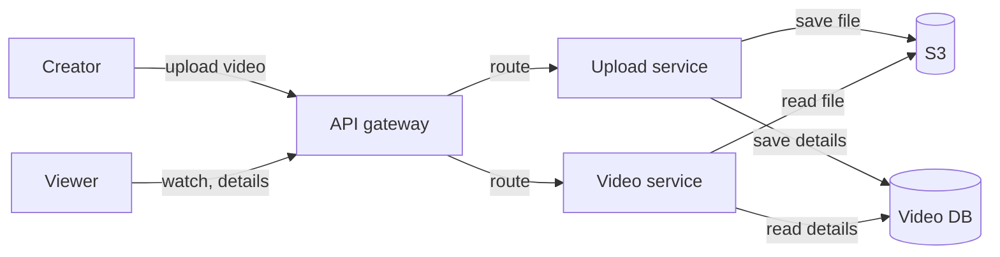
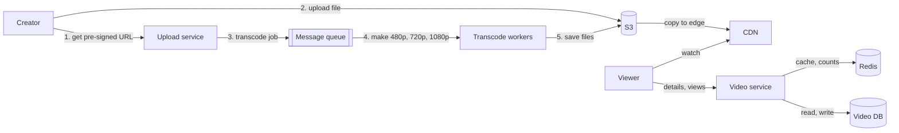

# 27. Design YouTube (Video Upload and Streaming)

Creators upload videos, and viewers watch them on any device and any network. Videos are big and are watched far more often than they are uploaded.

## Step 1: FR

- User should be able to upload a video with a title and a description.
- User should be able to watch a video.
- User should be able to see a video's details, such as its title, uploader and view count.

Comments, likes, subscriptions, recommendations, search and live streaming are out of scope.

## Step 2: NFR

- **CAP:** We choose AP ([CAP](14-cap-theorem.md)). Watching must always work, and a new video or a view count may show a few seconds late.
- **Latency:** A video starts playing in under 2 seconds.

## Step 3: Estimates

| Quantity | Calculation | Result |
|----------|-------------|--------|
| DAU | | 1 billion (10^9) |
| Users per second | 10^9 / 10^5 | 10^4 |
| Write QPS at peak | 10^4 × 0.01 uploads × 5 | 500 per second |
| Read QPS at peak | 10^4 × 5 videos × 5 | 250K per second |

Reads are 500 times the writes, so the system is read heavy. A 1-minute video is about 20 to 50 MB, so a 10-minute video can be 500 MB.

## Step 4: Entities

| Entity | Key fields |
|--------|------------|
| User | `id`, `name` |
| Video | `id`, `uploader_id`, `title`, `description`, `status`, `views`, `created_at` |
| Video file | `video_id`, `resolution`, `s3_url` |

## Step 5: APIs

- `POST /videos {title, description}` creates a video and returns `{videoId}`.
- `GET /videos/{videoId}/play` returns the URLs of the video files.
- `GET /videos/{videoId}` returns the title, the uploader and the view count.

## Step 6: Basic diagram

The upload service saves the video file in [blob storage](08-rest-and-blob-storage.md) (S3) and its details in the DB. The video service reads the details from the DB and the file from S3. With this design, FRs are satisfied.

## Step 7: Problems

**1. Big files pass through the upload service.** A 500 MB file ties up the server for minutes. The fix is a [pre-signed URL](08-rest-and-blob-storage.md), so the client writes the file straight to S3. The upload service only creates the link and saves the details.

**2. One video file does not play well on every network.** A phone on a slow network cannot play a 1080p file without pauses. The fix is transcoding. Transcoding converts a video into other formats and resolutions, such as 480p, 720p and 1080p. After an upload, a job goes on a [message queue](13-message-queues.md), and workers make each resolution. The player picks the resolution that suits the viewer's network.

**3. Viewers far from the data center wait too long.** 250K big reads per second from one region is slow and costly. The fix is a [CDN](10-caching-and-cdn.md). It serves the video files from an edge server near the viewer, which takes 25 to 35 ms instead of 250 to 350 ms.

**4. Every view writes the view count to the DB.** That is 250K writes per second on the video rows. The fix is to count views in [Redis](07-storing-data-and-redis.md) and copy the totals to the DB every minute. Redis also caches the video details, so most detail reads never reach the DB.

> **Interview:** Say "uploads go straight to S3, workers transcode each video, and a CDN serves it near the viewer".

## Likely questions

- **Why not upload through the server?** Video files are hundreds of MB. A pre-signed URL lets the client send them straight to S3.
- **How does a viewer on a slow network watch?** Workers make the video in many resolutions. The player picks a low one on a slow network.
- **Why a CDN?** There are 250K reads per second of big files. An edge server near the viewer is about 10 times faster and takes the load off the origin.
- **How do you count 250K views per second?** Count the views in Redis, and copy the totals to the DB every minute.
