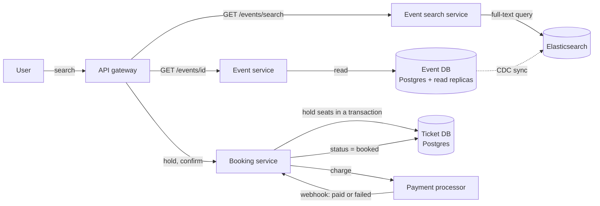
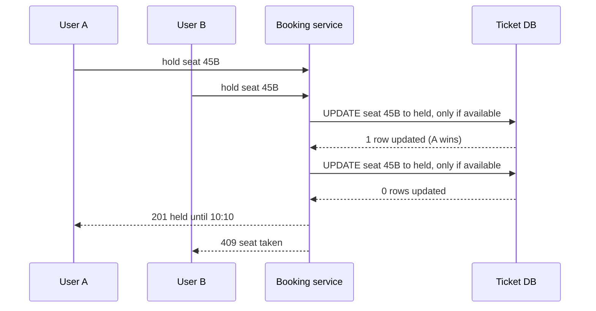
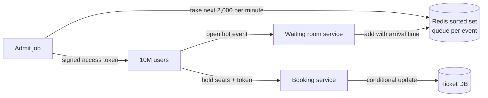

# 28. Design Ticketmaster (Event Ticket Booking)

Users find concerts and matches, pick seats, and pay. Popular events sell out in minutes, with millions of users trying at once.

## Step 1: Functional requirements

| Core | Below the line (out of scope) |
|------|-------------------------------|
| Users can search for events (by name, city, date) | Organisers creating events |
| Users can view an event and its available seats | Ticket resale, dynamic pricing |
| Users can book tickets: hold seats, then pay | Email and SMS notifications |
| | Refunds |

## Step 2: Non-functional requirements

| NFR | Target |
|-----|--------|
| CAP | **CP for booking:** a seat must never be sold twice. **AP for search and browsing:** stale results for a few seconds are fine. |
| Latency | Search under 500 ms |
| Spikes | A popular event: 10 million users arrive in the first minutes for 50,000 seats |
| Scale | 10 million DAU on normal days |
| Fairness | Users who arrive first should get the first chance during a spike |

### Estimation

| Quantity | Calculation | Result |
|----------|-------------|--------|
| Normal requests | 10^7 DAU × 20 requests / 10^5 s | 2,000 per second |
| Read : write | Many searches and views per booking | About 100 : 1 |
| Spike | 10^7 users, each refreshing every few seconds | Millions of requests per second on one event |
| Seats per event | | 50,000 |
| Storage | 10^5 events a year × 50,000 seats × 100 B | 500 GB a year. Small. |

Storage is small. The hard part is the spike on a single event.

## Step 3: Entities

| Entity | Key fields |
|--------|------------|
| Event | `event_id`, `name`, `city`, `venue_id`, `date`, `performer` |
| Venue | `venue_id`, `name`, `seat_map` (sections and rows) |
| Seat (ticket) | `event_id`, `section_id`, `seat_number`, `price`, `status` (available, held, booked), `held_until` |
| Inventory (general admission) | `event_id`, `section_id`, `quantity` left |
| Order (booking) | `order_id`, `request_id`, `user_id`, `event_id`, `seats`, `status` (held, confirmed, expired), `payment_id` |

- **Individual seating:** Each seat is a row with its own status.
- **General admission:** No seat numbers. Only a count per section is kept (for example VIP: 7,000).

## Step 4: APIs

| Purpose | API | Response |
|---------|-----|----------|
| Search events | `GET /events/search?q={q}&city={c}&date={d}&cursor={x}` | `Event[]` |
| View an event | `GET /events/{eventId}` | Event, venue and seat map with status |
| Hold seats | `POST /events/{eventId}/holds`, body `{ seatIds, requestId }` | `201 { orderId, expiresAt }` or `409 Conflict` if a seat is taken |
| Pay and confirm | `POST /orders/{orderId}/confirm`, body `{ paymentToken }` | `200 { status: "confirmed" }` |
| Live seat updates | WebSocket or SSE on `/events/{eventId}/seats` | Seat status changes |

- **Two steps:** Hold first, then pay. Payment takes time. The hold keeps the seats safe meanwhile.
- **`requestId`:** Made by the client. A retried request with the same id returns the same order, not a second one (idempotency).
- **`paymentToken`:** Card details go straight to the payment processor (for example Stripe). Our servers only see a token.

## Step 5: High-level design



1. **Search:** The search service queries Elasticsearch. Event data flows from Postgres to Elasticsearch through CDC (topic 14).
2. **View:** The event service reads the event and seat map from read replicas.
3. **Hold:** The booking service marks the chosen seats `held` with an expiry, in one transaction.
4. **Pay:** The booking service calls the payment processor. On success, the seats become `booked` and the order is `confirmed`.

With this design, all FRs are satisfied.

## Step 6: Deep dives

### Deep dive 1: never selling a seat twice

Two users click the same seat at the same moment. Both must not succeed.

| Option | How | Trade-off |
|--------|-----|-----------|
| Pessimistic lock | `SELECT ... FOR UPDATE` on the seat rows, then update | Correct. Locks are held during the whole payment. Under a spike, threads wait and pile up. |
| Status + expiry column | `UPDATE seats SET status = 'held', held_until = now() + 10 min WHERE event_id = ? AND seat_number IN (...) AND (status = 'available' OR held_until < now())` | Correct. No long locks. Expired holds free themselves. **Chosen.** |
| Redis lock with TTL | `SET hold:event:seat <orderId> NX EX 600` per seat | Very fast. Two systems must agree. Combine it with the DB check above. |

- **Check the row count:** If the `UPDATE` changed fewer rows than the seats asked for, one is taken. Roll back and return `409 Conflict`.
- **All or nothing:** Holding 4 seats is one transaction. The user gets all 4 or none.
- **Hold time:** 10 minutes to pay. After that, `held_until` has passed and the seat is available again. A background job also resets expired holds.



**General admission:** No seat rows. One atomic update on the count:

```sql
UPDATE inventory SET quantity = quantity - 2
WHERE event_id = 12345 AND section_id = 'VIP' AND quantity >= 2;
```

If 0 rows change, the section is sold out.

### Deep dive 2: surviving the spike with a virtual waiting room

10 million users hit one event. The Ticket DB cannot take millions of writes per second for one event.

- **Waiting room:** Users who open a hot event enter a queue instead of the booking page. A Redis sorted set stores `user: arrival time`.
- **Admit in batches:** A job lets in, for example, 2,000 users per minute. That is the rate the booking service can handle.
- **Show the position:** Users see "You are number 45,210 in line" through SSE or WebSocket (topic 16).
- **Token:** An admitted user gets a signed, short-lived token. The booking service rejects hold requests without one.
- **Fair:** First come, first served. Refreshing the page does not help.



### Deep dive 3: payment and idempotency

- **Order table:** Partitioned by `request_id` or `user_id`. A retry with the same `request_id` finds the existing order.
- **Webhook:** The payment processor calls back with "paid" or "failed". Task runners process these events. On "paid", seats become `booked`. On "failed", or when the hold expires, seats go back to `available`.
- **Payment after expiry:** If money arrives after the hold expired and the seat was resold, refund it automatically.

### Deep dive 4: live seat map

Thousands of users look at the same seat map. Seats turn grey as others hold them.

- **Change feed:** CDC on the Ticket DB puts each seat change on a queue.
- **Push:** The booking service pushes changes to every viewer of that event over WebSocket or SSE.
- **Fallback:** Without push, the client polls every few seconds. A `409` on hold is the final truth anyway.

### Deep dive 5: fast search

- **Elasticsearch:** An inverted index for full-text search on names and performers, with filters on city and date. Postgres `LIKE '%swift%'` cannot use an index.
- **Cache:** Popular searches and event pages are cached in Redis and on the CDN (topic 10).

### Does every part scale?

| Part | How it scales |
|------|---------------|
| Search, event services | Stateless. Read replicas, Elasticsearch replicas, caches. |
| Ticket DB | Shard by `event_id`. All seats of one event stay on one shard, so a multi-seat hold is one local transaction. |
| Hot event | Protected by the waiting room, not by more DB nodes |
| Booking service | Stateless. Scales behind the LB. |

> **Interview:** The hard parts are double booking and the spike. Say "hold seats with a conditional update and an expiry, in one transaction", "general admission as an atomic decrement", and "a virtual waiting room that admits users at the rate the booking service can take".
