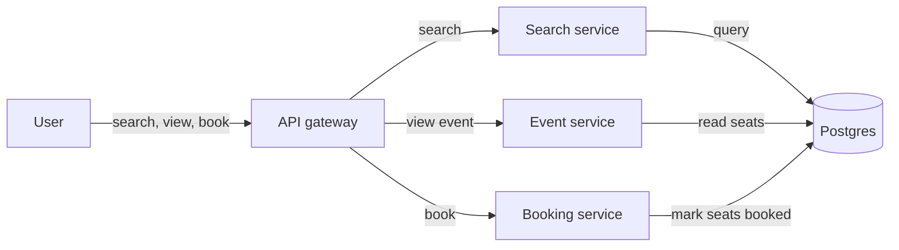
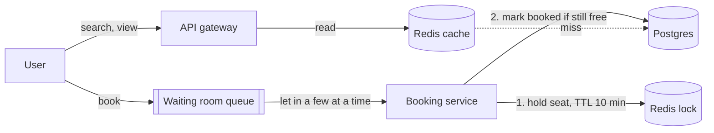

# 28. Design Ticketmaster (Event Ticket Booking)

Users find concerts and matches, pick seats, and book them. A popular event can sell out in minutes while millions of users try at once.

## Step 1: FR

- User should be able to search for events by name, city and date.
- User should be able to view an event and its free seats.
- User should be able to book seats for an event.

Organisers creating events, the payment itself, refunds, resale and notifications are out of scope.

## Step 2: NFR

- **CAP:** We choose CP for booking ([CAP](14-cap-theorem.md)). A seat must never be sold to two users. Search and the seat view may be a few seconds stale.
- **Latency:** Search returns results in under 500 ms.

## Step 3: Estimates

| Quantity | Calculation | Result |
|----------|-------------|--------|
| DAU | | 10 million (10^7) |
| Users per second | 10^7 / 10^5 | 100 |
| Read QPS at peak | 100 × 20 searches and views × 5 | 10K per second |
| Write QPS at peak | 100 × 0.1 bookings × 5 | 50 per second |

Reads are 200 times the writes, so the system is read heavy. One Postgres server can take 50 bookings per second. The hard part is a popular event, when 10 million users may come for 50,000 seats.

## Step 4: Entities

| Entity | Key fields |
|--------|------------|
| Event | `id`, `name`, `city`, `date`, `venue` |
| Seat | `id`, `event_id`, `number`, `status` (free, held or booked) |
| Booking | `id`, `user_id`, `event_id`, `seat_ids`, `status` |

## Step 5: APIs

- `GET /events?name=&city=&date=` returns the events that match.
- `GET /events/{eventId}` returns the event and the status of each seat.
- `POST /bookings {eventId, seatIds}` books the seats and returns `{bookingId}`.

## Step 6: Basic diagram

The search service and the event service read events and seats from Postgres. The booking service marks the chosen seats as booked. With this design, FRs are satisfied.

## Step 7: Problems

**1. Two users book the same seat at once.** Both see the seat as free, and both book it. The fix is to update the seat row only if its status is still free, inside a [transaction](09-data-modelling.md). If no row changes, another user got the seat first, and this user gets an error.

**2. The user needs time to pay.** If the seat stays free while they pay, someone else can take it. The fix is a hold. A hold is a [lock](16-interview-framework.md) on the seat in Redis with a [TTL](07-storing-data-and-redis.md) of 10 minutes. If payment succeeds, the booking service marks the seat booked in Postgres. If the TTL ends first, the lock goes away and the seat is free again.

**3. Search is slow on a large events table.** Every search scans many rows. The fix is an [index](09-data-modelling.md) on city and date, plus a [cache](04-performance-throughput-load-balancing.md) of popular searches and event pages in Redis.

**4. A popular event brings 10 million users at once.** The booking service and the DB cannot take that spike. The fix is a waiting room. Users join a [message queue](13-message-queues.md) in the order they arrive. The system lets in a few thousand users at a time, and the rest wait their turn.

> **Interview:** Say "a Redis lock with a TTL holds the seat, Postgres books it only if free, and a waiting room takes the spike".

## Likely questions

- **How do you stop two users booking the same seat?** Update the seat row only if it is still free. Only one update succeeds.
- **What if a user holds a seat and never pays?** The hold has a TTL of 10 minutes. When it ends, the seat is free again.
- **Why CP, not AP?** A seat sold twice means two people at one seat. Booking must be correct, even if it is briefly unavailable.
- **How do you handle a sudden spike?** A waiting room queue lets in a few thousand users at a time, in the order they arrived.
