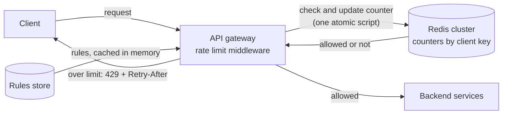
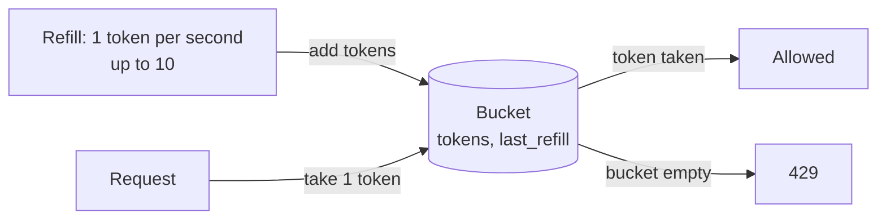
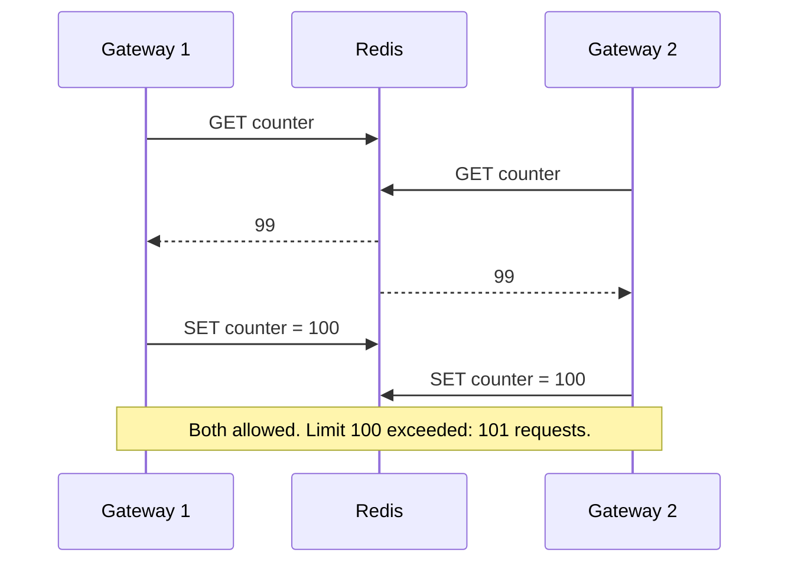

# 29. Design a Rate Limiter

A **rate limiter** caps how many requests a client can make in a time window, for example 100 requests per minute per user. Extra requests get `429 Too Many Requests`. It protects services from abuse, bugs in clients, and traffic spikes. It also enforces paid tiers. Topic 6 places it in the API gateway. This topic designs it.

## Step 1: Functional requirements

| Core | Below the line (out of scope) |
|------|-------------------------------|
| Limit requests per client by user id, IP or API key | Network-level DDoS protection (L3 and L4) |
| Rules per endpoint and per tier (for example `POST /messages`: 20 per minute for free users) | Billing and monthly quotas |
| Reject over-limit requests with `429` and tell the client when to retry | A UI for editing rules |

## Step 2: Non-functional requirements

| NFR | Target |
|-----|--------|
| Latency | Under 10 ms added to each request (ideally about 1 ms) |
| Availability | Very high. If the limiter fails, requests must still flow (fail open). |
| CAP | AP. Letting a few extra requests through during a partition is acceptable. Blocking all traffic is not. |
| Accuracy | Close to exact across many gateway servers |
| Scale | 100 million DAU, 1 million requests per second at peak |

### Estimation

| Quantity | Calculation | Result |
|----------|-------------|--------|
| Checks per second | One per request | 1 million at peak |
| Memory per client | Key + counter + timestamp | About 100 B |
| Memory for all clients | 10^8 × 100 B | 10 GB. Fits in a Redis cluster. |
| Redis nodes | About 100,000 simple operations per second per node | 10+ nodes, sharded by client key |

## Step 3: Entities

| Entity | Key fields |
|--------|------------|
| Rule | `id`, `endpoint`, `key_type` (user, IP, API key), `tier`, `limit`, `window` |
| Counter (bucket) | `key` (for example `rl:user_42:POST:/messages`), `count` or `tokens`, `last_refill` |

## Step 4: APIs

The limiter is internal. The gateway calls it before every request.

```
isAllowed(clientKey, endpoint) -> { allowed, limit, remaining, resetAt }
```

The client sees standard responses:

```
HTTP/1.1 429 Too Many Requests
X-RateLimit-Limit: 100
X-RateLimit-Remaining: 0
X-RateLimit-Reset: 1735689660
Retry-After: 30
```

- **Headers on every response:** Even allowed responses carry `X-RateLimit-Remaining`. Good clients slow down before they hit the limit.
- **Rules admin:** `PUT /rules/{ruleId}` with `{ limit, window }`, used by the platform team.

## Step 5: High-level design



1. The gateway finds the rule for this client and endpoint. Rules are loaded from the rules store and cached.
2. It runs one atomic check-and-update on the client's counter in Redis.
3. If allowed, the request goes on to the backend. If not, the gateway returns `429`.

**Why the gateway:** Every request passes through it. Limiting in each service repeats the logic. Limiting in the client cannot be trusted.

**Why Redis:** The counters must be shared by all gateway servers. Redis is in memory (sub-ms), has atomic operations and supports TTLs (topic 7).

With this design, all FRs are satisfied.

## Step 6: Deep dives

### Deep dive 1: the algorithms

| Algorithm | How | Pros | Cons |
|-----------|-----|------|------|
| Fixed window counter | One counter per window (for example per minute). `INCR`, reject above the limit. Reset each new window. | Simplest. One integer per client. | Allows bursts at window edges |
| Sliding window log | Store the timestamp of every request. Drop the ones older than the window. Count the rest. | Exact | Memory: one entry per request |
| Sliding window counter | Weighted mix of the current and previous fixed windows | Close to exact, little memory | An approximation |
| Token bucket | A bucket of tokens refills at a fixed rate. Each request takes one. Empty bucket means reject. | Allows short bursts up to the bucket size. Little memory. | Two settings to tune |
| Leaky bucket | Requests join a queue that drains at a fixed rate. A full queue means reject. | Perfectly smooth output | Bursts wait in the queue, adding latency |

**Fixed window edge problem:** Limit 100 per minute. A client sends 100 requests at 10:00:59 and 100 more at 10:01:00. Both windows allow them. The backend sees 200 requests in 2 s.

**Sliding window counter formula:**

```
estimate = current_count + previous_count × (1 - time_into_current_window / window)
```

Limit 100 per minute. Previous minute had 80. Now it is 15 s into this minute with 30 so far. Estimate = 30 + 80 × (1 - 15/60) = 30 + 60 = 90. Allowed.

**Token bucket example:** Bucket size 10, refill 1 token per second.

| Time | Tokens before | Requests | Result | Tokens after |
|------|---------------|----------|--------|--------------|
| 0 s | 10 | 8 | All allowed (burst) | 2 |
| 1 s | 2 + 1 = 3 | 5 | 3 allowed, 2 rejected | 0 |
| 5 s | 0 + 4 = 4 | 1 | Allowed | 3 |



- **Lazy refill:** No timer runs. On each request, compute `tokens = min(size, tokens + (now - last_refill) × rate)`.
- **Used by:** Token bucket is the most common choice (Amazon API Gateway, Stripe). It allows a natural burst while keeping the average rate.

### Deep dive 2: race conditions in a distributed limiter

Two gateway servers check the same client at the same time:



**Fix:** Make read-check-update one atomic step.

- **Fixed window:** `INCR` is atomic. Use its return value. Set `EXPIRE` when the counter is created.
- **Token bucket:** Run the whole refill-and-take logic as a Lua script. Redis runs a script as one step, with nothing in between.

```lua
-- KEYS[1] = bucket key, ARGV = size, rate, now
local b = redis.call('HMGET', KEYS[1], 'tokens', 'ts')
local tokens = tonumber(b[1]) or tonumber(ARGV[1])
local ts = tonumber(b[2]) or tonumber(ARGV[3])
tokens = math.min(tonumber(ARGV[1]), tokens + (tonumber(ARGV[3]) - ts) * tonumber(ARGV[2]))
local allowed = tokens >= 1
if allowed then tokens = tokens - 1 end
redis.call('HSET', KEYS[1], 'tokens', tokens, 'ts', ARGV[3])
redis.call('EXPIRE', KEYS[1], 3600)
return allowed and 1 or 0
```

### Deep dive 3: latency and Redis failure

- **One round trip:** The script does everything in one call. Inside one data center, that is under 1 ms.
- **Shard by client key:** Use a Redis cluster. One client's counter lives on one node (topic 12).
- **Local pre-check (optional):** Each gateway keeps a small local counter and syncs with Redis every few hundred ms. Faster, slightly less accurate.
- **Fail open:** If Redis is down or slow (timeout about 5 ms), allow the request and log it. A short period without limits is better than a full outage.
- **Fail closed:** For sensitive endpoints, such as login attempts, reject when the limiter is down.

### Deep dive 4: rules and multiple regions

- **Rules:** Stored in a DB or config service. Gateways cache them in memory and refresh every minute. A rule change needs no deploy.
- **Several limits at once:** A request can face a per-user limit, a per-IP limit and a global limit for the endpoint. It must pass all.
- **Multiple regions:** Keep counters per region and give each region a share of the limit. Or sync counters between regions asynchronously and accept small overshoot (AP).

### Does every part scale?

| Part | How it scales |
|------|---------------|
| Gateways | Stateless. Add more behind the LB. |
| Counters | Redis cluster sharded by client key. 10 GB of memory. |
| Rules | Small, cached in every gateway |
| Hot client | One abusive key hits one Redis node. A local pre-check at the gateway absorbs most of its traffic. |

> **Interview:** State where the limiter runs (the gateway), which algorithm and why (token bucket for bursts, sliding window counter for accuracy), how the counter is shared (Redis with an atomic Lua script), and what happens when Redis is down (fail open).
