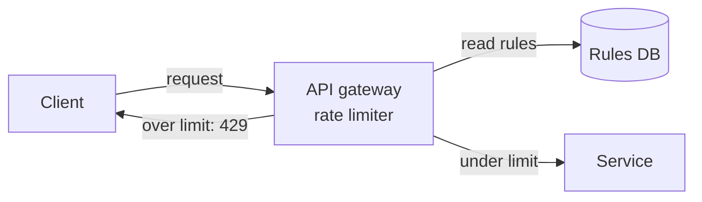
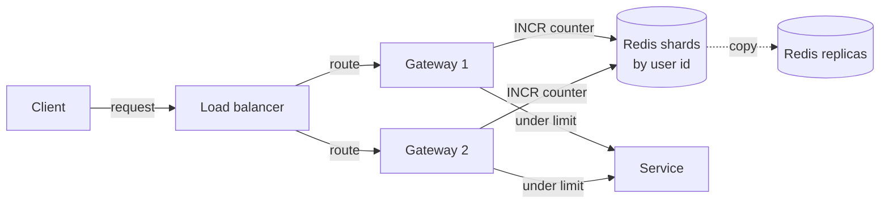

# 29. Design a Rate Limiter

A rate limiter caps how many requests a client can make in a time window, such as 100 requests per minute per user. It sits in the [API gateway](06-gateway-observability-maintainability.md) and protects the services from abuse and sudden spikes.

## Step 1: FR

- User (a service owner) should be able to set a limit for an endpoint, such as 100 requests per minute per user.
- User should be able to send requests that stay under the limit without being slowed down.
- User should be able to get a `429 Too Many Requests` reply with a retry time once they cross the limit.

Network-level attack protection, billing quotas and a screen for editing rules are out of scope.

## Step 2: NFR

- **CAP:** We choose AP ([CAP](14-cap-theorem.md)). If the limiter cannot reach its counters, requests still pass. A few extra requests are better than blocking everyone.
- **Latency:** The check adds under 10 ms to each request.

## Step 3: Estimates

| Quantity | Calculation | Result |
|----------|-------------|--------|
| DAU | | 100 million (10^8) |
| Users per second | 10^8 / 10^5 | 1,000 |
| Read QPS at peak | 1,000 × 200 requests × 5 | 1M checks per second |
| Write QPS at peak | Each check also adds one to a counter. | 1M per second |
| Memory | 10^8 users × 100 B per counter | 10 GB |

Reads and writes are equal, and 1M writes per second is far more than Postgres can take. 10 GB fits in memory, so the counters can live in Redis.

## Step 4: Entities

| Entity | Key fields |
|--------|------------|
| Rule | `id`, `endpoint`, `limit`, `window` |
| Counter | `key` (user id, endpoint and current minute), `count` |

## Step 5: APIs

- The admin endpoint `POST /rules {endpoint, limit, window}` creates a rule and returns `{ruleId}`.
- For every request, the gateway calls `allow(userId, endpoint)`, which returns true while the user is under the limit.
- When `allow` returns false, the gateway replies `429 Too Many Requests` with a `Retry-After` time and does not call the service.

## Step 6: Basic diagram

The gateway uses a fixed window. It keeps one counter per user, per endpoint, per minute. Each request adds one to the counter. If the count is above the limit, the gateway replies 429. A new minute starts a new counter at zero. The gateway loads the rules once and keeps them in memory. With this design, FRs are satisfied.

## Step 7: Problems

**1. Each gateway server has its own counters.** With 10 gateway servers, a user can send 10 times the limit. The fix is to keep the counters in [Redis](07-storing-data-and-redis.md), shared by all gateway servers. Each counter gets a TTL of one minute, so old windows delete themselves.

**2. Two requests read the same count at once.** Both see 99, both pass, and the user gets 101 requests. The fix is the Redis `INCR` command. It adds one and returns the new count in a single step, so no two requests see the same value.

**3. One Redis server cannot take 1M operations per second.** The fix is to [shard](12-scaling-databases.md) Redis by user id. All counters of one user sit on one node, so each check touches only one node.

**4. Redis goes down.** Every check would fail. The fix is a [replica](05-scalability-availability-consistency.md) of each Redis node that takes over. Until it does, the gateway fails open, which means it lets requests through.

> **Interview:** Say "fixed window counters live in Redis, INCR makes each check one step, and the limiter fails open".

## Likely questions

- **Why Redis for the counters?** There are 1M checks per second, and each must take under 10 ms. Redis keeps the counters in memory and is shared by all gateways.
- **What is a weak point of the fixed window?** A user can send the full limit at the end of one minute and again at the start of the next. That is twice the limit in a few seconds.
- **How do you stop two requests from both passing at 99?** Use `INCR`, which adds one and returns the new count in one step.
- **What happens if Redis is down?** The limiter fails open and lets requests through, until a replica takes over.
