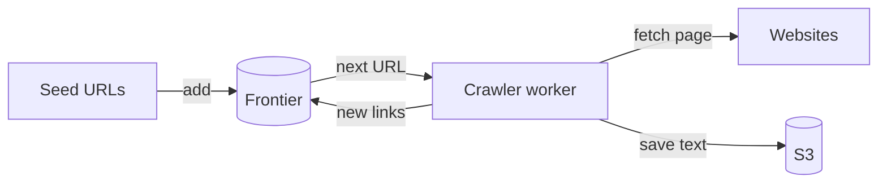
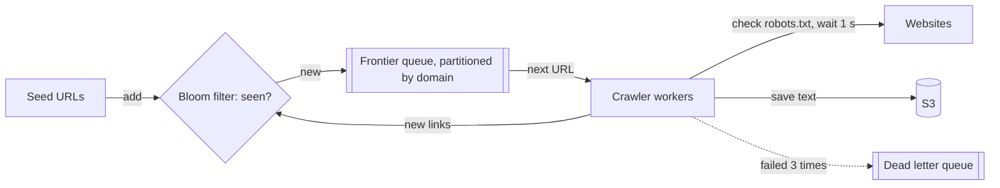

# 30. Design a Web Crawler

A web crawler starts from a list of seed URLs. It downloads each page, pulls out the links, and visits them too. Search engines use the stored pages to build their index.

## Step 1: FR

- User (the crawl owner) should be able to start a crawl from a list of seed URLs.
- User should be able to get the text of every crawled page from storage.
- User should be able to have the crawler follow the links on each page, so it finds new pages.

Building the search index, ranking, running JavaScript, images and videos, and re-crawling for freshness are out of scope.

## Step 2: NFR

- **CAP:** We choose AP ([CAP](14-cap-theorem.md)). Crawling is a background job, and a page crawled twice now and then is harmless.
- **Latency:** A worker waits at most 5 seconds for a page, then moves on.

## Step 3: Estimates

| Quantity | Calculation | Result |
|----------|-------------|--------|
| DAU | The crawler has no users. Its target is 10 billion (10^10) pages in 5 days. | |
| Pages per second | 10^10 / (5 × 10^5) | 20K |
| Read QPS at peak | A crawl runs at a steady rate, so the peak is the average. Each page is fetched once. | 20K fetches per second |
| Write QPS at peak | Each fetched page is stored once. | 20K per second |
| Storage | 10^10 pages × 100 KB | 1 PB |

20K writes per second and 1 PB of text are far more than one Postgres server can take. The page text goes to S3.

## Step 4: Entities

| Entity | Key fields |
|--------|------------|
| URL | `url`, `domain`, `status` (to visit or done) |
| Page | `url`, `s3_key`, `crawled_at` |
| Domain | `domain`, `robots_rules`, `last_fetched_at` |

## Step 5: APIs

- The admin endpoint `POST /crawls {seedUrls}` starts a crawl and returns `{crawlId}`.
- `GET /pages?url=` returns the stored text of one page.
- After it parses a page, a worker calls `addUrls(links)`, which puts the new links on the frontier. The frontier is the list of URLs still to visit.

## Step 6: Basic diagram

The worker takes a URL from the frontier and fetches the page. It saves the text in [blob storage](08-rest-and-blob-storage.md) (S3), then adds the page's links back to the frontier. With this design, FRs are satisfied.

## Step 7: Problems

**1. One worker cannot fetch 20K pages per second.** The fix is many stateless workers that read from a shared [message queue](13-message-queues.md) as the frontier. A worker sends the [ACK](13-message-queues.md) only after the page is saved. If a worker crashes, its URL goes back on the queue, so no work is lost.

**2. The same URL is crawled again and again.** Many pages link to the same page. The fix is a [Bloom filter](17-storage-engines.md) of seen URLs, which says for sure when a URL has never been seen. If it says "maybe seen", the URL is skipped. Missing a few new pages is fine, since we chose AP.

**3. Workers flood one website.** 20K fetches per second could hit one site hard. The fix has two parts. First, obey the site's `robots.txt`, the file where a site lists the pages crawlers must not visit. Second, [partition](20-partitioning.md) the queue by domain, so one worker owns each domain and waits 1 second between its requests.

**4. Some sites are slow or keep failing.** A worker that waits forever stops crawling. The fix is the 5-second timeout. A failed URL goes to a retry queue, and after 3 failed tries it moves to the [dead letter queue](13-message-queues.md).

> **Interview:** Say "a queue is the frontier, many stateless workers fetch pages, a Bloom filter skips seen URLs, and partitioning by domain keeps the crawler polite".

## Likely questions

- **How do you avoid crawling a page twice?** Check each new URL against a Bloom filter of seen URLs. Skip it if the filter says it may be seen.
- **How do you stay polite to websites?** Obey `robots.txt`, and let one worker own each domain and wait between its requests.
- **What if a worker crashes mid-page?** It never sent the ACK, so the URL goes back on the queue for another worker.
- **Where do the pages go?** They go to S3, because 1 PB of text is far too much for one database.
