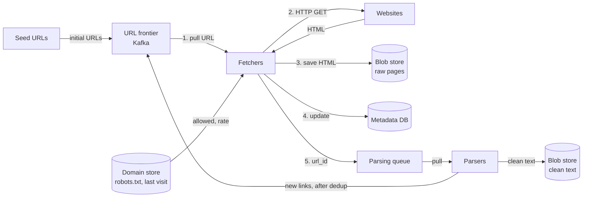
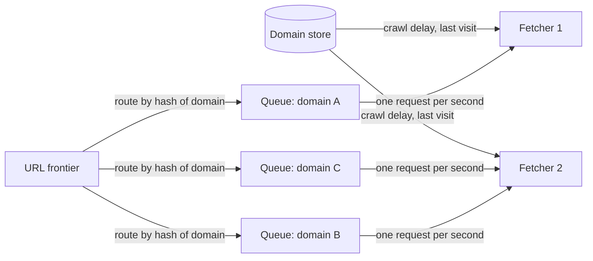

# 30. Design a Web Crawler

A **web crawler** starts from a list of seed URLs. It downloads each page, pulls out the links, and adds them to the list of pages to visit. It repeats until the web (or a target part of it) is covered. Search engines use the pages to build their index. AI labs use them as training data.

## Step 1: Functional requirements

| Core | Below the line (out of scope) |
|------|-------------------------------|
| Start from seed URLs and crawl the web | Building the search index and ranking (PageRank) |
| Download each page and store its text | Running JavaScript to render pages |
| Extract links from each page and crawl them too | Images, videos and other non-HTML files |
| Re-crawl pages so the copy stays fresh | Logging in to crawl private pages |

## Step 2: Non-functional requirements

| NFR | Target |
|-----|--------|
| Scale | 10 billion pages in 5 days |
| Politeness | Obey `robots.txt`. Never flood one site with requests. |
| Fault tolerance | A crashed crawler machine loses no work. Crawling continues. |
| No duplicates | Do not fetch the same URL twice. Do not store the same content twice. |
| Robustness | Survive bad HTML, very slow servers, and crawler traps |
| CAP | AP. Crawling is a background batch job. A page crawled twice now and then is harmless. |

### Estimation

| Quantity | Calculation | Result |
|----------|-------------|--------|
| Pages per second | 10^10 / (5 days × 86,400 s) = 10^10 / 4.3 × 10^5 | About 23,000 |
| Average page size | HTML only | 100 KB |
| Download bandwidth | 23,000 × 100 KB | 2.3 GB/s, about 18 Gbps |
| Storage | 10^10 × 100 KB | 1 PB raw (about 300 TB compressed) |
| Crawler machines | About 1,000 pages per second each | About 25, with headroom 50 |
| URL metadata | 10^10 URLs × 100 B | 1 TB |

The bottleneck is network I/O and waiting on slow sites, not CPU.

## Step 3: Entities

| Entity | Key fields |
|--------|------------|
| URL (frontier entry) | `url_id`, `url`, `domain`, `priority`, `depth` |
| Page metadata | `url_id`, `url`, `s3_location`, `content_hash`, `last_crawled`, `status_code` |
| Domain | `domain`, `robots_txt` rules, `crawl_delay`, `last_visited` |
| Page content | Raw HTML and cleaned text in blob storage, keyed by `url_id` |

## Step 4: APIs

A crawler has no public API. It is a pipeline of internal services. The interfaces between them are queue messages:

| Queue | Message | Producer | Consumer |
|-------|---------|----------|----------|
| URL frontier | `{ url_id, url, domain, priority }` | Seeds, link extractor, re-crawl scheduler | Fetchers |
| Fetched pages | `{ url_id, s3_location }` | Fetchers | Parser (link extractor and text cleaner) |

An admin API controls the crawl: `POST /crawls` with `{ seedUrls, maxDepth }`, and `GET /crawls/{id}` for progress.

## Step 5: High-level design

Each fetcher runs this loop:

1. Pull a URL from the frontier.
2. Check `robots.txt` and the domain's rate. Download the page.
3. Save the HTML to the blob store.
4. Update the metadata DB (location, time, content hash).
5. Put the `url_id` on the parsing queue.
6. Commit the frontier offset. Only now is the URL marked as done.

Parsers read the HTML, strip tags to get the text, extract links, and add new links to the frontier.

With this design, all FRs are satisfied.

## Step 6: Deep dives

### Deep dive 1: fault tolerance

- **Commit the offset last:** A fetcher commits the Kafka offset only after steps 1 to 5. If it crashes midway, another fetcher gets the same URL again (at-least-once, topic 13).
- **Idempotent steps:** Re-running a URL overwrites the same blob key and the same metadata row. A second run does no harm.
- **Separate fetch and parse:** Two queues, two worker pools. A bug in the parser does not stop downloading. Failed pages can be re-parsed from the blob store without fetching again.
- **Retries:** A timeout or `5xx` goes back to the frontier with a retry count and a delay. After 3 tries, the URL goes to a dead-letter queue.

### Deep dive 2: politeness

23,000 requests per second, aimed carelessly, would crash small websites.

- **robots.txt:** Each site lists the paths crawlers may not visit, and sometimes a `Crawl-delay`. Fetch it once per domain, cache it in the domain store, refresh it daily.
- **One domain, one queue:** Route every URL to a queue by `hash(domain)`. Each domain is handled by one worker, so its rate is easy to control.
- **Rate per domain:** Wait at least the crawl delay (for example 1 s) between requests to one domain. The domain store keeps `last_visited`.
- **User-Agent:** Identify the crawler, so site owners can contact you or block you.

- **Throughput still high:** Millions of domains are crawled in parallel. Each fetcher keeps hundreds of connections open at once with async I/O.
- **DNS cache:** Every fetch needs an IP address. DNS lookups take 10 to 200 ms. Cache them per domain.

### Deep dive 3: avoiding duplicates

| Duplicate type | Check | Tool |
|----------------|-------|------|
| Same URL seen before | Before adding a link to the frontier | A Bloom filter (topic 22) of 10 billion URLs at 10 bits each, about 12 GB. A false positive skips a page we have not crawled. That is acceptable. |
| Different URL, same content | After download | Hash the cleaned text (for example SHA-256). Look up `content_hash` in the metadata DB. If it exists, do not store or parse it again. |
| Nearly the same content | After download | SimHash. Pages differing only in an ad or a date have close hashes. |

- **Normalise URLs first:** Lowercase the host, drop `#fragments`, sort query parameters, remove tracking parameters. Then `http://Example.com/a?b=1#top` and `http://example.com/a?b=1` count as the same URL.

### Deep dive 4: crawler traps and bad sites

- **Trap:** A site generates endless URLs, such as a calendar with a "next month" link forever.
- **Max depth:** Stop following links beyond a depth (for example 20 links from a seed).
- **Max URL length:** Skip URLs longer than about 2,000 characters.
- **Per-domain cap:** Stop after a set number of pages per domain per crawl.
- **Timeouts:** Abandon a download after about 30 s, or once it passes a size limit (for example 10 MB).

### Deep dive 5: priority and re-crawling

- **Priority:** Not all pages are equal. Score each URL by the importance of its domain, the number of links pointing to it (PageRank), and how often it changes. Keep separate frontier topics for high, medium and low priority. Fetchers pull mostly from high.
- **Re-crawl:** A scheduler reads `last_crawled` from the metadata DB. News sites are re-crawled every hour. Rarely changing pages are re-crawled every month. If the content hash did not change, crawl that page less often.
- **Conditional GET:** Send `If-Modified-Since`. An unchanged page returns `304 Not Modified` with no body. That saves bandwidth.

### Does every part scale?

| Part | How it scales |
|------|---------------|
| Frontier | Kafka, partitioned by `hash(domain)` |
| Fetchers | Stateless. Add machines. Async I/O for many connections each. |
| Parsers | Stateless. Scale on their own queue. |
| Blob store | S3 scales to petabytes |
| Metadata DB | 1 TB, keyed by `url_id`. Cassandra or DynamoDB, sharded by `url_id`. |
| URL dedup | Bloom filter in Redis, sharded by URL hash |

> **Interview:** State the loop (frontier, fetch, store, parse, add links), then go deep on politeness (robots.txt, one queue per domain, crawl delay), fault tolerance (commit the offset last, idempotent steps), and duplicates (Bloom filter for URLs, content hash for pages).
