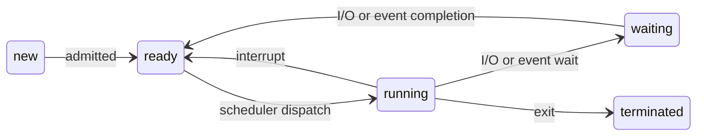

# Lecture 10: Process States | Process Queues

- **PCB field:** The PCB (previous lecture) has a field "Process state" that stores the current state. This lecture expands it.
- **Life cycle:** A process's life cycle runs from its creation (new) to its termination. On the way it passes through several states.

## 1. Process States

As a process executes, it changes state. Each process may be in one of the following states.

a. **New:** The OS is about to pick the program and convert it into a process, or the process is being created.
   - **PCB:** While the program is loaded from disk and converted into a process, its PCB state says "new".

b. **Run:** Instructions are being executed. The CPU is allocated.
   - **PCB:** A process from the ready queue has been given the CPU and is executing. Its PCB state says "running".

c. **Waiting:** The process is waiting for IO.
   - **Cause:** While running, the process hits an I/O instruction and goes to the waiting state until the I/O completes.

d. **Ready:** The process is in memory, waiting to be assigned to a processor.
   - **Ready queue:** The process has been created and brought into memory. The area of memory where such processes sit is the ready queue.
   - **Needs only CPU:** It is ready for execution. As soon as the CPU is scheduled to it, it runs.
   - **Many processes:** The ready queue can hold many processes at once. A multiprogramming OS keeps more than one process in the ready queue to increase the degree of multiprogramming.

e. **Terminated:** The process has finished execution. Its PCB entry is removed from the process table.
   - **Memory:** The process no longer exists in memory.



Life cycle walkthrough (the diagram above):

1. **On disk:** Programs sit on disk. They are converted into processes. During this, the process is in the new state.
2. **Admitted:** Once fully created, the process is put in the ready state.
3. **Dispatch:** A separate OS module takes processes from the ready queue and dispatches the CPU to them (scheduler dispatch). The process is now running.
4. **While running:** One of three things happens.
   - **I/O:** The process goes for I/O. It moves to the waiting state.
   - **Time quantum expires:** In time-sharing systems, the process goes back to the ready queue. This is handled as a software interrupt: "P1, your time is up, come back".
   - **Finishes:** Its execution ends. It exits and is terminated.
5. **I/O completes:** A process whose I/O completes goes from waiting back to the ready queue.

Common doubt: after waiting (I/O), does the process go straight back to running?

- **No:** It first goes to the ready queue.
- **Then:** The scheduler gives it a chance again, depending on its priority and the scheduling algorithm in use.

Example with P1, P2, P3 in the ready queue:

1. P3 is scheduled. It moves to the running state and leaves the ready queue.
2. P3 gets an I/O request. It moves to the waiting state. The CPU becomes free.
3. Within a fraction of a second, P2 is scheduled and starts executing. It leaves the ready queue.
4. P3 completes its I/O. It goes back into the ready queue, not to running, since P2 is executing.
5. P3 gets its chance again later.

## 2. Process Queues

a. **Job queue:**
   1. Processes in new state.
   2. Present in secondary memory.
   3. **Job scheduler (long-term scheduler, LTS)** picks processes from the pool and loads them into memory for execution.
      - **The pool:** A large pool on disk holds many programs ready to be executed. The job scheduler picks them from disk, converts them to the new state, then puts them in the ready queue. Moving processes from the job queue into the ready state is its work.

b. **Ready queue:**
   1. Processes in ready state.
   2. Present in main memory.
   3. **CPU scheduler (short-term scheduler, STS)** picks a process from the ready queue and dispatches it to the CPU.
      - **How:** It picks a process depending on the scheduling algorithm and priority. Deciding which process goes from the ready state to the running state is its work.

c. **Waiting queue:**
   1. Processes in wait state.
      - **Example:** P1, P2, P3 are in the ready queue. P3 runs briefly and goes for I/O, so P2 is given the CPU. P2 also goes for I/O after a while. Now P2 and P3 wait in a queue for I/O. That is the waiting queue. P1 is scheduled next.

```
 Disk (pool)       Main memory                            CPU
┌───────────┐  LTS  ┌─────────────┐  STS (dispatch)  ┌─────────┐
│ Job queue │ ────► │ Ready queue │ ───────────────► │ Running │ ──► terminated
│ (new)     │       └─────────────┘ ◄─────────────── └─────────┘
└───────────┘             ▲           interrupt           │
                          │                               │ I/O
                          │      ┌───────────────┐        │
                          └───── │ Waiting queue │ ◄──────┘
                    I/O complete └───────────────┘
```

### Why "long-term" and "short-term" scheduler?

- **Names:** They depend on frequency: how often each scheduler runs (the idle gap between two runs).
- **CPU scheduler is the short-term scheduler.** It works at very high frequency, with gaps of milliseconds.
  - **Example:** The CPU scheduler schedules P1. After only a few instruction cycles, P1 needs I/O and leaves. The CPU is now free.
  - **Why fast:** If it waited one minute before checking the ready queue again, the CPU would sit idle. The CPU must never sit idle.
  - **Minimal idle time:** After scheduling a job, it does not rely on that job. It keeps checking whether the CPU is free. As soon as it is, it picks another process (for example P3) and runs it.
- **Job scheduler is the long-term scheduler.** It is "lazy". The gap between its runs is larger.
  - **Example:** At t = 0 it puts 5 jobs into the ready queue. At t0 + 1 minute it checks again whether any new job has arrived to be put in the ready queue.

## 3. Degree of multi-programming

The degree of multi-programming is the number of processes in memory. It is how many processes can be in the ready queue at one time.

- **Example:** If only 5 processes fit in the ready queue at once, the degree is 5.

a. **LTS** controls the degree of multi-programming.
   - **Why:** The LTS picks jobs from the pool (secondary storage) and puts them into the ready queue.

> **Interview:** "Who controls the degree of multiprogramming?" The answer is the LTS (long-term scheduler). This is a likely question.

## 4. Dispatcher

The **dispatcher** is the module of the OS that gives control of the CPU to a process selected by the **STS**.

- **Split of work:** The CPU scheduler (STS) decides which process to run. The dispatcher actually provides the CPU for it.
- **Why mentioned:** The term should be familiar from other texts.
