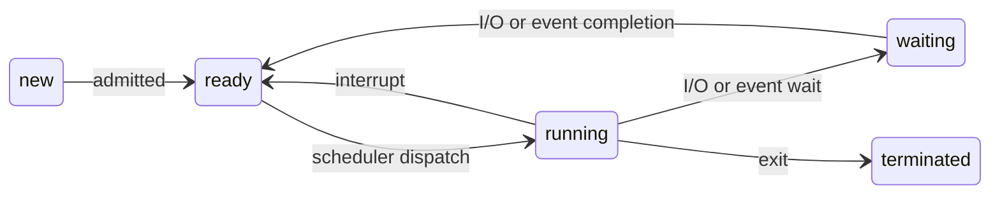

# Lecture 10: Process States | Process Queues

- The PCB (previous lecture) has a field "Process state" that stores the current state of the process. This lecture expands that field.
- A process's life cycle runs from its creation (new) to its termination. On the way it passes through several states.

## 1. Process States

Process States: As process executes, it changes state. Each process may be in one of the following states.

a. **New**: OS is about to pick the program & convert it into process. OR the process is being created.
   - While the program is being converted into a process (loaded from disk), the state field in its PCB says "new".

b. **Run**: Instructions are being executed; CPU is allocated.
   - A process from the ready queue has been given the CPU and is executing. Its PCB state says "running".

c. **Waiting**: Waiting for IO.
   - While running, the process hits an I/O instruction and goes to the waiting state. It waits for the I/O to complete so it can continue.

d. **Ready**: The process is in memory, waiting to be assigned to a processor.
   - The process has been created and brought into memory. The area of memory where such processes sit is the ready queue.
   - It is ready for execution; it only needs the CPU. As soon as the CPU is scheduled to it, it runs.
   - The ready queue can hold many processes at once. A multiprogramming OS keeps more than one process in the ready queue to increase the degree of multiprogramming.

e. **Terminated**: The process has finished execution. PCB entry removed from process table.
   - The process no longer exists in memory.



Life cycle walkthrough (the diagram above):
1. Programs sit on disk. They are picked up and converted into processes; during this the process is in the new state.
2. Once fully created, the process is put in the ready state (admitted).
3. A separate OS module takes processes from the ready queue and dispatches the CPU to them (scheduler dispatch). The process is now running.
4. While running, one of three things happens:
   - It goes for I/O: it moves to the waiting state.
   - In time-sharing systems, its time quantum expires: it goes back to the ready queue. This is handled as an interrupt (a software interrupt is generated: "P1, your time is up, come back").
   - Its execution finishes: it exits and is terminated.
5. A process whose I/O completes goes from waiting back to the ready queue.

Common doubt: after waiting (I/O), does the process go straight back to running?
- No. It first goes to the ready queue.
- From there it is the scheduler's job to give it a chance again, depending on its priority and the scheduling algorithm in use.

Example with P1, P2, P3 in the ready queue:
1. P3 is scheduled: it moves to the running state and leaves the ready queue.
2. P3 gets an I/O request: it moves to the waiting state. The CPU becomes free.
3. Within a fraction of a second, P2 is scheduled and starts executing; it leaves the ready queue.
4. P3 completes its I/O: it goes back into the ready queue (not to running, since P2 is executing).
5. P3 gets its chance again later.

## 2. Process Queues

a. **Job Queue**:
   1. Processes in new state.
   2. Present in secondary memory.
   3. **Job Schedular (Long term schedular (LTS))** picks process from the pool and loads them into memory for execution.
      - The pool: a large pool on disk holds many programs ready to be executed. The job scheduler picks them from disk, converts them to the new state, then puts them in the ready queue.
      - So moving processes from the job queue into the ready state is the job scheduler's work.

b. **Ready Queue**:
   1. Processes in Ready state.
   2. Present in main memory.
   3. **CPU Schedular (Short-term schedular)** picks process from ready queue and dispatch it to CPU.
      - It picks a process depending on the scheduling algorithm and priority.
      - Deciding which process goes from the ready state to the running state is the CPU scheduler's work.

c. **Waiting Queue**:
   1. Processes in Wait state.
      - Example: P1, P2, P3 in the ready queue. P3 is scheduled, runs briefly, goes for I/O. The CPU is free, so P2 is given the CPU. P2 also goes for I/O after a while. Now P2 and P3 are both doing I/O, and they wait in a queue: the waiting queue. P1 is scheduled next.

```
 Disk (pool)       Main memory                            CPU
┌───────────┐  LTS  ┌─────────────┐  STS (dispatch)  ┌─────────┐
│ Job queue │ ────► │ Ready queue │ ───────────────► │ Running │ ──► terminated
│ (new)     │       └─────────────┘ ◄─────────────── └─────────┘
└───────────┘             ▲           interrupt           │
                          │                               │ I/O
                          │      ┌───────────────┐        │
                          └───── │ Waiting queue │ ◄──────┘
                    I/O complete └───────────────┘
```

### Why "long-term" and "short-term" scheduler?

- The names depend on frequency: how often each scheduler runs (the idle gap between two runs).
- **CPU scheduler = short-term scheduler**: works at very high frequency, with gaps of milliseconds.
  - Example: the CPU scheduler schedules P1. After only a few instruction cycles, P1 needs I/O and leaves; the CPU is now free.
  - If the CPU scheduler waited, say, one minute before checking the ready queue again, the CPU would sit idle. The CPU must never sit idle.
  - So its idle time is kept minimal. After scheduling a job it does not rely on that job; it keeps checking whether the CPU is free, and as soon as it is, it picks another process (e.g., P3) and puts it in the running state.
- **Job scheduler = long-term scheduler**: it is "lazy"; the gap between its runs is larger.
  - Example: at t = 0 it puts 5 jobs into the ready queue. At t0 + 1 minute it checks again whether any new job has arrived to be put in the ready queue.

## 3. Degree of multi-programming

Degree of multi-programming: The number of processes in the memory.
- i.e. how many processes can be in the ready queue at one time.
- Example: if only 5 processes can be in the ready queue at once, the degree of multiprogramming is 5.

a. **LTS** controls degree of multi-programming.
   - Because the LTS is the one that picks jobs from the pool (secondary storage) and puts them into the ready queue.
   - Likely question: "Who controls the degree of multiprogramming?" Answer: the LTS (long-term scheduler).

## 4. Dispatcher

**Dispatcher:** The module of OS that gives control of CPU to a process selected by **STS**.
- The CPU scheduler (STS) decides which process to run; the dispatcher is the module that actually provides/enables the CPU for it.
- Mentioned so that the term is familiar when it appears in other texts.
