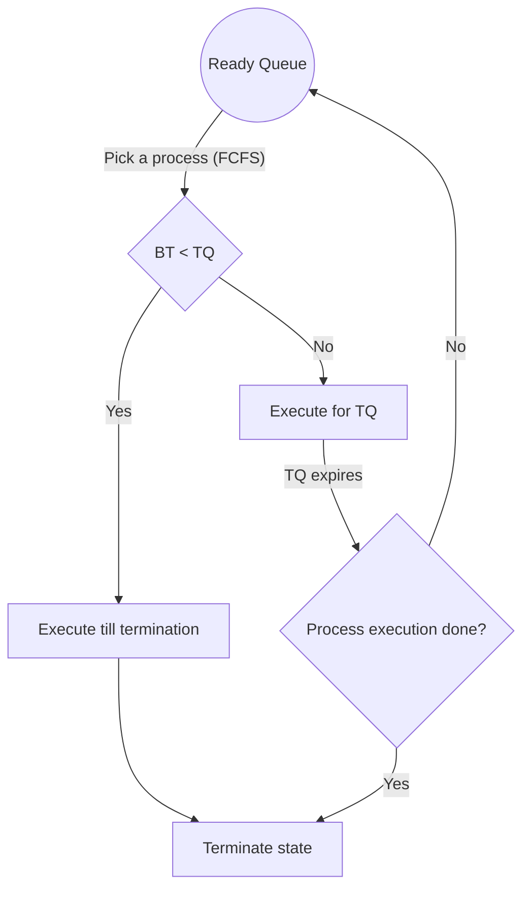

# Lecture 13: CPU Scheduling | SJF | Priority | RR

- Last lecture: FCFS, the simplest scheduling algorithm. This lecture: SJF (non-preemptive and preemptive), Priority scheduling (non-preemptive and preemptive), and Round Robin.
- Terms used throughout (from lecture 12): AT = arrival time, BT = burst time, CT = completion time, TAT = turnaround time = CT − AT, WT = waiting time = TAT − BT.

## 1. Shortest Job First (SJF) [Non-preemptive]

- a. Process with least BT will be dispatched to CPU first.
  - Least BT = the job expected to finish soonest. Jobs with higher BT get the CPU after it.
  - Why: in FCFS, when the process with the highest BT was scheduled first, the average WT shot up (convoy effect). SJF tries to fix that.
  - Non-preemptive: once a process gets the CPU it keeps it until it finishes; it is not preempted.
- b. Must do estimation for BT for each process in ready queue beforehand, Correct estimation of BT is an impossible task (ideally.)
  - Before scheduling, the OS applies heuristics (educated guesses written into the algorithm) to guess each BT, e.g. from the code size, or from history (how long the same job took the last time it ran).
  - It is fully estimation-based. The actual BT cannot be known without executing the process; the scheduler just hopes the estimate is right.
  - E.g. estimates P1 = 2 s, P2 = 5 s, P3 = 10 s, so P1 goes first. But P1 may actually take 20 s.
  - This estimation is the biggest problem/drawback of SJF.
- c. Run lowest time process for all time then, choose job having lowest BT at that instance.
- d. This will suffer from convoy effect as if the very first process which came is Ready state is having a large BT.
  - E.g. in the example below, if P1 (AT 0) had BT 80 instead of 8, it would run for 80 s and every other job would wait 80 s without getting the CPU even once, since there is no preemption.
- e. Process starvation might happen.
- f. Criteria for SJF algos, AT + BT.
  - AT decides which processes are present in the ready queue at that moment; among them, the one with the lowest BT is picked.

Example (the BTs are estimates):

| Process | AT | BT | CT | TAT = CT − AT | WT = TAT − BT |
|---|---|---|---|---|---|
| P1 | 0 | 8 | 8 | 8 | 0 |
| P2 | 1 | 4 | 12 | 11 | 7 |
| P3 | 2 | 9 | 26 | 24 | 15 |
| P4 | 3 | 5 | 17 | 14 | 9 |

```
| P1      | P2   | P4    | P3        |
0         8      12      17          26
```

- t = 0: only P1 is in the ready queue, so P1 runs, and (non-preemptive) runs its full 8 s.
- t = 8: P2, P3, P4 have all arrived (last AT is 3). Lowest BT is P2 (4), runs till 12.
- t = 12: P3 (9) and P4 (5) left; P4 has the lower BT, so P4 runs (FCFS would have run P3), till 17. Then P3 till 26.
- Average WT = (0 + 7 + 15 + 9) / 4 = 7.75 s.

## 2. SJF [Preemptive]

- When a new process arrives whose BT is less than the remaining BT of the running process, the running process is preempted and the new one gets the CPU. Criteria is still AT + BT, plus preemption.

Same example:

| Process | AT | BT | CT | TAT | WT |
|---|---|---|---|---|---|
| P1 | 0 | 8 | 17 | 17 | 9 |
| P2 | 1 | 4 | 5 | 4 | 0 |
| P3 | 2 | 9 | 26 | 24 | 15 |
| P4 | 3 | 5 | 10 | 7 | 2 |

```
| P1 | P2     | P4      | P1          | P3        |
0    1        5         10            17          26
```

- t = 0: only P1, so P1 runs.
- t = 1: P2 arrives with BT 4 < P1's remaining 7, so P1 is preempted and P2 runs.
- P3 (9) and P4 (5) arrive while P2 runs but neither is shorter than P2's remaining time, so P2 runs to completion at 5.
- t = 5: shortest is P4 (5), runs till 10. Then P1 (remaining 7, less than P3's 9) till 17. Then P3 till 26.
- Average WT = (9 + 0 + 15 + 2) / 4 = 6.5 s, less than the non-preemptive 7.75 s.

- a. Less starvation.
- b. No convoy effect.
  - Convoy effect came from a first job with a huge BT holding the CPU for a long time while the rest starved. Here, even if the first job has BT 80, it starts running but is preempted as soon as a job with lower BT arrives.
  - So the long (higher-BT) jobs keep shifting down the order, and the average WT stays the lowest.
- **c. Gives average WT less for a given set of processes as scheduling short job before a long one decreases the WT of short job more than it increases the WT of the long process.**
- Preemptive SJF is better than non-preemptive SJF (no convoy effect, less starvation).
- Biggest challenge of SJF (both versions): it is near impossible to implement, because BT cannot be known beforehand in practice.
  - E.g. a programmer expects their process to run 70 s, but an erroneous `while(1)` loop left in the code makes its actual BT unlimited.

## 3. Priority Scheduling [Non-preemptive]

- a. Priority is assigned to a process when it is created.
  - So far no explicit priority was used. Here each job gets a priority as it enters the ready queue (e.g. P1 = 2, P2 = 4), and the job with the highest priority at that point of time is scheduled first.
  - Non-preemptive: once a process gets the CPU, it is not preempted.
- b. SJF is a special case of general priority scheduling with priority inversely proportional to BT.
  - In SJF no separate priority is assigned; the process with the lowest BT at that point of time simply has the highest priority.

Example (higher number = higher priority):

| Process | AT | BT | Priority | CT | TAT | WT |
|---|---|---|---|---|---|---|
| P1 | 0 | 4 | 2 | 4 | 4 | 0 |
| P2 | 1 | 2 | 4 | 25 | 24 | 22 |
| P3 | 2 | 3 | 6 | 23 | 21 | 18 |
| P4 | 3 | 5 | 10 | 9 | 6 | 1 |
| P5 | 4 | 1 | 8 | 20 | 16 | 15 |
| P6 | 5 | 4 | 12 | 13 | 8 | 4 |
| P7 | 6 | 6 | 9 | 19 | 13 | 7 |

```
| P1   | P4     | P6   | P7      | P5 | P3   | P2 |
0      4        9      13        19   20     23   25
```

- t = 0: only P1, runs its full 4 s.
- t = 4: P2 to P5 are present; highest priority is P4 (10), runs till 9.
- t = 9: all have arrived (last AT is 6). Order by priority: P6 (12) till 13, P7 (9) till 19, P5 (8) till 20, P3 (6) till 23, P2 (4) till 25.
- Every time the lowest-priority jobs are left behind while the highest-priority ones keep getting scheduled; this causes the problem discussed below.
- Average WT = 67 / 7 ≈ 9.57 s (the lecture's board says 9.714, an arithmetic slip).

## 4. Priority Scheduling [Preemptive]

- a. Current RUN state job will be preempted if next job has higher priority.
  - The example assumes the scheduler checks the ready queue for new arrivals every 1 s. How often it checks is implementation-based.

Same example:

| Process | AT | BT | Priority | CT | TAT | WT |
|---|---|---|---|---|---|---|
| P1 | 0 | 4 | 2 | 25 | 25 | 21 |
| P2 | 1 | 2 | 4 | 22 | 21 | 19 |
| P3 | 2 | 3 | 6 | 21 | 19 | 16 |
| P4 | 3 | 5 | 10 | 12 | 9 | 4 |
| P5 | 4 | 1 | 8 | 19 | 15 | 14 |
| P6 | 5 | 4 | 12 | 9 | 4 | 0 |
| P7 | 6 | 6 | 9 | 18 | 12 | 6 |

```
| P1 | P2 | P3 | P4   | P6       | P4     | P7          | P5 | P3   | P2 | P1     |
0    1    2    3      5          9        12            18   19     21   22       25
```

- t = 1: P2 (4) beats P1 (2), so P1 is preempted (3 s left). t = 2: P3 (6) preempts P2 (1 s left). t = 3: P4 (10) preempts P3 (2 s left).
- t = 4: P5 (8) arrives, lower than P4, so P4 continues. t = 5: P6 (12) preempts P4 (3 s left); P6 is the highest, so it runs fully, till 9.
- Then by priority: P4 till 12, P7 till 18, P5 till 19, P3 till 21, P2 till 22, P1 till 25.
- Average WT = 80 / 7 ≈ 11.4 s, even more than the non-preemptive version.
- Lots of overhead: the scheduler context-switches again and again just to finish one job.
- P2 has BT of only 2 s (SJF would have finished it early), yet it completes at 22 s.
- Convoy effect is here too, and worse: high-priority jobs (possibly with high BT) keep arriving, so low-priority jobs keep shifting down even if their BT is only 1–2 s, and the average WT rises a lot.

- b. May cause indefinite waiting (Starvation) for lower priority jobs. (Possibility is they won’t get executed ever). (True for both preemptive and non-preemptive version)
  - This is the biggest drawback of priority scheduling (likely interview question). Also called indefinite blocking or extreme starvation; it is the extreme form of the convoy effect.
  - E.g. P3, P4, P5 get priorities like 100, 102; after they finish, a new P6 comes with priority 200, and so on. Jobs with priority 1 or 2 are blocked forever: the system keeps running and they never get the CPU.
  - Rumour (even books call it a rumour): when the IBM 7094 at MIT was shut down in 1973, they found a low-priority job submitted in 1967 that had never been run.
  - The algorithm itself is useful: as seen in the types of OS, a high-priority job (e.g. the antivirus example) should execute first. The fix is for the drawback, not the idea.
  - i. Solution: Ageing is the solution.
  - ii. Gradually increase priority of process that wait so long. E.g., increase priority by 1 every 15 minutes.
    - The interval is customisable. As the waiting low-priority jobs' priority keeps rising, after some time they are bound to get a chance: by then the oldest process's priority has grown above that of any newly arriving high-priority job.

## 5. Round robin scheduling (RR)

- Why the name: it gives every process in the ready queue an equal chance in turn, so every process gets the CPU soon and waiting time is quite low.
- a. Most popular
  - Still used at different levels of operating systems today.
- b. Like FCFS but preemptive.
  - No priority criterion at all.
- c. Designed for time sharing systems.
  - Time sharing: any process is preempted after a fixed time quantum. Time sharing is used in multitasking OSs, where RR is the most popular algorithm.
- d. Criteria: AT + time quantum (TQ), Doesn’t depend on BT.
  - So SJF's most problematic part (having to estimate BT before scheduling) does not exist here.
  - TQ is decided by the OS designer/developer.
- e. No process is going to wait forever, hence very low starvation. [No convoy effect]
  - Lowest starvation of all these algorithms, because the next process's turn always comes after a short while.
- f. Easy to implement.
- g. If TQ is small, more will be the context switch (more overhead).



- Pick a process FCFS, i.e. the one with the lowest AT.
- If its BT is less than TQ, it finishes within the quantum and goes to the terminate state.
- Otherwise it runs for TQ; when TQ expires it is preempted. If not finished, it goes back to the ready queue; if finished, to the terminate state.
- Why easy: the scheduler only runs each process for one TQ and then checks. Knowing BT or not makes no difference, and there is no BT estimation at all. In practice: run for TQ, check whether it terminated; if not, put it back in the ready queue, else move it to the terminate state.

Example, TQ = 2 s:

| Process | AT | BT | CT |
|---|---|---|---|
| P1 | 0 | 4 | 8 |
| P2 | 1 | 5 | 18 |
| P3 | 2 | 2 | 6 |
| P4 | 3 | 1 | 9 |
| P5 | 4 | 6 | 21 |
| P6 | 6 | 3 | 19 |

```
| P1 | P2 | P3 | P1 | P4 | P5 | P2 | P6 | P5 | P2 | P6 | P5 |
0    2    4    6    8    9    11   13   15   17   18   19   21
```

- t = 0–2: P1 runs (2 s left). P2, P3 have arrived; P1 is preempted and put back in the queue. Queue: P2, P3, P1.
- t = 2–4: P2 runs (3 s left). P4, P5 have arrived. Queue: P3, P1, P4, P5, P2.
- t = 4–6: P3 runs its 2 s and terminates. P6 arrives at 6. Queue: P1, P4, P5, P2, P6.
- t = 6–8: P1 finishes its last 2 s. No more arrivals (last AT is 6).
- t = 8–9: P4 needs only 1 s, terminates before its quantum ends.
- t = 9–11: P5 (4 left). 11–13: P2 (1 left). 13–15: P6 (1 left). 15–17: P5 (2 left). 17–18: P2 done. 18–19: P6 done. 19–21: P5 done (the only one left).
- Overhead: after every TQ the scheduler decides whether to preempt, so context switching in RR is very high.
- Starvation and convoy effect are removed, but overhead goes up. What is wanted is a balance: low convoy effect and low overhead.
- The overhead in RR is determined by TQ: larger TQ means fewer context switches (less overhead); smaller TQ (e.g. 1 s instead of 2 s) means more context switches (more overhead).

## Implementing the algorithms

- Recommended practice: code these algorithms as simulations, taking the Gantt-chart questions above as the problem statement, using data structures from DSA.
- SJF: a min-heap keyed on BT; insert processes as they arrive, and the lowest-BT process at that point of time is on top.
- Priority scheduling: a priority queue keyed on priority.
- RR: think which data structure fits (the diagram picks from a FIFO ready queue).
