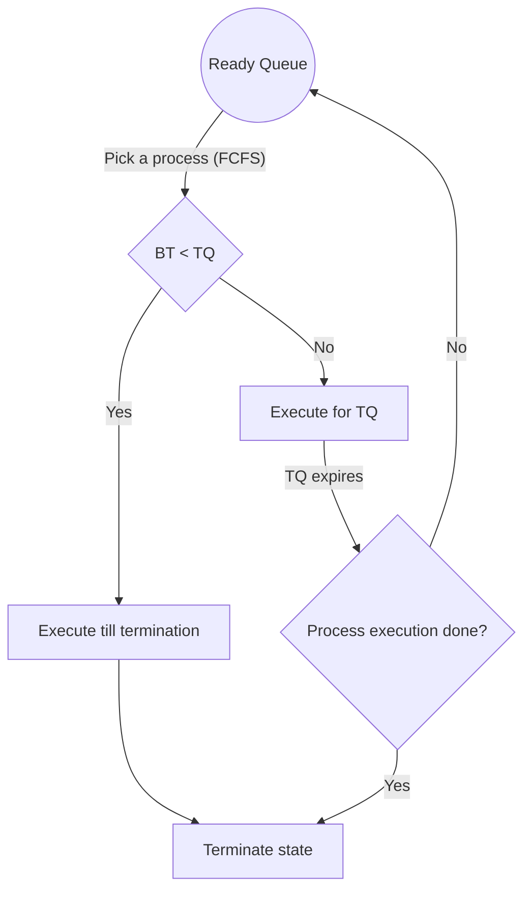

# Lecture 13: CPU Scheduling | SJF | Priority | RR

- **Covered here:** SJF (non-preemptive and preemptive), Priority scheduling (non-preemptive and preemptive), and Round Robin.
- **Terms:** AT = arrival time, BT = burst time, CT = completion time, TAT = CT − AT, WT = TAT − BT.

## 1. Shortest Job First (SJF) [Non-preemptive]

a. The process with the least BT is dispatched to the CPU first.
   - **Why:** In FCFS, scheduling the highest-BT process first raised the average WT (convoy effect). SJF tries to fix that.
   - **Non-preemptive:** A process keeps the CPU until it finishes.

b. The OS must estimate the BT of each process in the ready queue beforehand. Correct estimation is ideally impossible.
   - **Heuristics:** Guesses written into the algorithm, such as code size or history (how long the job took last time).
   - The actual BT cannot be known without executing the process.
   - **Example:** Estimates are P1 = 2 s, P2 = 5 s, P3 = 10 s, so P1 goes first. But P1 may actually take 20 s.
   - **Biggest drawback:** This estimation is the biggest problem of SJF.

c. Run the lowest-time process. Then choose the job with the lowest BT at that instant.

d. It suffers from the convoy effect if the very first process has a large BT.
   - **Example:** In the example below, if P1 (AT 0) had BT 80 instead of 8, every other job would wait 80 s, since there is no preemption.

e. Process starvation might happen.

f. The criteria are AT + BT.
   - AT decides which processes are in the ready queue. Among them, the lowest BT is picked.

Example (the BTs are estimates):

| Process | AT | BT | CT | TAT = CT − AT | WT = TAT − BT |
|---|---|---|---|---|---|
| P1 | 0 | 8 | 8 | 8 | 0 |
| P2 | 1 | 4 | 12 | 11 | 7 |
| P3 | 2 | 9 | 26 | 24 | 15 |
| P4 | 3 | 5 | 17 | 14 | 9 |

```
| P1      | P2   | P4    | P3        |
0         8      12      17          26
```

- **t = 0:** Only P1 is present. It runs its full 8 s.
- **t = 8:** P2, P3, P4 have arrived. P2 has the lowest BT (4). It runs till 12.
- **t = 12:** P4 (5) beats P3 (9). FCFS would have run P3. P4 runs till 17, then P3 till 26.
- **Average WT:** (0 + 7 + 15 + 9) / 4 = 7.75 s.

## 2. SJF [Preemptive]

- **Rule:** A new process arrives with BT less than the remaining BT of the running process. The running process is preempted. The criteria are still AT + BT, plus preemption.

Same example:

| Process | AT | BT | CT | TAT | WT |
|---|---|---|---|---|---|
| P1 | 0 | 8 | 17 | 17 | 9 |
| P2 | 1 | 4 | 5 | 4 | 0 |
| P3 | 2 | 9 | 26 | 24 | 15 |
| P4 | 3 | 5 | 10 | 7 | 2 |

```
| P1 | P2     | P4      | P1          | P3        |
0    1        5         10            17          26
```

- **t = 1:** P2 (4) is less than P1's remaining 7. P1 is preempted.
- **P3 and P4:** They arrive while P2 runs, but neither is shorter than P2's remaining time. P2 completes at 5.
- **t = 5:** P4 (5) runs till 10. Then P1 (remaining 7, less than P3's 9) runs till 17. Then P3 runs till 26.
- **Average WT:** (9 + 0 + 15 + 2) / 4 = 6.5 s. This is less than the non-preemptive 7.75 s.

Properties:

a. Less starvation.

b. No convoy effect.
   - Even if the first job has BT 80, it is preempted as soon as a job with lower BT arrives.
   - Long jobs keep shifting down the order. The average WT stays the lowest.

c. **It gives the lowest average WT for a given set of processes.** Scheduling a short job before a long one decreases the short job's WT more than it increases the long job's WT.

- **Comparison:** Preemptive SJF is better than non-preemptive SJF.
- **Biggest challenge (both versions):** It is near impossible to implement, because BT cannot be known beforehand.
  - **Example:** A programmer expects 70 s, but an erroneous `while(1)` loop makes the actual BT unlimited.

## 3. Priority Scheduling [Non-preemptive]

a. Priority is assigned to a process when it is created.
   - Each job gets a priority as it enters the ready queue (for example P1 = 2, P2 = 4). The highest priority at that point of time is scheduled first.
   - **Non-preemptive:** Once a process gets the CPU, it is not preempted.

b. SJF is a special case of priority scheduling. Priority is inversely proportional to BT.
   - In SJF the lowest BT at that point of time simply has the highest priority.

Example (higher number = higher priority):

| Process | AT | BT | Priority | CT | TAT | WT |
|---|---|---|---|---|---|---|
| P1 | 0 | 4 | 2 | 4 | 4 | 0 |
| P2 | 1 | 2 | 4 | 25 | 24 | 22 |
| P3 | 2 | 3 | 6 | 23 | 21 | 18 |
| P4 | 3 | 5 | 10 | 9 | 6 | 1 |
| P5 | 4 | 1 | 8 | 20 | 16 | 15 |
| P6 | 5 | 4 | 12 | 13 | 8 | 4 |
| P7 | 6 | 6 | 9 | 19 | 13 | 7 |

```
| P1   | P4     | P6   | P7      | P5 | P3   | P2 |
0      4        9      13        19   20     23   25
```

- **t = 0:** Only P1 is present. It runs its full 4 s.
- **t = 4:** P2 to P5 are present. P4 (10) is highest. It runs till 9.
- **t = 9:** All have arrived. Order by priority: P6 (12) till 13, P7 (9) till 19, P5 (8) till 20, P3 (6) till 23, P2 (4) till 25.
- **Problem:** The lowest-priority jobs are left behind each time.
- **Average WT:** 67 / 7 ≈ 9.57 s. The lecture's board says 9.714, which is an arithmetic slip.

## 4. Priority Scheduling [Preemptive]

a. The current RUN state job is preempted if the next job has higher priority.
   - **Assumption:** The scheduler checks the ready queue for new arrivals every 1 s. How often it checks is implementation-based.

Same example:

| Process | AT | BT | Priority | CT | TAT | WT |
|---|---|---|---|---|---|---|
| P1 | 0 | 4 | 2 | 25 | 25 | 21 |
| P2 | 1 | 2 | 4 | 22 | 21 | 19 |
| P3 | 2 | 3 | 6 | 21 | 19 | 16 |
| P4 | 3 | 5 | 10 | 12 | 9 | 4 |
| P5 | 4 | 1 | 8 | 19 | 15 | 14 |
| P6 | 5 | 4 | 12 | 9 | 4 | 0 |
| P7 | 6 | 6 | 9 | 18 | 12 | 6 |

```
| P1 | P2 | P3 | P4   | P6       | P4     | P7          | P5 | P3   | P2 | P1     |
0    1    2    3      5          9        12            18   19     21   22       25
```

- **Preemptions:** At t = 1, P2 (4) preempts P1 (3 s left). At t = 2, P3 (6) preempts P2 (1 s left). At t = 3, P4 (10) preempts P3 (2 s left). At t = 4, P5 (8) is lower than P4, so P4 continues. At t = 5, P6 (12) preempts P4 (3 s left) and runs fully till 9.
- **After that, by priority:** P4 till 12, P7 till 18, P5 till 19, P3 till 21, P2 till 22, P1 till 25.
- **Average WT:** 80 / 7 ≈ 11.4 s. This is even more than the non-preemptive version.
- **Overhead:** It is high. The scheduler context-switches again and again just to finish one job.
- **P2:** It has BT of only 2 s, yet it completes at 22 s. SJF would have finished it early.
- **Convoy effect:** It is worse here. High-priority jobs (possibly with high BT) keep arriving, so low-priority jobs shift down even if their BT is only 1–2 s.

b. It may cause indefinite waiting (starvation) for lower priority jobs. They may never get executed. This is true for both versions.
   - It is also called indefinite blocking or extreme starvation. It is the extreme form of the convoy effect.

     > **Interview:** The starvation drawback of priority scheduling is a likely interview question. It is the biggest drawback.

   - **Example:** P3, P4, P5 get priorities like 100, 102. After they finish, a new P6 comes with priority 200, and so on. Jobs with priority 1 or 2 never get the CPU.
   - **Rumour (even books call it a rumour):** The IBM 7094 at MIT was shut down in 1973. A low-priority job submitted in 1967 was found that had never been run.
   - **Still useful:** A high-priority job (for example the antivirus example) should execute first. The fix is for the drawback, not the idea.
   - **i. Solution:** Ageing.
   - **ii. How:** Gradually increase the priority of a process that waits long. For example, increase priority by 1 every 15 minutes.
     - The interval is customisable.
     - After some time the oldest process's priority grows above that of any newly arriving high-priority job.

## 5. Round robin scheduling (RR)

- **Why the name:** It gives every process in the ready queue an equal chance in turn. Waiting time is quite low.

a. It is the most popular. It is still used at different levels of operating systems today.

b. It is like FCFS but preemptive.
   - There is no priority criterion at all.

c. It is designed for time sharing systems.
   - **Time sharing:** Any process is preempted after a fixed time quantum. It is used in multitasking OSs, where RR is the most popular algorithm.

d. The criteria are AT + time quantum (TQ). It does not depend on BT.
   - So SJF's problem of estimating BT does not exist here.
   - The OS designer or developer decides TQ.

e. No process waits forever, so starvation is very low. There is no convoy effect.
   - It has the lowest starvation of all these algorithms.

f. It is easy to implement.

g. If TQ is small, there are more context switches (more overhead).



- **Pick:** Pick a process FCFS, that is, the one with the lowest AT.
- **BT less than TQ:** It finishes within the quantum and goes to the terminate state.
- **Otherwise:** It runs for TQ, then is preempted. If not finished, it goes back to the ready queue. If finished, it goes to the terminate state.
- **Why easy:** The scheduler runs each process for one TQ and checks. There is no BT estimation at all.

Example, TQ = 2 s:

| Process | AT | BT | CT |
|---|---|---|---|
| P1 | 0 | 4 | 8 |
| P2 | 1 | 5 | 18 |
| P3 | 2 | 2 | 6 |
| P4 | 3 | 1 | 9 |
| P5 | 4 | 6 | 21 |
| P6 | 6 | 3 | 19 |

```
| P1 | P2 | P3 | P1 | P4 | P5 | P2 | P6 | P5 | P2 | P6 | P5 |
0    2    4    6    8    9    11   13   15   17   18   19   21
```

- **t = 0–2:** P1 runs (2 s left). Queue: P2, P3, P1.
- **t = 2–4:** P2 runs (3 s left). P4, P5 have arrived. Queue: P3, P1, P4, P5, P2.
- **t = 4–6:** P3 runs its 2 s and terminates. P6 arrives at 6. Queue: P1, P4, P5, P2, P6.
- **t = 6–8:** P1 finishes. No more arrivals (last AT is 6).
- **t = 8–9:** P4 needs only 1 s. It terminates before its quantum ends.
- **t = 9–19:** P5 runs 9–11 (4 left). P2 runs 11–13 (1 left). P6 runs 13–15 (1 left). P5 runs 15–17 (2 left). P2 finishes 17–18. P6 finishes 18–19.
- **t = 19–21:** P5 finishes. It is the only one left.
- **Overhead:** After every TQ the scheduler decides whether to preempt. So context switching in RR is very high.
- **Balance:** Starvation and convoy effect are removed, but overhead goes up. What is wanted is low convoy effect and low overhead.
- **TQ decides overhead:** A larger TQ means fewer context switches. A smaller TQ (for example 1 s instead of 2 s) means more.

## Implementing the algorithms

- **Practice:** Code these algorithms as simulations. Take the Gantt-chart questions above as the problem statement. Use data structures from DSA.
- **SJF:** A min-heap keyed on BT. Insert processes as they arrive. The lowest BT is on top.
- **Priority scheduling:** A priority queue keyed on priority.
- **RR:** Think which data structure fits. The diagram picks from a FIFO ready queue.
