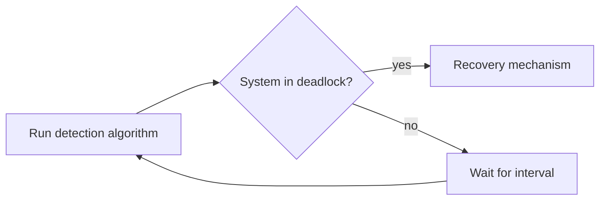

# Lecture 22: Deadlock Part-2

This part covers deadlock avoidance, deadlock detection and recovery. Deadlock prevention was covered earlier.

## 1. Deadlock Avoidance

The kernel is told in advance which resources each process will use in its lifetime. With this, the system decides for each request whether the process should wait.

To decide, the system considers three things:

- the resources currently available
- the resources currently allocated to each process
- the future requests and releases of each process

In avoidance, the system knows this in advance:

- **Processes:** the number of processes.
- **Resources:** the number of resources and the number of instances of each.
- **Allocation:** the resources currently allocated to each process.
- **Maximum need:** the maximum instances of each resource a process needs to finish.

Using this, the goal is to schedule processes and allocate resources so that the system always stays in a safe state.

1. Schedule processes and allocate their resources in a way that deadlock never occurs.

2. **Safe state:** A state is safe if the system can allocate resources to each process (up to its maximum) in some order and still avoid deadlock. A system is in a safe state only if a safe sequence exists.
   - **Safe state, simply:** With the current allocations, maximum needs and processes, some order of scheduling lets all processes finish without deadlock.
   - **Safe sequence:** That order. With P1, P2, P3, P4, the order P1, P3, P4, P2 may cause no deadlock. The order P1, P2, P3, P4 may cause one. The first order is a safe sequence.

3. **Unsafe state:** The OS cannot stop processes from requesting resources in a way that causes deadlock.
   - **Not always deadlock:** Not every unsafe state is a deadlock. An unsafe state may lead to a deadlock.
   - **Meaning:** It is the opposite of safe. Further allocations may lead to deadlock, because all four necessary conditions may get fulfilled.

4. **Key rule:** A request for resources is approved only if the resulting state is a safe state.

5. **Unsafe, restated:** If the system cannot fulfil the requests of all processes, the state is called unsafe.

6. **Algorithm:** The Banker's algorithm avoids deadlock by finding a safe state.
   - A safe state needs a safe sequence. The Banker's algorithm finds that safe sequence.

## 2. Banker's Algorithm

1. A process requests a set of resources. The system checks whether allocating them leaves the system in a safe state.
   - **If yes:** The resources are allocated to the process.
   - **If no:** The process waits until other processes release enough resources.

**Example:** 5 processes and 3 resource types A, B, C. A resource can be anything: memory, CPU, files, locks.

- **Total instances:** A = 10, B = 5, C = 7.
- **Allocated:** The instances already given to each process.
- **Max need:** The maximum instances a process needs to execute.

| Process | Allocated (A B C) | Max need (A B C) | Remaining need = Max − Allocated (A B C) |
|---------|-------------------|------------------|------------------------------------------|
| P1      | 0 1 0             | 7 5 3            | 7 4 3                                    |
| P2      | 2 0 0             | 3 2 2            | 1 2 2                                    |
| P3      | 3 0 2             | 9 0 2            | 6 0 0                                    |
| P4      | 2 1 1             | 2 2 2            | 0 1 1                                    |
| P5      | 0 0 2             | 4 3 3            | 4 3 1                                    |
| Total   | 7 2 5             |                  |                                          |

- **Available:** Total − Total allocated = (10−7, 5−2, 7−5) = **3 3 2**.
- **Finding a safe sequence:** Pick a process whose remaining need is at most the available resources. Let it run to completion. It then frees all its allocated resources, and they are added to available. Repeat.

| Step | Check                                  | Runs? | Available after (A B C) |
|------|----------------------------------------|-------|-------------------------|
| 0    | start                                  |       | 3 3 2                   |
| 1    | P1 needs 7 4 3 > 3 3 2                 | no    | 3 3 2                   |
| 2    | P2 needs 1 2 2 ≤ 3 3 2                 | yes   | 3 3 2 + 2 0 0 = 5 3 2   |
| 3    | P3 needs 6 0 0 > 5 3 2                 | no    | 5 3 2                   |
| 4    | P4 needs 0 1 1 ≤ 5 3 2                 | yes   | 5 3 2 + 2 1 1 = 7 4 3   |
| 5    | P5 needs 4 3 1 ≤ 7 4 3                 | yes   | 7 4 3 + 0 0 2 = 7 4 5   |
| 6    | P1 needs 7 4 3 ≤ 7 4 5                 | yes   | 7 4 5 + 0 1 0 = 7 5 5   |
| 7    | P3 needs 6 0 0 ≤ 7 5 5                 | yes   | 7 5 5 + 3 0 2 = 10 5 7  |

- **Safe sequence:** **P2, P4, P5, P1, P3**, in this order. After all processes run, available equals total (10 5 7). So the state is safe and deadlock can be avoided.
- **Unsafe case:** Suppose P3 needed 8 instances of A instead of 6. Only 7 would be available, so P3 could never be scheduled. No safe sequence exists, so the state is unsafe and deadlock may occur.
- **In short:** At each step, check whether the available resources can fulfil some process's remaining need. If yes, schedule it and continue. If you reach a point where no remaining need can be fulfilled, the system is in an unsafe state.

> **Interview:** Interviews do not ask you to solve a Banker's algorithm numerical. That comes in university exams ("find the safe sequence"). Interviews ask three things. What is deadlock avoidance? What does it assume is known (allocated, max need, number of processes, instances of each resource)? Which algorithm is used for it (Banker's)?

## 3. Deadlock Detection

Some systems implement neither deadlock prevention nor deadlock avoidance. They may use deadlock detection and then a recovery technique.

- **Handling order:** Prevention, then avoidance, then detection and recovery.
- **Detection and recovery:** The OS lets the system go into deadlock. It detects the deadlock with an algorithm, then recovers.
- **Interval:** The detection algorithm runs periodically, at some set interval.



1. Single instance of each resource type **(wait-for graph method)**

   1. A deadlock exists if and only if the wait-for graph has a cycle. The system maintains the wait-for graph. It periodically runs an algorithm that searches for a cycle.
      - **Wait-for graph:** A version of the resource allocation graph (RAG). Remove the resource vertices from the RAG and merge the edges. Only process vertices remain.
      - **Edge:** Pi to Pj means Pi is waiting for a resource held by Pj.

      ```
      Resource allocation graph            Wait-for graph

         P1 ──request──> R1                  P1 ────> P2
         ^                |                  ^         |
         |            held by                └─────────┘
       held by            v
         R2 <──request── P2
      ```

      - **Example:** P1 waits for a resource held by P2. P2 waits for a resource held by P1. This is a cycle, so there is deadlock.
      - **Rule:** A cycle in the wait-for graph means deadlock. No cycle means no deadlock. This is valid only for a single instance of each resource.

2. Multiple instances of each resource type

   1. Banker's algorithm
      - Run the Banker's algorithm. If a safe sequence is found, there is no deadlock. If no safe sequence is found, deadlock is detected.

## 4. Recovery from Deadlock

Once detection finds a deadlock, the recovery mechanism is called.

1. Process termination

   1. **Abort all deadlocked processes:** For example, forcefully kill both P1 and P2 from the example above. This surely removes the deadlock, but it is very harsh.

   2. **Abort one process at a time** until the deadlock cycle is eliminated.
      - **Example:** Kill only the lower-priority process. If P2 has low priority, kill it. It frees R1, so P1 gets R1 and the deadlock is removed. This is gentler than killing all.

2. Resource preemption

   1. Successively preempt some resources from processes and give them to other processes until the deadlock cycle is broken.
      - **Example:** This is similar to process termination, but resources are taken away instead of killing the process. P2 has low priority, holds R1 and waits for R2. Preempt R1 from P2. R1 is free, so P1 gets it.
