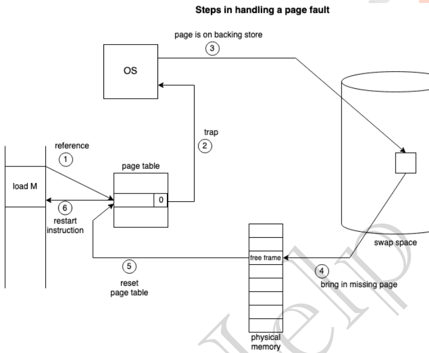

# Lecture 28: What is Virtual Memory? || Demand Paging || Page Faults

1. **Virtual memory** is a technique that allows the execution of processes that are not completely in the memory. It provides user an illusion of having a very big main memory. This is done by treating a part of secondary memory as the main memory. (Swap-space)
   - Recap: physical memory (RAM) holds the physical address space; every process has its own logical address space, divided into pages; RAM is divided into frames.
   - Problem without virtual memory (load every page of every process):
     - RAM = 12KB, page size = 1KB, so 12 frames.
     - P1 = 6KB (6 pages) gets 6 frames; P2 = 5KB gets 5 frames. 11KB used, 1 free frame (one 1KB node in the free-frame list).
     - P3 = 5KB arrives. It needs 5 free frames, only 1 is free, so P3 cannot be allocated at all.
     - So a 12KB RAM can run only 2 processes (P1, P2).
   - Modern PCs do not behave like this. A 16GB RAM runs the OS, background OS programs, a music player and GTA 5 (a 30-40GB game) together. A 30GB game cannot fit in 16GB RAM, yet it runs. This works because of virtual memory.
   - RAM is small (16GB, 32GB) and costly; disk is huge (1TB, 2TB). Programs are often bigger than RAM.
   - Idea: when a process is brought to ready/running state, allocate frames to only some pages of it, the pages that are needed right now.
     - A process never uses all its code at the same time. Execution starts at `main`, then a few functions are called; maybe only 3 pages are in use.
     - Parts of the code (e.g. some `switch` cases for user input) may never execute, so those pages are never needed.
   - Same example with only needed pages loaded:
     - P1 needs 3 pages, P2 needs 1 page, P3 needs 2 pages. Only 6 frames are used; 6 frames are still free.
     - P4 (3KB, all 3 pages needed) arrives; it is also allocated.
     - Loading only the needed pages (and pages near them) at the start uses the idea of **locality of reference**.
   - Where do the remaining (not needed) pages go?
     - OS reserves a small area of the disk (e.g. 1GB of a 1TB disk). The user does not notice; the rest of the disk is still available.
     - All the not-needed pages of every process are stored in this reserved area. No user program can touch it. Pages are stored there ready to use.
     - This reserved area of the disk (not the whole disk) is called the **swap space**.
   - The user is tricked: the user thinks all pages of P1, P2, P3 are in RAM. Internally, only the needed pages are in RAM; the rest are in swap space.
   - When execution of P1 reaches its 3rd page, the CPU assumes it is in RAM. The OS knows it is not, so a trap (exception) is raised and the OS is notified to load P1's 3rd page into RAM quickly.
     - OS finds a free frame. If all frames are full, it frees a frame whose page is not needed now (e.g. P1's page 0), and puts P1's 3rd page there.
     - **Swap in**: bring a needed page from swap space into RAM. **Swap out**: move a not-needed page from RAM to swap space.
   - Total programs = P1 6KB + P2 5KB + P3 5KB + P4 3KB = 19KB, running in a 12KB RAM, because only needed pages are in RAM and the rest are in swap space.
   - GTA 5 (30GB) on 16GB RAM: only the important related pages (say 3-4GB) are kept in actual RAM, the rest go to swap space, and the game runs by swapping pages in and out.
   - **RAM + swap space together form the virtual memory arrangement.** RAM is the real physical memory. Swap space is added to it and both together behave like one big RAM. That big RAM does not really exist, so it is called virtual memory.
     - From the user's view, RAM is not 12KB; RAM is 12KB + 1GB of swap space. The swap area works as a type of RAM that is stored on the disk.
2. **Advantage** of this is, programs can be larger than physical memory.
   - Example: a single process P5 of 20KB (20 pages). Even with the whole 12KB RAM empty, 20 frames cannot be given. OS determines the needed pages (say the first 5), allocates them to 5 free frames and runs the process.
3. It is required that instructions must be in physical memory to be executed. But it limits the size of a program to the size of physical memory. In fact, in many cases, the entire program is not needed at the same time. So, we want an ability to execute a program that is only partially in memory would give many benefits:
   1. A program would no longer be constrained by the amount of physical memory that is available.
   2. Because each user program could take less physical memory, more programs could be run at the same time, with a corresponding **increase in CPU utilization and throughput.**
      - Each process holds only some pages in memory, so many processes fit (higher degree of multiprogramming). If one process goes for I/O, the CPU is given to another process at once, so CPU utilization goes up.
   3. Running a program that is not entirely in memory would benefit **both the system and the user.**
      - User: can run a program bigger than physical memory.
      - System: more CPU utilization and throughput.
4. Programmer is provided very large virtual memory when only a smaller physical memory is available.
   - A programmer does not have to limit a program to 1GB because the PC has 1GB RAM. A 10GB program can be written; the OS keeps only the pages it needs in RAM, keeps the rest in the swap area, swaps a page in when it is needed and swaps out pages that are not needed.
5. **Demand Paging** is a popular method of **virtual memory management.**
   - It is the popular method to implement the whole scheme above: pages are loaded on demand.
6. In demand paging, the pages of a process which are least used, get stored in the secondary memory.
7. A page is copied to the main memory when its demand is made, or **page fault** occurs. There are various **page replacement algorithms** which are used to determine the pages which will be replaced.
   - P1's 3rd page is loaded only when the CPU demands it. The demand sends an interrupt to the OS, called a **page fault**: the page is not in actual memory, it is in the swap area, so it must be swapped in.
   - If RAM is completely full, the OS needs a mechanism to decide which frame to empty, i.e. which page to swap out to swap space, so the demanded page can be loaded. This mechanism is the page replacement algorithm (types are covered in the next lecture).
8. Rather than swapping the entire process into memory, we use **Lazy Swapper.** A lazy swapper never swaps a page into memory unless that page will be needed.
   - At the start the OS swaps in only the page containing `main` into main memory, keeps the rest in the backing store (swap space), and then lazily swaps in pages on a need basis (demand paging).
9. We are viewing a process as a sequence of pages, rather than one large contiguous address space, using the term **Swapper is technically incorrect**. A swapper manipulates entire processes, whereas a **Pager** is concerned with individual pages of a process.
   - Recall the Medium-Term Scheduler (MTS): when the degree of multiprogramming gets too high, it swaps a whole process out to the swap area. That is a swapper.
   - Here only some pages of a process are swapped in/out, never the whole process, so the correct term is pager.
10. **How Demand Paging works?**
    1. When a process is to be swapped-in, the pager guesses which pages will be used.
       - E.g. the pager guessed that 3 pages of P1 will be used.
    2. Instead of swapping in a whole process, the pager brings only those pages into memory. This, it avoids reading **into memory pages that will not be used anyway.**
       - A part of the code (say on the 5th page) may never be accessed by the user in the whole run. No frame is given to it.
       - GTA 5 example: the city map has many areas. If you play only in the north-west area, only the pages for that area are loaded and swapped in/out as needed. If you never drive to the south-west area in the whole life cycle, its pages are never loaded.
    3. Above way, **OS decreases the swap time and the amount of physical memory needed.**
       - Only as many pages as needed are loaded, so less swap time.
    4. The **valid-invalid bit scheme in the page table** is used to distinguish between pages that are in memory and that are on the disk.
       - It is one more column (entry) in the page table, used to tell how many pages of P1 are in actual RAM and how many are in the swap area.
       1. Valid-invalid bit **1** means, the associated page is both legal and in memory.
          - Legal = the address belongs to the logical address space of that same process (isolation, memory protection). In memory = allocated in actual RAM.
       2. Valid-invalid bit **0** means, the page either is not valid (not in the LAS of the process) or is valid but is currently on the disk.
          - On the disk = in the swap area, not in memory now.
    5. **Page table when some pages are not in memory**

       Logical memory (LAS of 8 pages, A to H) and its page table:

       | Page | Content | Frame | Valid-invalid bit |
       |------|---------|-------|-------------------|
       | 0 | A | 4 | 1 |
       | 1 | B |   | 0 |
       | 2 | C | 6 | 1 |
       | 3 | D |   | 0 |
       | 4 | E |   | 0 |
       | 5 | F | 9 | 1 |
       | 6 | G |   | 0 |
       | 7 | H |   | 0 |

       Physical memory (frames 0-15): frame 4 = A, frame 6 = C, frame 9 = F, other frames not used by this process.

       Swap space: B, D, E, G, H.

       - Pages actually in RAM (A, C, F) have bit 1; the rest have bit 0 and lie in the swap area (B, D, E, G, H).
       - Page table + physical memory + swap area together let the system know whether a page is in physical memory or in the swap area.
       - Example: the process needs page E (page 4). Its bit is 0, so it is in the swap area. OS picks E from swap, puts it in a free frame (say frame 14), sets page 4's entry to frame 14 and its valid-invalid bit to 1.
    6. If a process never attempts **to access some invalid bit page, the process will be executed successfully without even the need pages present in the swap space.**
    7. What happens if the process tries to access a page that was not brought into memory, access to a page marked invalid causes **page fault.** Paging hardware noticing invalid bit for a demanded page will cause **a trap to the OS.**
    8. **The procedure to handle the page fault:**
       1. Check an internal table (in PCB of the process) to determine whether the reference was valid or an invalid memory access.
       2. If ref. was invalid process throws exception.
          If ref. is valid, pager will swap-in the page.
          - Invalid reference = the generated address does not belong to this process at all (e.g. the program added too much to an address and it went into another process's space). A trap/exception is raised for it.
       3. We find a free frame (from free-frame list)
       4. Schedule a disk operation to read the desired page into the newly allocated frame.
       5. When disk read is complete, we modify the page table that, the page is now in memory.
       6. Restart the instruction that was interrupted by the trap. The process can now access the page as through it had always been in memory.
    9. **Steps in handling a page fault**

       

       - CPU is executing the process and generates a logical address (instruction `load M`). Page M is in the swap space, not in physical memory.
       - (1) Reference: look up page M in the page table. Its valid-invalid bit is 0, so the page is not loaded in any frame.
       - (2) Trap: an exception goes to the OS. OS first checks whether the address is valid. It is valid.
       - (3) Page is on backing store: OS locates the page in the swap space and schedules a disk operation to read it.
       - (4) Bring in missing page: meanwhile a free frame is found from the free-frame list, and page M is loaded into it.
       - (5) Reset page table: write the frame number (e.g. frame 2) in page M's entry and set its bit to 1.
       - (6) Restart instruction: the instruction that caused the trap runs again and the program continues.
       - All this (trap, swap-in, page table update) runs in the background. The user never knows which page is where or when it was loaded; it looks as if the whole program was always in RAM.
    10. **Pure Demand Paging**
        1. In extreme case, we can start executing a process with no pages in memory. When OS sets the instruction pointer to the first instruction of the process, which is not in the memory. The process immediately faults for the page and page is brought in the memory.
           - At the start all pages of P1 are put in the swap area. When `main` executes, a page fault occurs and that page is loaded. A little later the second page is needed, so another page fault occurs, and so on.
        2. Never bring a page into memory until it is required.
        - Problem: with nothing loaded at the start, many page faults happen initially. Disk access is slower than RAM, so each swap in/swap out is a costly overhead. So pure demand paging is not good in practice.
    11. We use **locality of reference** to bring out reasonable performance from demand paging.
        - Instead of pure demand paging, the pager also loads the pages it expects will be needed: not just `main`, but also the pages of the 3-4 functions called inside `main`. An algorithm behind the pager decides this.
        - Related pages are loaded together, so there are fewer page faults, which gives reasonable performance.
11. **Advantages of Virtual memory**
    1. The degree of multi-programming will be increased.
       - 12KB RAM: loading all pages, only P1 (6KB) + P2 (5KB) = 11KB fit and P3 could not be loaded. Loading only some pages of each and keeping the rest in the swap area, more processes run. From the user's view memory is not 12KB, it is much bigger.
    2. User can run large apps with less real physical memory.
       - A single 19KB process cannot run in 12KB RAM normally. With virtual memory, if only 2 pages (1KB each) are needed, only those 2 are loaded and the other 17 pages stay in the swap area. So processes bigger than RAM can run.
12. **Disadvantages of Virtual Memory**
    1. The system can become slower as swapping takes time.
       - If many programs are running and many of their pages are in the swap area, swap in/swap out happens again and again. Disk is slow, so lag is felt while multitasking, while the system wants the user to feel everything is seamless.
       - The best way to get a high degree of multiprogramming is more RAM (upgrade RAM). RAM is expensive and not everyone can afford it, so the OS gives virtual memory as the technique.
    2. **Thrashing** may occur.
       - Thrashing is covered in the next lecture.

- Interview questions from this lecture: what is a page fault; where page replacement algorithms are needed; what is a lazy swapper and why the term is pager, not swapper; how demand paging works; the valid-invalid bit in the page table; how a page fault is handled and the page table reset; pure demand paging; locality of reference.
